# SRCNN Experiment Ideas and Evolution

[中文版](0004-experiment-evolution.md)

One-graph entry: [complete compact SVG](experiment-evolution/full.en.svg) / [local viewer with zoom, lookup, and relationship highlighting](experiment-evolution/full.en.html). All 153 experiments appear together, with 160 thick solid arrows for the main optimization progression; only eight essential nodes retain two parents. Nodes show only IDs, short ideas, and bold network ms/frame at a 100 MHz reference clock, or "No frame result" without valid network cycles. All 207 archive relationships remain in the ledger and route diagrams.

The complete graph converts existing cycles with `network latency cycles x 10 ns / 1,000,000` to milliseconds, using a valid current-experiment RTL maximum latency or HLS top-level latency, excluding host/DMA transfers. This reference-clock conversion is neither synthesis rerun at 10 ns nor board measurement. PE, layer-only, and C-simulation-only results do not supply network time. See the [generation guide](experiment-evolution/README.en.md) for the metric definition and edge selection.

This guide explains what each experiment builds on, why its design changed, and how its results motivated the next step. The [complete ledger](experiment-evolution/records.en.md) covers all 153 experiments.

The archive snapshot is source commit `800a87a`: 142 experiments have result records and 11 have only plans or preparation records. Results include failures, timeouts, and invalid configurations. Runs in other workspaces are not automatically counted as complete. IDs name experiment archives, not network layers, clock settings, or different IP blocks.

## Reading Order

1. Start with the [overview](experiment-evolution/overview.en.svg) to see branches and combinations.
2. Follow the [continuous pipeline route](experiment-evolution/continuous.en.svg) to understand how F25 developed.
3. Read the [verification graph](experiment-evolution/verification.en.svg) to distinguish F80/F81/F82 from F25.
4. Explore the routes below, then use the ledger to check individual settings, evidence, and failure states.

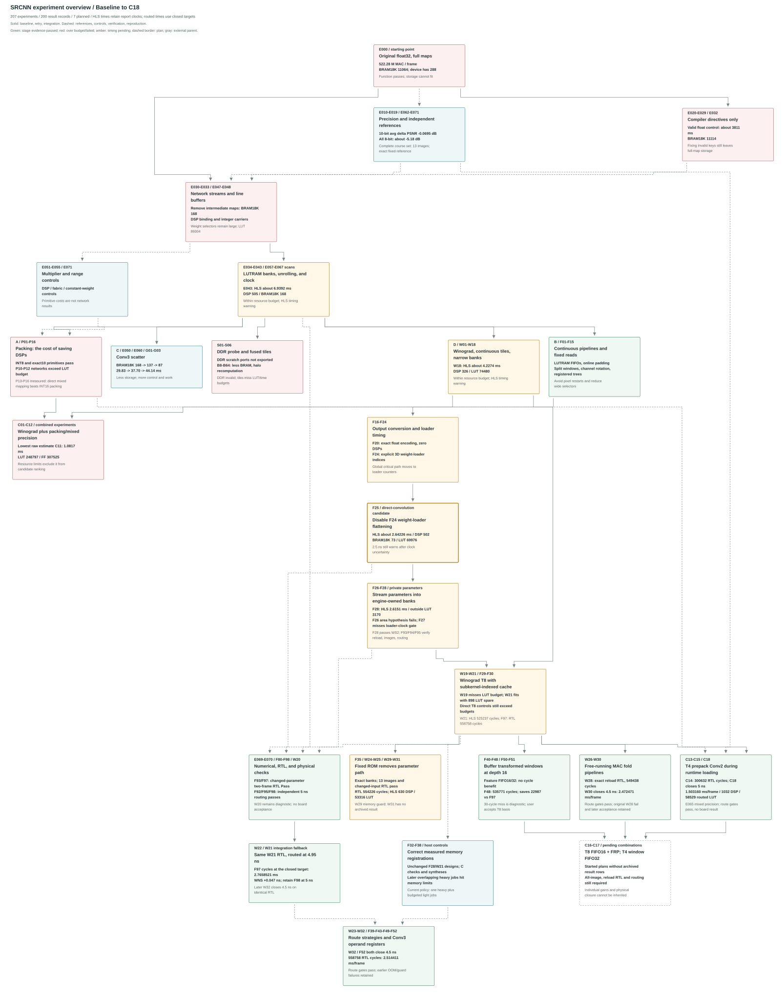

The route diagrams below show complete dependencies between designs, parameters, integrated modules, and verification steps, rather than Git commit ancestry. Their solid edges show design or parameter evolution; dashed edges show numerical references, controls, or verification of the same design. The complete compact graph selects main relationships and uses thick solid arrows throughout. Combined experiments have several parents, so the structure is a directed graph rather than a strict tree.

The text below and the route diagrams retain the original registry formula: `cycles * max(target period, HLS estimated period) / 10^6` milliseconds, which differs from the complete compact graph's common 100 MHz normalization. This original calculation does not establish timing closure after clock uncertainty, routed timing, or measured board performance.

## Names and Parameters

| Name | Meaning | Common source of confusion |
| --- | --- | --- |
| E series | First round: baseline, precision, compiler controls, streaming, and parameter scans | Includes CPU analysis, synthesis, and implementation; their latencies cannot all be ranked together |
| P series | Packing primitives and full-network controls | A passing PE does not establish full-network feasibility |
| G series | Matched Conv3 gather/scatter controls | Less BRAM can require more control, coefficient storage, and cycles |
| S series | DDR probe, streaming control, and fused spatial tiles | S01 did not export scratch ports and is not a valid DDR design |
| W series | Winograd PEs, single-layer/network designs, scheduling, and banking | W03's 16-bit Winograd is not INT16 packing |
| C series | Winograd combined with packing or mixed precision | A paper DSP budget says nothing about meeting LUT/FF budgets |
| F01-F25 | Pipeline, FIFO, window selection, conversion, and loader timing changes | F25 contains cumulative changes; relative to F24 it adds only one loader-loop directive |
| F80-F91 | Separate acceptance runs and retries for F25/F24/F23 | F82 verifies F25 RTL; it introduces no new algorithm |
| T=16 | Sixteen computation rounds per output pixel | It does not mean 16-bit quantization; F25 weights and activations remain 10-bit |
| B=32 | Output tile side length of 32 pixels | It is neither DSP count nor data width |

The original A/B/C/D labels name ideas, not ID prefixes: A = packing -> P; B = whole-network dataflow -> E/F; C = Conv3 scatter -> G; D = Winograd -> W. Experiment IDs beginning with C describe combinations.

## 1. Baseline and Precision: Establish the Numerical Contract

The original network requires approximately 522,280,800 MACs per frame; Conv1 accounts for 64.54%. Two complete floating-point intermediate maps occupy about 23.81 MiB. Baseline synthesis estimates 11,064 BRAM18K blocks against the device's 288. Floating-point C simulation is correct, but this on-chip storage organization cannot fit.

E010 begins with measured image ranges and software quantization scans. E017/E019 then use AMD data types to validate rounding, saturation, and complete arithmetic. With 10-bit weights and activations, average PSNR drops about 0.0695 dB across the 13 supplied Set14 pairs, within the 0.1 dB average-loss gate. Using 8 bits throughout loses about 5.18 dB and is rejected. E062/E065/E066 identify a narrower exception: 8-bit Conv2 weights with 10-bit activations lose about 0.07589 dB on average.

These records supply the shared numerical reference for later routes. Bit-exact fixed-point results match an independent fixed-point reference, not floating-point golden output. PSNR measures quality against high-resolution ground truth; delta PSNR compares fixed-point and float outputs on the same inputs. Golden-output MSE is a different comparison. The missing comic pair limits all 13-image quality claims.

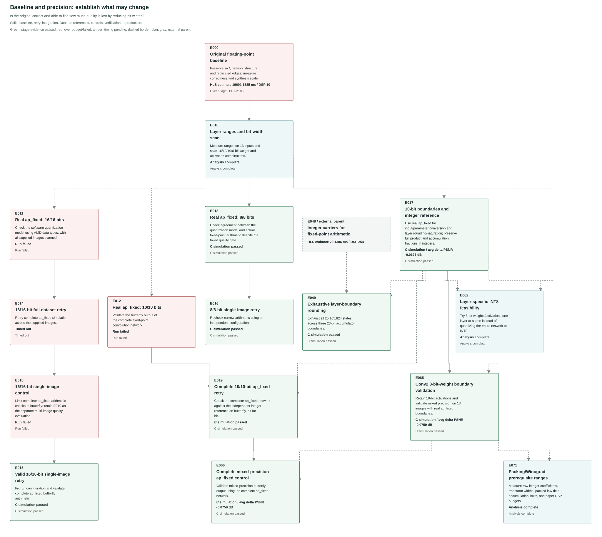

## 2. Compiler Controls: Directives Do Not Remove Full Maps

E020-E029/E032 investigate default optimization, target clock, automatic pipelining, inner-MAC or pixel-loop pipelining, array partitioning, and floating-point reassociation. E023/E024/E025 use configuration keys ignored by the tool; E028/E029/E032 are the valid retries. E027 tests 16-bit fixed point while retaining full-frame maps.

The fastest valid float control, E029, estimates about 3.811 seconds but needs approximately 11,114 BRAM18K blocks. The computation and storage organization must change. An ignored directive and a valid synthesis result with excessive resources are different outcomes.

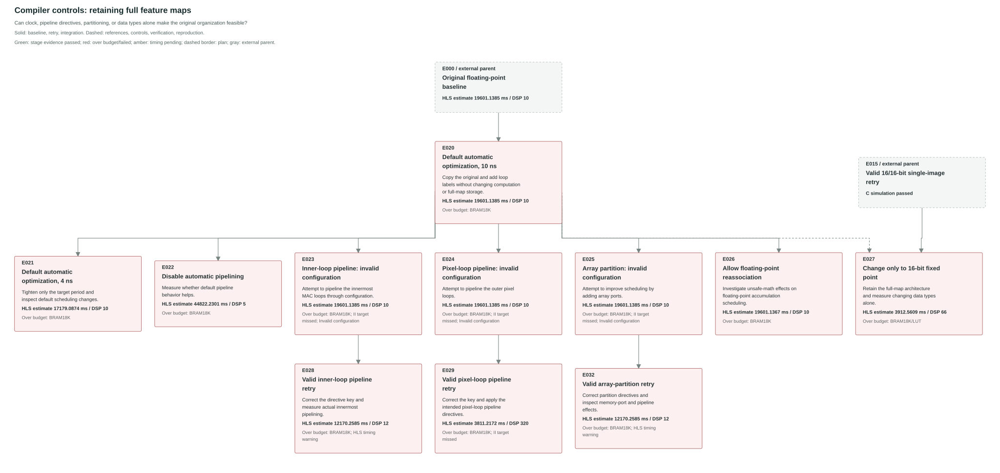

## 3. Initial Streaming: Storage Improves, Mapping Becomes the Limit

E030 first validates floating-point line buffers, streams, and boundary behavior. E031/E033 convert this architecture to 10-bit arithmetic and remove full intermediate maps, reducing BRAM18K to 168. Default mapping of narrow multipliers and type logic nevertheless consumes 136,868 LUTs, with an estimated 31.822 ns path.

E047 explicitly binds multipliers to DSPs. E048 carries fixed-point raw bits in integers and explicitly implements layer-boundary rounding. E057/E058 replace fully partitioned weight registers with LUTRAM banks matched to parallel read ports, producing a resource-feasible baseline. An inner II of 1 still permits pipeline restart/drain overhead per pixel, serial padding phases, and FIFO stalls.

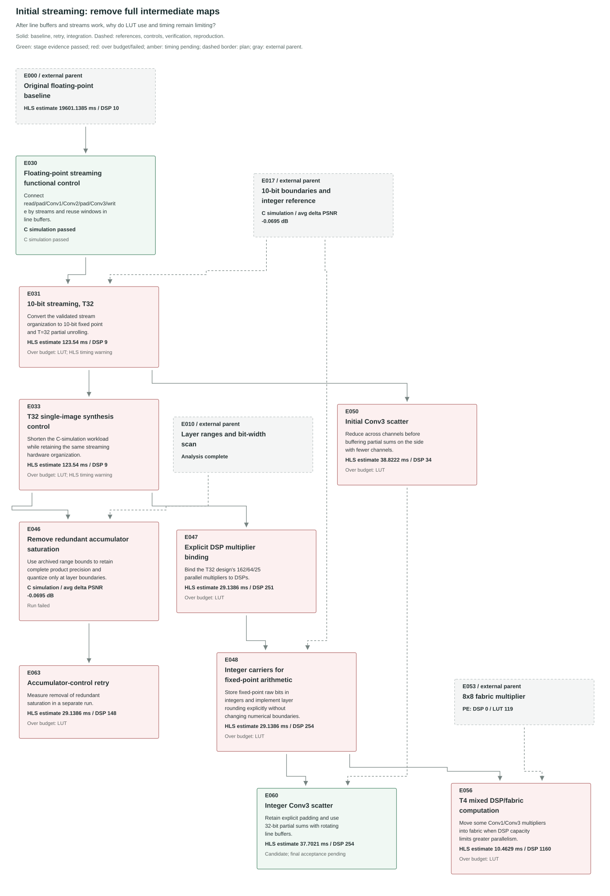

## 4. Parameter Scans: More Parallelism Can Cost More Time

Scans vary T, each layer's unroll direction, weight storage, and target period independently. T32 -> T16 -> T8 increases parallel multipliers, but LUTs, FFs, memory ports, and critical paths may worsen. E040/E067 waste BRAM on many shallow weight banks; full partitioning in E064 increases registers and selectors. E036 is marked provisional, yet its actual II misses the target; that failure remains visible.

E043 is the first round's fastest estimate within the resource and precision budgets: about 6.9392 ms, 505 DSPs, and 168 BRAM18K blocks. It is a comparison baseline, not a measured board rate.

E043 and the later W18 both have HLS 200-871 timing warnings. Resource feasibility does not establish the requested clock. The ledger extracts the effective logic budget from original logs, rather than comparing only estimated and nominal periods.

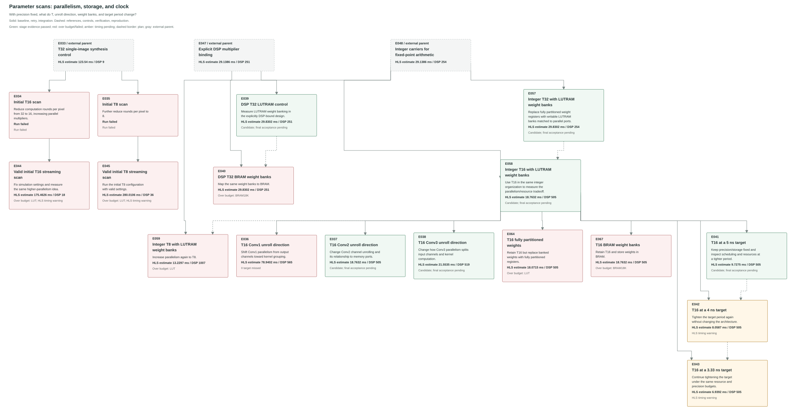

## 5. A: Packing From Primitive Savings to Network Cost

P01-P07 validate operand packing, negative low-field borrow correction, safe accumulation groups, DSP builtins, and exact 10-bit residual recovery. P08 checks actual DSP pre-adder attributes; P09 reproduces a frozen archive. P10/P11/P12 integrate exact 10-bit packing into the network. DSP use decreases, but decoding, residual recovery, selectors, and pipeline logic push LUTs beyond the project budget.

P13-P16 investigate two complete INT16 products: a direct two-DSP control, byte-limb packing, overlapping fields with fabric recovery, and a matched ordinary DSP-plus-fabric control. This snapshot contains plans/preparation only, with no measured results. INT8's one-DSP/two-product result cannot be assumed for complete INT16 products; all partial products and recovery logic must be counted.

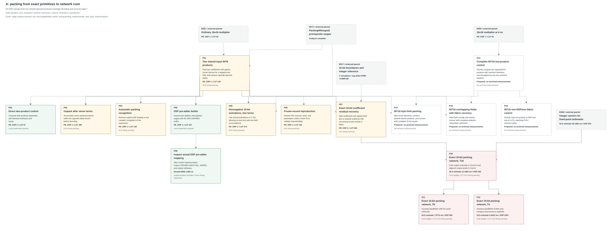

## 6. C: Scatter Trades Buffer Capacity for More Work

The matched gather control G01 estimates 29.83 ms and 168 BRAM18K blocks. G02 reduces channels before buffering partial sums, lowering BRAM18K to 137 but increasing time to about 37.70 ms. G03 merges replicated-edge taps into kernels for nine boundary classes, reducing BRAM18K to 87. Wider/more coefficients, kernel selection, and loader control increase time to about 44.14 ms.

This route confirms the benefit of buffering the side with fewer channels and measures its cost. It provides a storage tradeoff but does not outperform the best continuous direct-convolution candidate.

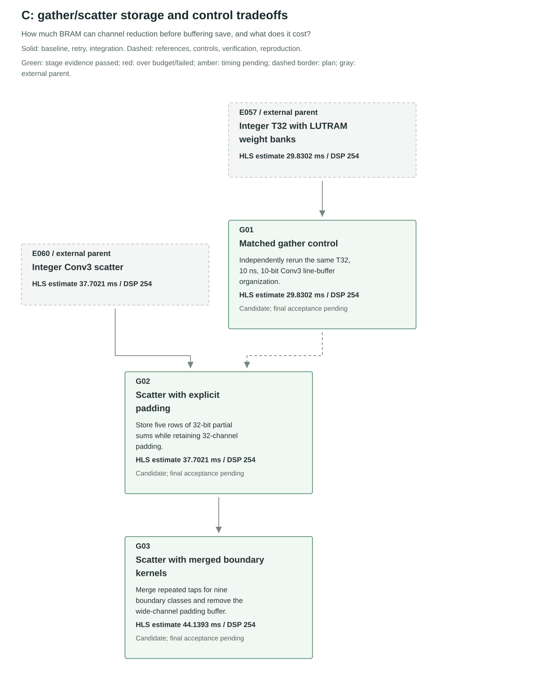

## 7. DDR and Fused Tiles: The Interface Must Exist

S01 attempts to place global scratch arrays in DDR. The tool exports no scratch1/2 AXI ports and instead synthesizes enormous on-chip storage, so the run is invalid_config. S02 is a whole-network dataflow control. S03-S06 scan B8/B16/B32/B64, fuse local computation, and recompute halos. They reduce BRAM but lose whole-network overlap and incur high LUT costs for banking/address selection plus additional cycles.

19.2 GB/s is a theoretical K26 DDR bandwidth derived from specifications; 9.6 GB/s assumes 50% efficiency. Transfer lower bounds are not board measurements and cannot establish feasibility when the interface is invalid or compute resources exceed capacity.

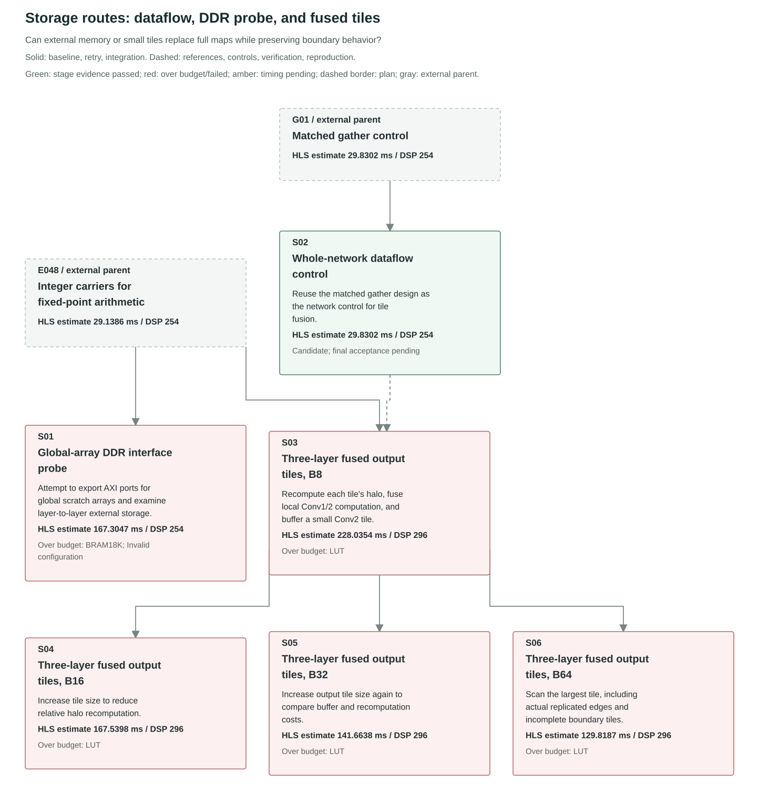

## 8. D: Winograd Also Requires Transform and Control Optimization

W01-W03 validate exact integer F(2x2,3x3) transforms and multiplier mapping. W04-W09 obtain valid layer/network results after fixing header macro collisions, but conditional tile loops and raster reordering are expensive. W10 separates window generation from a fixed-count MAC loop. W11-W16 extend continuous scheduling across all three layers and split an unsupported 8000-bit window stream into two 4000-bit channels.

Runtime weight-transform loading then exposes high banking/selector costs. W17/W18 narrow the raw-weight banks used only by sequential transforms while preserving transformed banks serving MACs. W18 estimates 4.2274 ms, 326 DSPs, and 74,480 LUTs, meeting the resource budget for this route. It saves DSPs but has a higher network time estimate than F25 and lacks equivalent final RTL/implementation evidence.

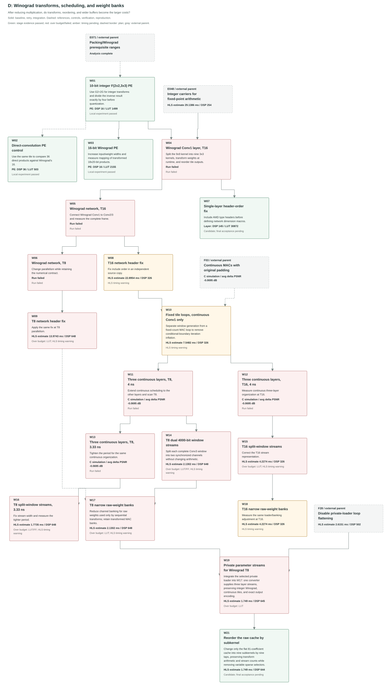

## 9. Combinations Also Combine Control Costs

C01-C06 combine Winograd and exact 10-bit packing. After header fixes, all exceed LUT/FF budgets. C07/C12 investigate continuous organization. C08/C09 use the Conv2 8-bit weights validated in E065 to remove that layer's residual recovery. C10/C11 fix the window-stream representation and obtain small HLS time estimates, but remain far above resource budgets.

C11's 1.0817 ms estimate is not a better feasible design than F25: it requires 248,797 LUTs and 307,525 FFs. Failed nodes remain in the graph to explain why this route did not produce a qualified candidate.

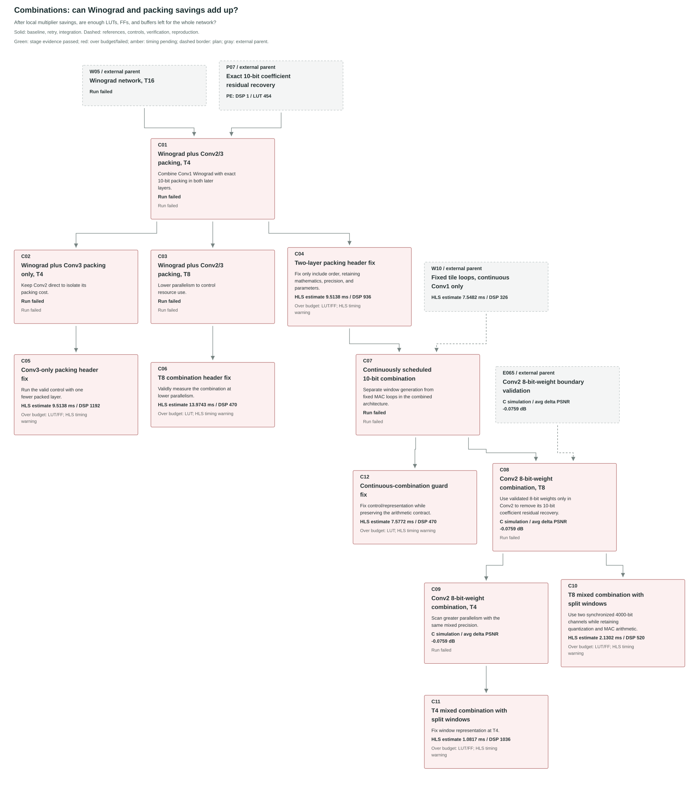

## 10. Continuing B: How F25 Developed

| Step | Motivation and change | Effect or next bottleneck |
| --- | --- | --- |
| E042/E043 | Fixed-point whole-network dataflow still has per-pixel pipeline and shallow wide-FIFO costs | Establish a resource-feasible control and investigate scheduling/storage |
| F01/F02 | LUTRAM FIFOs and a separate URAM line-buffer control | F01 reduces BRAM without reducing cycles; F02 wastes URAM depth |
| F03 -> F08 | Separate windows and MACs, continuously schedule pixels/groups, register a balanced adder tree, fix wide streams | About 4.1947 ms; variable channel selectors and padding stalls need attention |
| F04 -> F09 | Online padding and legal split-window streams | BRAM18K falls to 73; HLS cycles alone cannot establish FIFO benefits |
| F09 -> F13 | Rotate Conv3 channels each round so multipliers read fixed locations | Smaller dynamic selectors; float output conversion remains on the global timing path |
| F16 -> F18 -> F20 | Construct exact float bits; fix SDK types and duplicate object names | Output PE uses zero DSPs and matches all encodings exactly |
| F13 + F20 -> F22/F23 | Integrate only output encoding; compare 3/2.5 ns targets | DSPs fall from 505 to 502; Conv1 loader addressing becomes critical |
| F23 -> F24 | Explicit channel/kernel-row/kernel-column indices remove address multiplication | Estimate improves from 2.822 to 2.699 ns; flattened counter control remains long |
| F24 -> F25 | Add only LOOP_FLATTEN off to the Conv1 weight-loader inner loop | More loading cycles, but global estimated path falls to 2.377 ns; time estimate is 2.64226 ms |

F24 has 1,048,723 cycles converted at 2.699 ns to 2.830503377 ms. F25 has 1,056,904 cycles converted at 2.5 ns to 2.64226 ms. If both could run at the same physical 2.5 ns period, F24 would have fewer cycles. This selection uses the stated HLS estimate formula; physical timing and measurements must confirm the outcome.

F25 preserves the three-layer SRCNN, replicated edges, external float32 parameters/input/output, and tensor order. Internally it uses 10-bit values, 23-bit accumulators, line buffers, FIFOs, continuous direct convolution, partial parallelism, and registered adder trees. At T16, MAC DSP allocation is 324/128/50, totaling 502. Root `src/` remains the floating-point baseline and is not the F25 entry point.

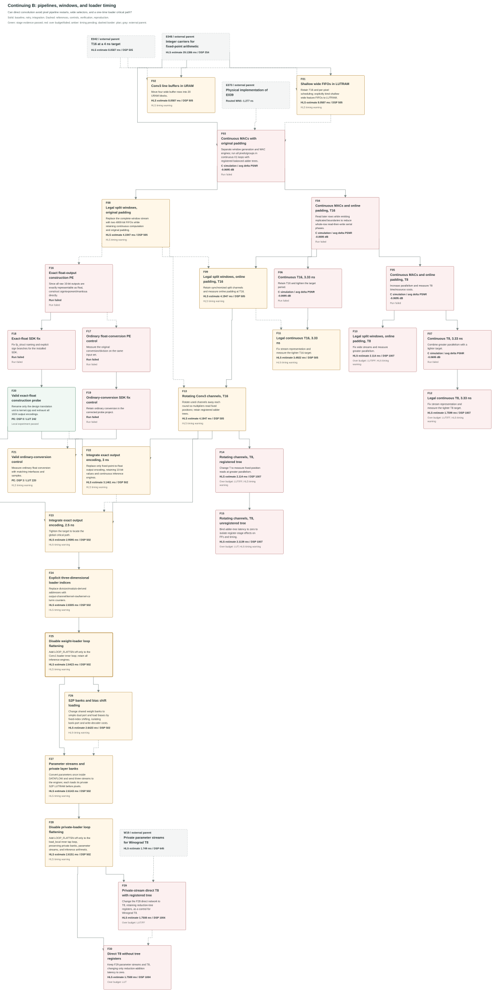

## 11. Separate Functional, RTL, and Physical Evidence

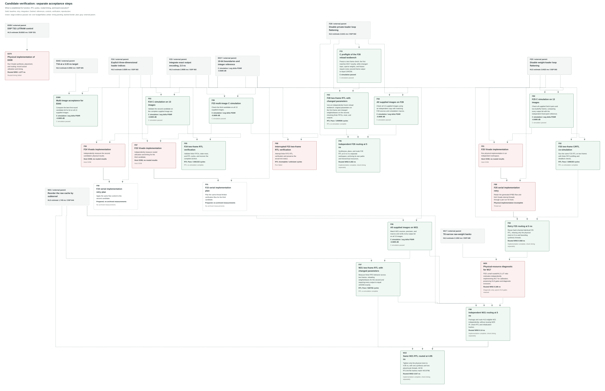

| Design | C simulation | Physical implementation | C/RTL co-simulation | Snapshot conclusion |
| --- | --- | --- | --- | --- |
| First-round E043 | E069 | E070 verifies E039, not E043 | No completed report | Numerical checks pass on 13 images |
| F25 | F80 | F81: host OOM; F89: serial retry planned | F82: two frames Pass | RTL latency 1,068,183 cycles; physical timing and board validation pending |
| F24 | F83 | F84: host OOM; F90: retry planned | F85: planned | 13-image checks pass; final RTL/physical evidence pending |
| F23 | F86: planned | F87/F91: planned | F88: planned | Candidate synthesis exists; final acceptance pending |

F82 takes about 1 hour 42 minutes 40 seconds of wall time. Its progress log reports only 0/2, 1/2, and 2/2 transactions. A long interval without output does not itself prove deadlock. Simulation wall time also differs from the approximately million-cycle RTL hardware latency.

**F25 has a real HLS timing warning at its 2.5 ns configuration.** The 2.500 ns target minus 0.675 ns clock uncertainty leaves a 1.825 ns logic budget, exceeded by estimated 2.377 ns paths. The 2.64226 ms number is a candidate HLS estimate at the nominal target, not evidence of 400 MHz timing closure. Passing RTL functional simulation does not remove this warning or replace placement/routing. Changing the target to 10 ns requires new synthesis/co-simulation and evaluation of the resulting reports; the earlier cycles, resources, and time estimates must not simply be reused.

E070 completes actual implementation but has WNS = -1.277 ns. F81/F84 host OOM failures produce no routed results. These are distinct outcomes. There is no completed board acceptance record in this snapshot.

## Complete Ledger and Reproduction

- [All 153 experiments: parents, changes, effects, issues, and original evidence](experiment-evolution/records.en.md)
- [Multiplier controls](experiment-evolution/micro.en.svg)
- [Machine-readable English metadata and shared results](experiment-evolution/data.en.json)
- [Mermaid overview source](experiment-evolution/overview.en.mmd)
- [Regeneration and diagram checks](experiment-evolution/README.en.md)
- [Frozen experiment reproduction](../experiments/REPRODUCE.md)

E099 is the first-round archive/audit closure event, not another synthesis design. F99 is the planned second-round closure event and is incomplete in this snapshot. The ledger includes actual records and plans without inventing missing IDs.
