# SRCNN 实验思路与演进图

[English](0004-experiment-evolution.en.md)

单图入口：[完整紧凑图](experiment-evolution/full.svg) / [可缩放、定位和高亮关系的本地查看器](experiment-evolution/full.html)。全部 207 项实验在同一张图中，以 217 条加粗实线呈现主要优化演进；11 个关键节点保留两个来源。节点显示编号、短思路与 100 MHz 参考整网 ms/张。绿色都有可比较耗时；红色增加一行具体问题，耗时不加粗；缺少整网周期的局部或纯 C 探索节点以灰色注明验证范围。全部 307 条档案关系保留在逐项记录和分路线图中。

主图统一使用 `整网延迟周期数 x 10 ns / 1,000,000` 换算毫秒，来源为本实验有效的 RTL 最大延迟或 HLS 顶层延迟；不计主机/DMA 传输。已完成的同设计验证可引用实际设计报告，例如 F80 显示 `~10.57 ms/张 (F25)`，用 `~` 和编号标明来源；设计的时序告警仍适用。它是现有周期数的参考时钟折算，未按 10 ns 重新综合，也不是板端实测。PE、单层和没有明确同设计整网报告的 C 仿真不填时间。绿色仍表示当前阶段通过，不代表布线通过；红色区分资源超预算、编译失败、主机 OOM 或布线时序等问题。具体口径与连线选择见[生成说明](experiment-evolution/README.md)。

这份文档回答三个问题：每项实验基于什么、为什么做这个调整、结果为什么促成下一次实验。完整逐项索引见 [207 项实验记录](experiment-evolution/records.md)。

本次整理以源码提交 `653ceb9` 为快照：200 项有归档结果，7 项没有结果行，比上一版 `a3d78b7` 新增 37 项。C18 的 T4 已在 5 ns 通过独立布线，结合 C14 的 RTL 周期为 1.503160 ms/张；W32/F52 的 T8 在 4.5 ns 通过，为 2.514411 ms/张，W30 的 FRP 分支为 2.472471 ms/张。上述时间按已收敛目标折算，区别于主图的固定 100 MHz 指标，尚未板端实测。F47/F48 是用户接受的新 T8 主线依据，W21/W22/F98 保留作集成后备。Set14 验收范围已明确为课程提供的完整 13 图；原始历史状态和报告不改写。本版固定到 W30，后续结果不纳入。编号是实验档案号，不是网络层数、时钟参数或不同 IP 名称。

## 阅读顺序

1. 看 [总览图](experiment-evolution/overview.svg)，了解分支与汇合。
2. 看 [连续流水路线](experiment-evolution/continuous.svg)，理解 F25 如何演进到私有加载器 F28。
3. 看 [Winograd 路线](experiment-evolution/winograd.svg) 与[候选验证图](experiment-evolution/verification.svg)，理解 W21、F97 和 W22 分别是设计、RTL 验证与物理时钟实验。
4. 看新增的 [T8 时钟与 FIFO](experiment-evolution/clock-fifo.svg)、[T4](experiment-evolution/t4.svg)、[ROM](experiment-evolution/rom.svg) 和[主机对照](experiment-evolution/host.svg)，区分已通过结果、主机失败重试与待验收组合。
5. 按问题进入下面各路线，再用完整索引核对单项参数、证据和失败状态。

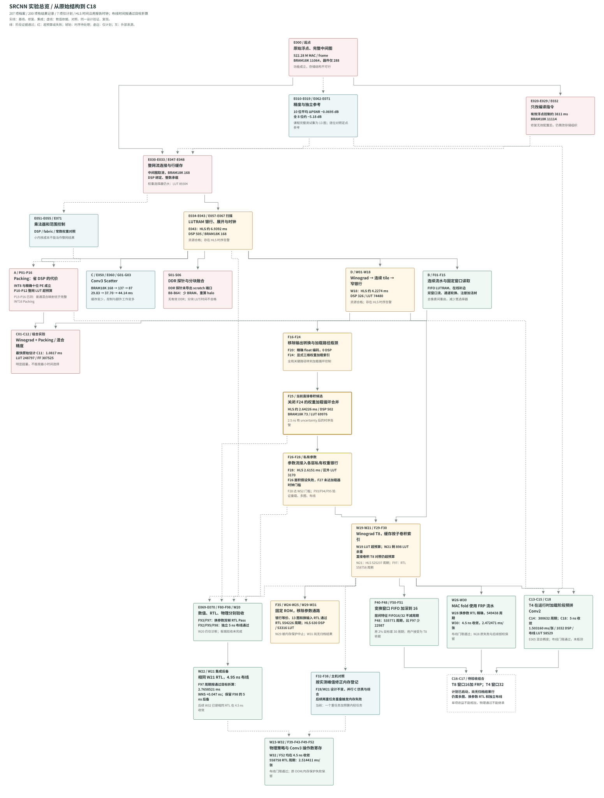

下列分路线图表示完整的设计、参数、模块集成与验证依赖，不是 Git 提交历史。路线图的实线表示设计/参数演进，虚线表示数值依据、对照或同一设计的验证；完整紧凑图则只画主要关系，全部使用加粗实线。组合实验有多个来源，因此整体是有向图，而不是严格的单亲树。

下文与分路线图的 HLS 毫秒值沿用原实验表的 `cycles × max(目标周期, HLS 估计周期) / 10^6` 公式，与完整紧凑图的统一 100 MHz 折算口径不同。这种原始比较仍未保证 clock uncertainty 后的逻辑预算，也不是布局布线或板端实测。

## 先读懂几个名字

| 名字 | 含义 | 容易混淆的地方 |
| --- | --- | --- |
| E 系列 | 第一轮：基线、精度、编译器、流式架构与参数扫描 | 既有 CPU 分析，也有综合和实现，不能直接混排延迟 |
| P 系列 | Packing 及其 PE/整网控制 | 小内核通过不代表整网资源合格 |
| G 系列 | Conv3 gather/scatter 的统一对照 | 减少 BRAM 可能增加控制、系数缓存和周期 |
| S 系列 | DDR 探针、整网流式对照、分块融合 | S01 端口没有导出，不是有效 DDR 方案 |
| W 系列 | Winograd 的 PE、单层、整网、调度和银行调整 | W03 的十六位 Winograd 不等于 INT16 Packing |
| C 系列 | Winograd 与 Packing/混合精度组合 | 纸面 DSP 合格不代表 LUT、FF 合格 |
| F01-F31 | 流水、FIFO、窗口、转换与参数加载优化及重载预检 | F28 改参数所有权；F31 是测试预检，没有新推理算法 |
| F80-F98 / W20 / W22 | 数值、RTL、资源诊断与独立布线 | F97 是 W21 的 RTL 验证，W22 只改变物理时钟及本次线程配置 |
| F32-F52 / W23-W32 / C13-C18 | 主机对照、ROM、物理策略、FRP、FIFO 与 T4 | 主机内存失败不证明 FPGA 不可行；同设计 RTL 与独立布线需匹配 |
| T=16 | 每像素计算分成 16 轮 | 不表示十六位量化；F25 的权重/激活仍为十位 |
| B=32 | 输出空间块的边长为 32 | 不表示 DSP 数或数据位宽 |

原始的 A/B/C/D 是思路名称，不对应实验编号前缀：A=Packing→P，B=整网 dataflow→E/F，C=Conv3 scatter→G，D=Winograd→W；实验 C 系列表示组合。

## 1. 基线与精度：先确定数值契约

原版每幅图约需 522,280,800 MAC，Conv1 占约 64.54%。两张完整浮点中间图约 23.81 MiB，原版综合估计需要 11,064 BRAM18K，而目标只有 288 个。浮点 C 仿真正确，但按这种片上组织无法装入目标器件。

E010 从实际图像范围和软件量化扫描开始；E017/E019 再用 AMD 数据类型验证舍入、饱和及完整算术。十位权重/激活在现有 13 张 Set14 上平均 PSNR 降约 0.0695 dB，满足本轮平均降幅不超过 0.1 dB 的门槛。全八位降约 5.18 dB，不能为了方便 Packing 直接采用。E062/E065/E066 找到一个更窄的例外：仅 Conv2 权重降八位、激活仍十位，平均降幅约 0.07589 dB。

这是后续分支共享的数值依据。定点架构的 bit-exact 指与独立定点参考逐位相同，不指与浮点 golden 完全相同。PSNR 是相对高清 GT 的质量指标；delta PSNR 比较同一输入的定点版和浮点版。MSE against golden 是另一种比较。当前用户决定以课程提供的完整 13 图验收，不再因为 comic 标注暂定；对未覆盖输入仍不推断质量结论。

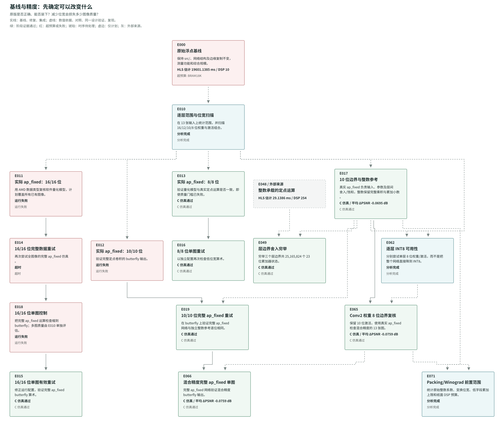

## 2. 编译器对照：只改指令解决不了完整中间图

E020-E029/E032 依次研究默认优化、目标时钟、自动流水、最内层/像素层流水、数组分区和数学重排。E023/E024/E025 的配置键被工具忽略，后续 E028/E029/E032 才是有效重试。E027 单独测十六位定点但保留整图。

最快的有效浮点对照 E029 估计约 3.811 秒，但需要约 11,114 BRAM18K。结论是改变计算/存储组织势在必行；这里的“无效配置”与“有效综合但资源超量”是两类不同结果。

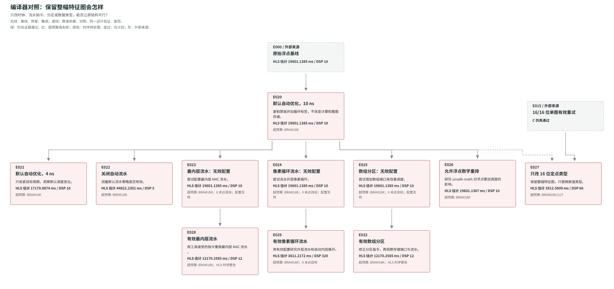

## 3. 第一轮流式架构：存储解决后，映射成为瓶颈

E030 先用浮点证明行缓存和流连接的边界功能。E031/E033 改为十位流式计算，消除了完整中间图，BRAM18K 降到 168，但默认窄乘法等大量落在 LUT，达到 136,868 LUT，估计路径 31.822 ns。

E047 显式绑定乘法到 DSP，E048 把定点数值以整数原始位承载，并显式实现层边界舍入。然后 E057/E058 将完全拆分的权重寄存器变成按并行端口分银行的 LUTRAM，才获得资源合格的基线。内层 II=1 仍可能付出每像素流水启动/排空、补边串行阶段和 FIFO 停顿。

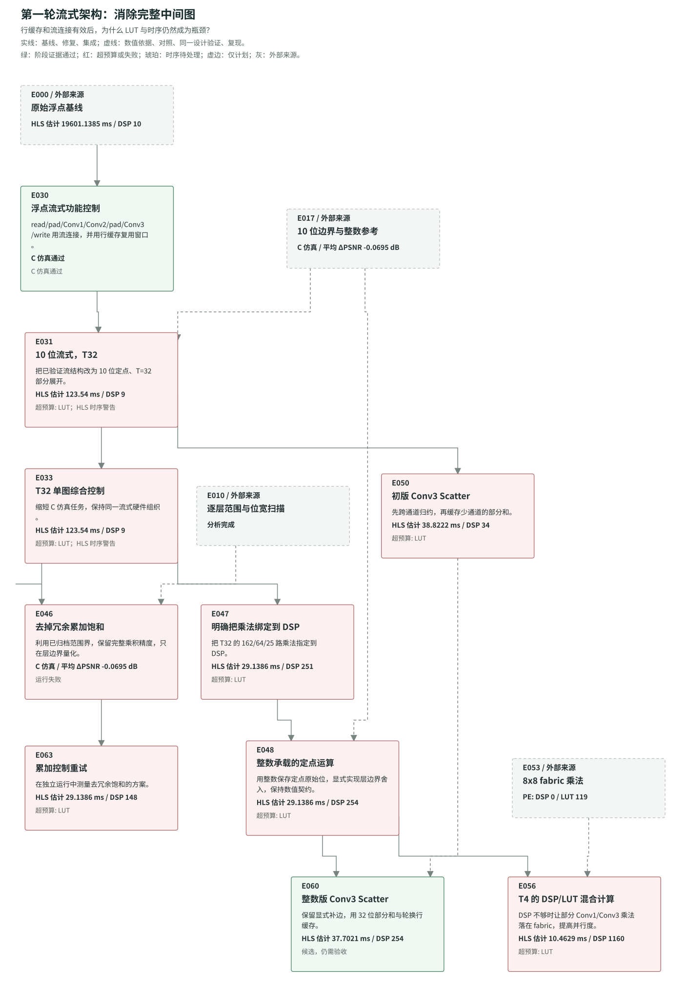

## 4. 参数扫描：增大并行度不一定更快

扫描分别改变 T、各层展开方向、权重存储和目标周期，而不是把所有参数一次改掉。T32→T16→T8 增加并行乘法，但 LUT、FF、端口和关键路径可能同时变差。BRAM 权重银行 E040/E067 因大量浅银行浪费容量；完全拆分 E064 增加选择器和寄存器成本。E036 虽有 provisional 标签，但实际 II 未达目标，应保留这个失败点。

第一轮资源/精度预算合格的最快 HLS 估计是 E043：约 6.9392 ms，505 DSP、168 BRAM18K。它是后续可比较的基线，不是板端实测速率。

E043 和后面的 W18 同样有 HLS 200-871 时序警告；资源合格并不表示目标时钟已实现。完整索引从原始日志提取实际逻辑预算，避免只拿报告里的估计周期和名义周期比较。

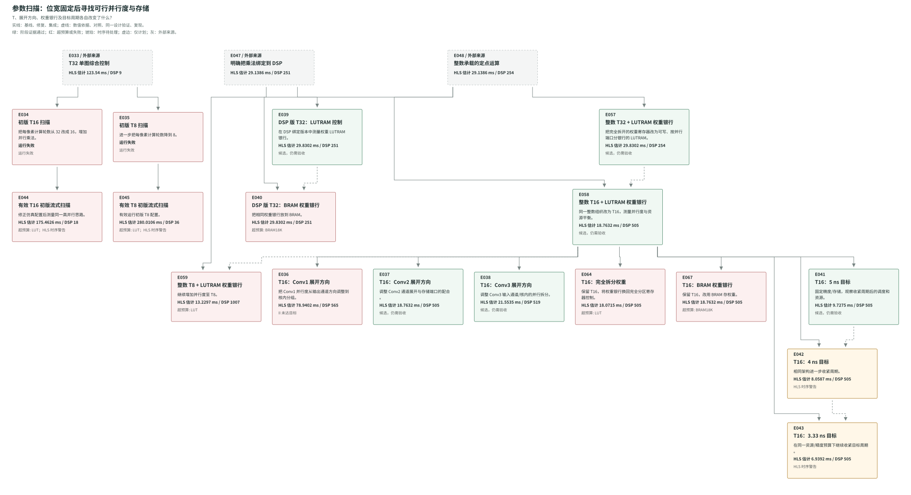

## 5. A：Packing，局部节省不等于整网节省

P01-P07 验证拼接、负低字段借位修正、分组累加安全界、DSP builtin 和十位残差恢复；P08 实际检查 DSP pre-adder 属性，P09 复现冻结记录。P10/P11/P12 把精确十位 Packing 接入整网，DSP 可以减少，但解码、残差恢复、选择器和流水成本让 LUT 都超过项目预算。

P13-P16 的完整 INT16 双乘法已经跑完 C 仿真和综合，均逐位精确。直接控制 P13 为 2 DSP、57 LUT、16 FF；拆肢 Packing P14 为 4 DSP、453 LUT、276 FF，反而更贵。重叠/fabric 修复 P15 为 1 DSP、747 LUT、200 FF、3.392 ns 估计路径；普通 DSP+fabric 控制 P16 在相同 1 DSP 下只需 330 LUT、16 FF，估计 2.48 ns。当前实验没有显示完整 INT16 Packing 优于普通混合映射，因此没有接入整网。这些是 PE 成本，不推算单张网络时间。

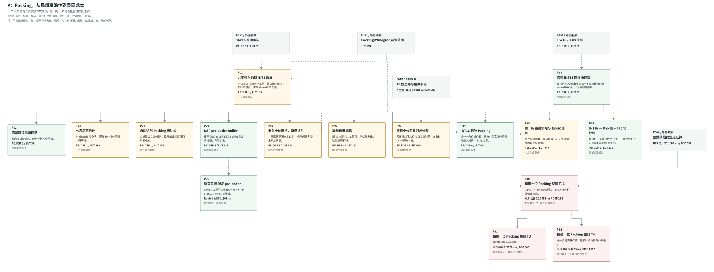

## 6. C：Scatter，减少缓存而增加工作

G01 统一 gather 基线约 29.83 ms / 168 BRAM18K。G02 先跨通道归约再存部分和，BRAM18K 降到 137，时间增到约 37.70 ms。G03 把边缘复制合并为九种位置的卷积核，BRAM18K 再降到 87，但更宽/更多系数、选择和加载控制使时间约 44.14 ms。

这条路线验证了“缓存少通道一侧”的收益，也量出了代价；适合研究存储取舍，当前没有胜过最佳连续直接卷积。

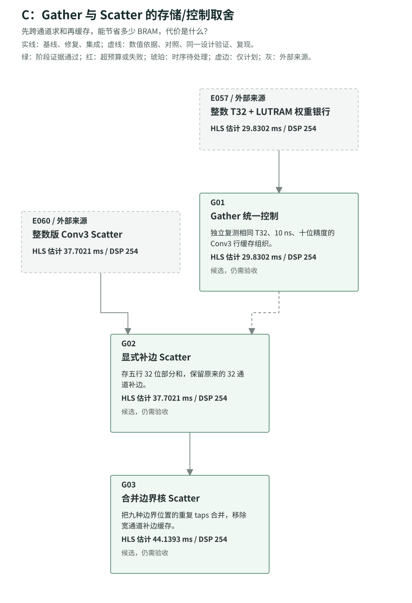

## 7. DDR 与分块融合：接口必须先成立

S01 想让全局 scratch 数组进入 DDR，但工具没有导出 scratch1/2 AXI 端口，实际综合仍配置成巨大片上存储，所以标为 invalid_config。S02 是整网 dataflow 对照。S03-S06 扫描 B8/B16/B32/B64，融合局部计算并重算 halo；BRAM 少了，但失去整网重叠，地址/银行控制的 LUT 和重算周期都很高。

19.2 GB/s 是 K26 DDR 规格推导的理论带宽，9.6 GB/s 是 50% 效率假设。传输时间下界与板端实测不同，不能用它挽救一个接口无效或计算资源超量的方案。

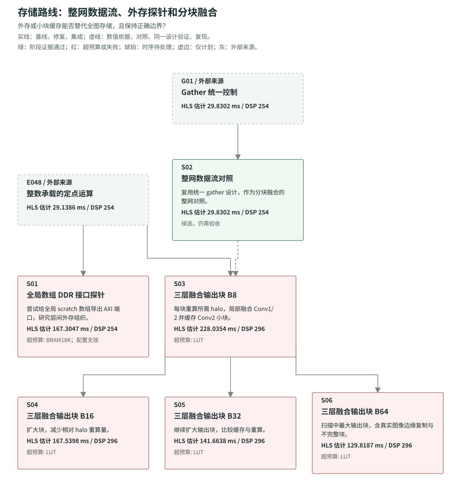

## 8. D：Winograd，乘法之后的成本必须一起优化

W01-W03 证明整数 F(2x2,3x3) 的精确变换及乘法映射。W04-W09 经过头文件宏冲突修复后得到有效层/整网结果，但条件 tile 循环和 raster 重排开销很大。W10 分离窗口与固定次数 MAC，W11-W16 推广三层连续调度，并通过两个 4000 位通道修复 8000 位窗口流的工具限制。

接下来发现运行时权重变换加载中的银行/选择器成本很高。W17/W18 减少仅供顺序变换使用的原始权重银行，保留 MAC 使用的变换后银行。W18 约 4.2274 ms、326 DSP、74,480 LUT，成为该路线资源合格候选。它在 DSP 上有优势，但这组整网估计仍慢于 F25，且没有同等完整的 RTL/实现证据。

后续 W19 集成 F28 的私有参数流，W21 再调整原始系数缓存布局，才使 Winograd T8 达到 HLS 资源门槛。F96/F97/F98/W22 已补齐多图、参数重载 RTL 和独立布线证据，详见第 12 节。

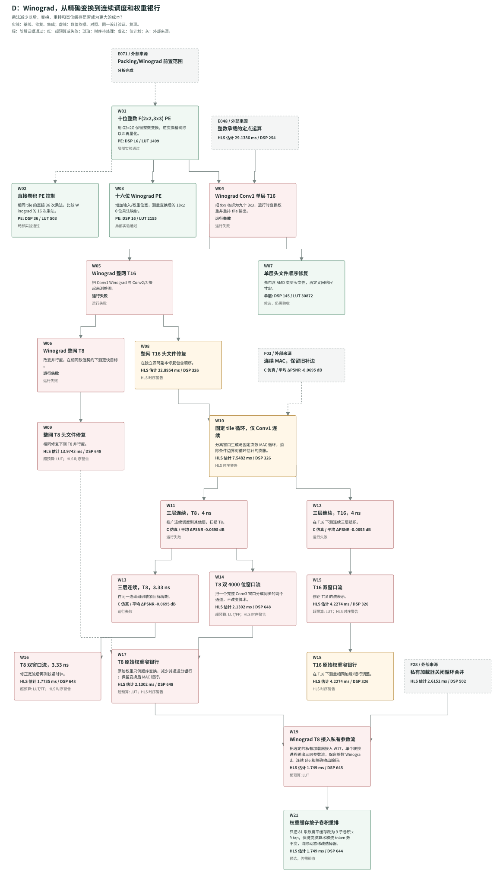

## 9. 组合：两条路线的控制成本也会叠加

C01-C06 组合 Winograd 和精确十位 Packing，头文件修复后均因 LUT/FF 超量未形成合格点。C07/C12 改为连续组织，C08/C09 则使用 E065 验证过的 Conv2 八位权重，减少该层残差修复；C10/C11 修正双窗口流后得到很小的 HLS 延迟估计，但仍严重超量。

C11 的 1.0817 ms 不是“比 F25 更好的可行方案”：它需要约 248,797 LUT 和 307,525 FF。图中保留这些失败节点，说明组合为何停止，而不是只展示最快数字。

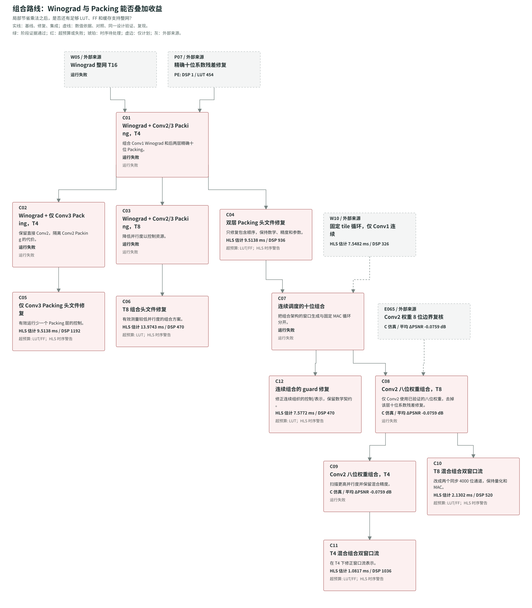

## 10. B 的后续：F25 是怎么形成的

主线可按以下因果顺序阅读：

| 阶段 | 调整原因与动作 | 观察到的效果或下一处问题 |
| --- | --- | --- |
| E042/E043 | 已有定点整网 dataflow，仍有逐像素流水和浅宽 FIFO 成本 | 形成可行对照，继续研究调度与存储 |
| F01/F02 | FIFO 用 LUTRAM；行缓存用 URAM 的独立控制 | F01 降低 BRAM，周期不变；F02 有粗颗粒浪费 |
| F03→F08 | 窗口生成和 MAC 分开，像素/分组连续流水，注册平衡加法树；修复宽流限制 | 约 4.1947 ms；动态通道选择及补边停顿成为问题 |
| F04→F09 | 在线补边与合法双窗口流 | BRAM18K 降到 73；不能只凭 HLS 周期判断 FIFO 收益 |
| F09→F13 | Conv3 每轮旋转通道，让乘法器读固定位置 | 减少动态选择器，输出 float 转换仍限制全局路径 |
| F16→F18→F20 | 精确构造 float 位；修复 SDK 类型及目标文件重名 | 输出转换 PE 用 0 DSP，逐位一致 |
| F13 + F20→F22/F23 | 只集成输出编码，并扫描 3/2.5 ns | 505→502 DSP；瓶颈移到 Conv1 权重加载地址 |
| F23→F24 | 用显式通道/核行/核列索引去掉地址乘法 | 估计 2.822→2.699 ns；自动合并循环的计数控制仍长 |
| F24→F25 | 权重加载内层仅增加 LOOP_FLATTEN off | 加载周期稍增，但全局估计路径降到 2.377 ns；名义目标下约 2.64226 ms |

F24 为 1,048,723 周期，表中用 2.699 ns 换算得到 2.830503377 ms；F25 为 1,056,904 周期，表中用 2.5 ns 换算得到 2.64226 ms。若两者都能实际运行于相同的 2.5 ns，F24 的周期数反而少；本轮选择 F25 依据的是上述 HLS 换算结果，最终仍要以物理时序及实测确认。

F25 保持三层 SRCNN、边缘复制、外部 float 参数/输入/输出和原 tensor 顺序，内部采用十位数值、23 位累加器、行缓存、FIFO、连续直接卷积、部分并行乘法及注册加法树。T16 的 MAC DSP 分配为 324/128/50，共 502。根目录 src/ 仍是浮点基线，不能把它当作 F25 入口。

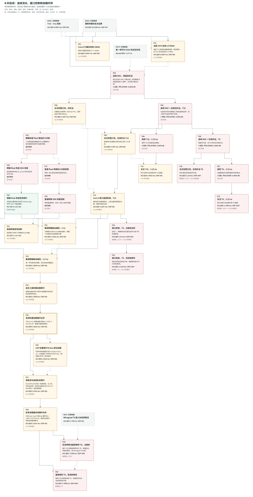

## 11. 验证不是新架构，时序也不是功能

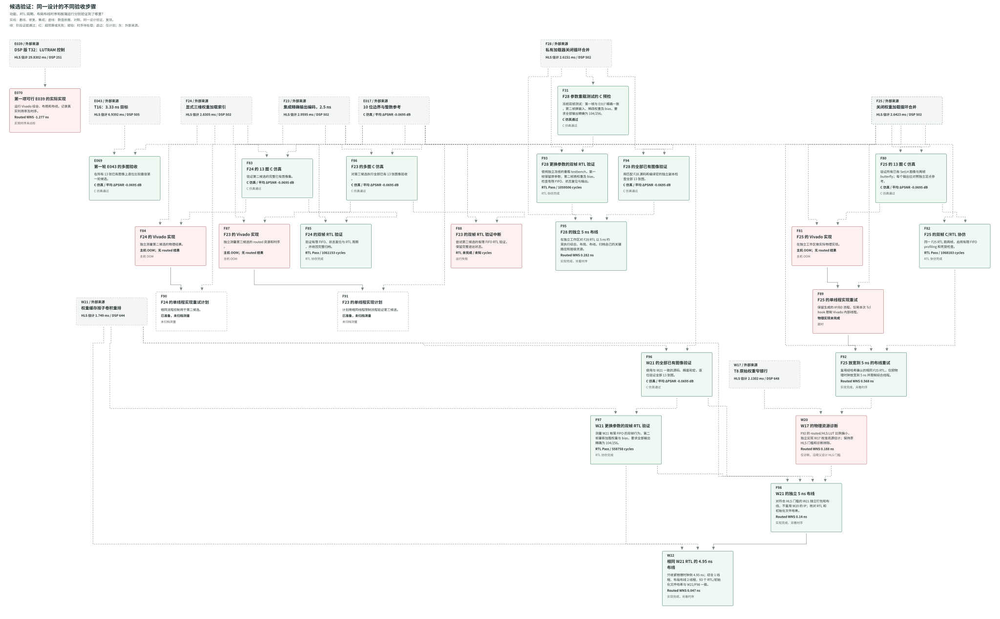

| 原设计 | C 仿真记录 | 物理实现记录 | C/RTL 记录 | 本快照结论 |
| --- | --- | --- | --- | --- |
| 第一轮 E043 | E069 | 未用 E070 代替；E070 验证的是 E039 | 无完成报告 | 13 图数值通过 |
| F25 | F80 | F81：OOM；F89：超时；F92：5 ns 通过 | F82：双帧 Pass | RTL 延迟 1,068,183 周期；物理时序通过，未板测 |
| F24 | F83 | F84：OOM；F90：暂缓计划 | F85：双帧 Pass | RTL 延迟 1,061,153 周期；尚无通过的物理报告 |
| F23 | F86：13 图通过 | F87：OOM；F91：暂缓计划 | F88：SIGTERM 中断 | 数值通过，RTL/物理证据未闭环 |
| F28 | F94；F31 重载预检 | F95：5 ns 通过 | F93：换参数双帧 Pass | RTL 延迟 1,059,506 周期；T16 后备 |
| W21 | F96：13 图通过 | F98：5 ns；W22：4.95 ns；W32：4.5 ns 通过 | F97：换参数双帧 Pass | RTL 延迟 558,758 周期；W21 保留作集成后备 |
| F39 | 原设计 13 图通过 | F49：内存保护；F52：4.5 ns 通过 | F43：换参数双帧 Pass | 558,758 周期；与 W32 同为 2.514411 ms/张 |
| C13 | 原设计 13 图 E065 精确 | C15：内存保护；C18：5 ns 通过 | C14：换参数双帧 Pass | 300,632 周期；1.503160 ms/张，尚未板测 |
| W17 | 原设计 C 验证 | W20：5 ns 通过，仅诊断 | 无独立完成记录 | 原 HLS LUT 仍超预算，不进入候选排名 |

F82 的完整协仿墙钟耗时约 1 小时 42 分 40 秒，进度日志只记录 0/2、1/2、2/2。长时间无新输出本身不能证明死锁；这也与 RTL 的约百万周期硬件延迟是两个概念。

**F25 的 2.5 ns 配置有真实的 HLS 时序警告。** 目标 2.500 ns 减去 clock uncertainty 0.675 ns，只剩 1.825 ns 逻辑预算，部分路径估计 2.377 ns，超过预算。2.64226 ms 是按名义目标周期换算的 HLS 候选估计，不是“已经 400 MHz 时序闭合”。RTL 功能仿真通过不消除这个警告，也不能代替布局布线。改为 10 ns 后需要重新综合/协仿和评估新报告，不沿用原周期、资源或时间估计。

E070 的实际实现完成但 WNS=-1.277 ns；F81/F84 的主机 OOM 则没有 routed 结果。两种状态不能混为“硬件失败”或“实现通过”。当前没有板端验收记录。

## 12. F25 之后：参数所有权、T8 与物理时钟

| 演进 | 思路与效果 | 问题或后续 |
| --- | --- | --- |
| F25 → F26 | 只改 S2P 银行和 bias 移位加载 | 总 LUT 升到 70,808；共享加载/计算银行仍有选择器 |
| F25/F26 → F27 | 参数只转换一次，经三条 FIFO 送到引擎私有银行 | 区外 LUT 32,294 → 3,170；估计 2.419 ns 未达加载器门槛 |
| F27 → F28 | 私有加载内层禁止循环合并 | 恢复 2.377 ns，1,046,029 HLS 周期，全部 WS2 门槛通过 |
| W17 + F28 → W19 | Winograd T8 接入私有参数流 | 83,623 LUT，仍比门槛多 1,639 |
| W19 → W21 | 81 系数缓存改为 9 子卷积 x 9 tap | 81,086 LUT，余量 898；525,237 HLS 周期，资源可行 |
| F28 → F29/F30 | 直接卷积 T8 比较注册/无寄存加法树 | F29 LUT/FF 超预算；F30 省 FF 但 LUT 更高，均不合格 |
| F28/W21 → F93/F97 | 第二帧更换输入、权重和 bias，检查有限 FIFO 与重载 | 两项 RTL Pass；周期较 HLS 分别多 1.2884% / 6.3821% |
| W21 → F98 → W22 | 独立 5 ns 布线通过后，仅收紧到 4.95 ns | W22 setup 余量 47 ps；保留 F98 的 140 ps 后备 |

W20 是由 F92 的物理/HLS LUT 比例偏小触发的校准实验：它的 5 ns 时序通过不能取消 W17 的原 HLS 超预算状态，也不能替代 W21 的独立实现。

以下时间使用同设计实际 RTL 周期与各自已通过的布线目标，不含主机/DMA，尚非板端实测。它们与主图固定 100 MHz 的参考值分开列示：

| 实现 | RTL 周期来源 | 布线目标 | WNS | 100 MHz 参考 ms/张 | 通过目标下的计算 ms/张 |
| --- | --- | --- | --- | --- | --- |
| F92 / F25 | F82：1,068,183 | 5 ns | +0.568 ns | 10.68183 | 5.340915 |
| F95 / F28 | F93：1,059,506 | 5 ns | +0.282 ns | 10.59506 | 5.29753 |
| F98 / W21 | F97：558,758 | 5 ns | +0.140 ns | 5.58758 | 2.79379 |
| W22 / W21 | F97：558,758 | 4.95 ns | +0.047 ns | 5.58758 | 2.7658521 |
| W32 / W21 | F97：558,758 | 4.5 ns | +0.144 ns | 5.58758 | 2.514411 |
| F52 / F39 | F43：558,758 | 4.5 ns | +0.072 ns | 5.58758 | 2.514411 |
| W30 / W27 | W28：549,438 | 4.5 ns | +0.027 ns | 5.49438 | 2.472471 |
| C18 / C13 | C14：300,632 | 5 ns | +0.047 ns | 3.00632 | 1.503160 |

W22 与 F98 的 RTL 周期相同，所以主图归一化时间相同；W22 的实际目标周期缩短 1%，计算时间也低 1%。W22 报告同时有 WHS +0.032 ns、THS 0、零未布线网络，93 个 RTL/初始化文件哈希与 W21/F98 一致。主要限制已转到 Conv3 控制/参数分发的布线与扇出，而不是 DSP 级联。尚余板端系统集成、数据搬运及真实端到端耗时验证。

原始工作项见[权重加载计划](0004-t8-weight-loading-plan.md)，分列测量见[权重加载结果](../experiments/WEIGHT_LOADING.md)，归档审计见[weight_loading_audit.json](../experiments/weight_loading_audit.json)。

## 13. 当前进度：ROM、控制扇出、窗口供给与 T4

用户在 [0005](0005-rom-clock-t4-plan.md) 中将最终资源验收改为独立布线报告，HLS 只作筛选，历史状态保持原样。因此 C13 的 HLS `infeasible` 节点仍为红色，C18 的物理通过单独显示。W20 原有的仅诊断排除也保留。

### 主机对照与常量权重

F32-F38 保持 F28/W21 的硬件设计，测量并行综合与 C 仿真的实际内存，修正首轮低估的登记。它们不是 FPGA 架构加速。后续 W23 被实际内核 OOM 杀死；F46/F49/W29/C15 则由可用内存保护中止，没有最终硬件结论。当前政策是一个重任务加预算内轻任务，原失败各有独立重试编号。

F35 先逐元素证明运行时银行和生成 ROM 内容相同，W24 才移除参数 AXI、读取/变换进程与写端口。W25 在同一 ROM 权重下更换第二帧输入，RTL Pass，554226 周期，比 F97 少 4532。W29 的物理运行被内存保护中止，W31 尚无结果；不能宣布 ROM 已通过物理验收或替代运行时参数主线。

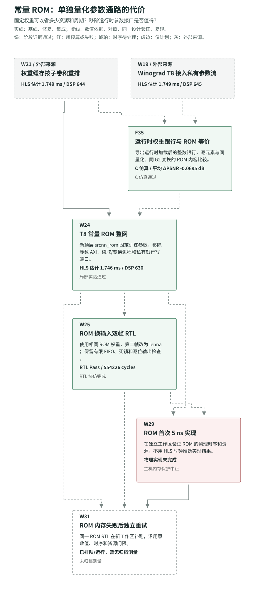

### T8 控制路径与有限 FIFO

| 分支 | 实际结果 | 当前含义 |
| --- | --- | --- |
| W23 → W32 | 相同 RTL、Performance_Explore、最终 postroute_physopt；4.5 ns 门限全部通过 | F97 周期折算 2.514411 ms/张，原 OOM 保留 |
| F39 → F43 → F49 → F52 | Conv3 操作数寄存；RTL 仍为 558758；4.5 ns 通过 | 布线 LUT 43468，WNS +0.072 ns；原保护失败保留 |
| F40/F41 → F44/F45 | 特征 FIFO 深度 16/32 均为 558758 RTL 周期 | 功能通过但没有帧延迟收益 |
| F42 → F46 → F50 | 重排输出缓冲 256；F46 被内存保护中止 | F50 未归档，收益未知 |
| F47 → F48 → F51 | 窗口 FIFO16 实测 535771 周期，减少 22987；读阻塞降为 0 | 原 2% 门限差 30 周期；用户接受为主线依据，F51 布线未归档 |
| W26 → W27 → W28 → W30 | FRP 数值与换参数 Pass，549438 周期；W30 独立 4.5 ns 布线通过 | 原 `fail` 保留；后获仅检查 564345 上限的授权，计算时间 2.472471 ms/张 |

W28 在完整图中保留红色问题行和普通字重的 5.49 ms/张，同时注明后续接受，不再作为未通过数值的运行淡化。这个特例必须由原始授权元数据与实际 RTL Pass 支持，不能推广给普通失败记录。F48 的原目标差距也没有被改成通过。

W30 的最终布线为 WNS +0.027 ns、WHS +0.030 ns，644 DSP、54091 LUT、77784 FF、109 BRAM18K，独立布线门限全部通过。结合 W28 周期与 4.5 ns，计算时间为 2.472471 ms/张，是本快照中最快的已验证统一十位 T8 分支。

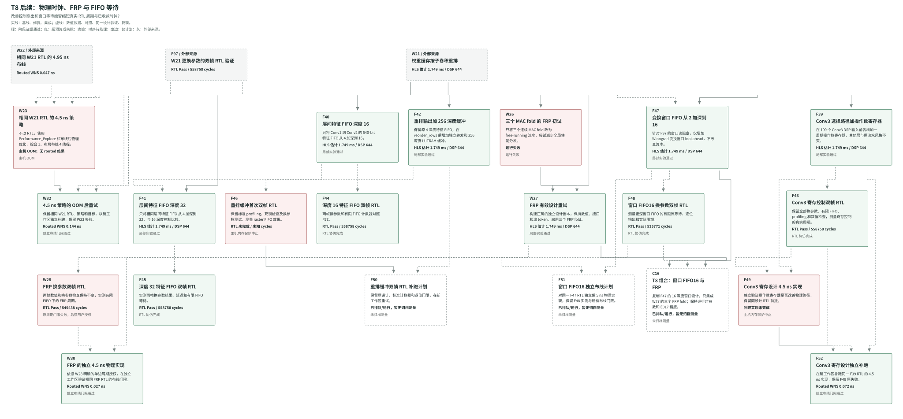

### T4 预拼参数与物理通过

C13 从 W21 改为 T4，并采用 E065 的 Conv2-only 8 位权重；其余激活和层保持原数值契约。系数对在运行时加载阶段预拼，避免每个像素重复 Packing。13 图与 E065 精确，平均 ΔPSNR -0.075890 dB；这与 T8 的 E017 参考不同，性能比较不能解释为只改变并行度。

C14 两帧换参数 RTL Pass，300632 延迟、300661 间隔。C15 因父综合设计与实现子进程的数据库叠加被内存保护中止。C18 用两个先后退出的 Vivado 进程运行同一 C13 RTL，保持 5 ns、线程和累计限时；最终 WNS +0.047 ns、WHS +0.031 ns，1032 DSP、58529 LUT、102072 FF、109 BRAM18K，全部布线门限通过。按 C14 周期与 5 ns 折算为 1.503160 ms/张，目前最快的已验证 IP 计算时间，不含系统集成、DDR、驱动或板测。

C16 将 F47 的窗口 FIFO16 与 W27 的 FRP 组合；C17 只把 C13 的窗口 FIFO 加深到 32。本快照中它们与 F50/F51/W31 共 5 项均无结果行，显示为等待/运行中、未归档；F90/F91 另为暂缓计划。不能相加单项收益，也不能继承 C18/W32/W30 的布线通过。

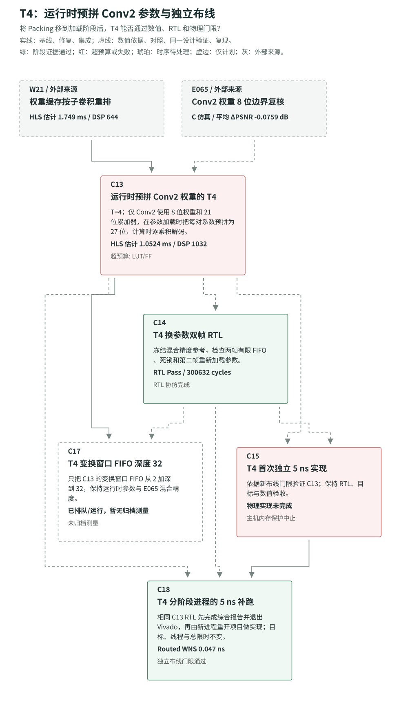

详细数字与状态见 [ROM_CLOCK](../experiments/ROM_CLOCK.md)。

## 完整索引与复现

- [全部 207 项：来源、改动、效果、问题、原始证据](experiment-evolution/records.md)
- [乘法器控制图](experiment-evolution/micro.svg)
- [机器可读关系和结果](experiment-evolution/data.json)
- [Mermaid 总览源码](experiment-evolution/overview.mmd)
- [所有图的重新生成与检查](experiment-evolution/README.md)
- [原实验冻结复现流程](../experiments/REPRODUCE.md)

E099 是第一轮归档/校验的收尾事件，不是另一个综合方案；F99 的权重加载收尾和归档审计已经完成，记录在工作流状态与审计文件中，也不另算一个综合点。F90/F91 仍只有暂缓计划，F88 保留中断结果。索引覆盖实际存在的记录和计划，不补造缺失编号。
