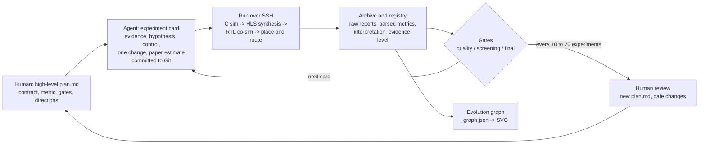

# Report section draft: Agent-Driven Design Space Exploration

> Draft for the course report. Written for the report's readers (the course instructor and markers), so it is in English and assumes the reader knows HLS but has not seen this repository. Figure slots are marked `[FIGURE n]`; the list at the end says which file to paste in each slot and how to caption it. Numbers were taken on 2026-10-25 from `experiments/results.csv`, `experiments/ARCH_SUMMARY.md`, `experiments/LOG.md`, `experiments/route_calibration.csv`, `docs/0004`, `docs/0005` and the per-experiment archives; re-check them if the registry changes.

---

## 3.x Agent-Driven Design Space Exploration

### 3.x.1 Why an agent

Optimising an HLS accelerator is a search. Every iteration follows the same fixed loop: choose one optimisation, change the code, run C simulation, run HLS synthesis, read the reports, and, for promising candidates, run C/RTL co-simulation and Vivado place-and-route. The loop is slow (one synthesis of this design takes 10 to 60 minutes on our host and one implementation up to three hours), the reports are long, and the space of techniques is large: precision, tiling, line buffers, loop pipelining and unrolling, dataflow, DSP packing, Winograd, parameter storage, FIFO depths and clock targets can be combined in countless ways. As beginners without hardware intuition we could not pick the right combination directly, and we could not afford to try many combinations by hand.

Both Vitis HLS and Vivado expose complete command-line flows, so the loop can be driven by a program. We therefore handed the loop to general-purpose LLM coding agents (OpenAI Codex and Anthropic Claude Code) running on a laptop and executing the tools over SSH on a Linux host (12 logical CPUs, 15 GiB of memory) with the Xilinx installation. This section describes how the agents were controlled, what the resulting search looked like, and what the method caught that we would otherwise have missed. The hardware results themselves are analysed in Section 4.

### 3.x.2 The problem was not the model

Our first attempts showed that a capable model is not enough. Left alone, an agent tends to:

- change several things at once, so that a measured gain cannot be attributed to any one of them;
- explain results after the fact, adjusting its expectation to whatever the tool reported;
- present a weaker result as a stronger one, for example reporting an HLS latency estimate as if it were the frame time, or a functional pass as a speedup;
- lose track of what has already been tried over a session that lasts many hours.

None of these are failures of hardware knowledge. They are failures of experimental discipline, and they are the same failures a student makes. We therefore wrote the discipline down as a rules file (`AGENTS.md`) and a reusable skill file that the agent loads at the start of every session. The rest of this section is that method.

`[FIGURE 1: the experiment loop]`

### 3.x.3 The protocol

**Plan before experimenting.** Planning happens at two levels. A high-level plan (`docs/000N-*.md`) fixes what must not change, what is being optimised, and which directions to explore. For this project the fixed contract is: the `srcnn` function signature with float arrays, runtime-loaded parameters, replicate padding, the 1-64-32-1 network, and bit-exact agreement with a fixed-point reference on all 13 Set14 images. The single primary metric is milliseconds per frame, computed as cycles multiplied by clock period. Three gates separate "ran" from "counts":

| Gate | Question | Criterion used in this project |
|---|---|---|
| Quality | Is the output correct? | Bit-exact against the 10-bit `ap_fixed` reference E017 (or the mixed-precision reference E065) on every image; mean PSNR change on Set14 no worse than -0.1 dB |
| Screening | Is it worth verifying further? | HLS synthesis completes with II = 1 in the compute loops and resources inside an explicit screen (for the T4 designs: DSP <= 1100, LUT <= 170 k, FF <= 230 k) |
| Final | Can we call it feasible? | Post-route timing met at the implemented clock, zero unrouted nets, routed resources within the device, and C/RTL co-simulation bit-exact over two or more frames with finite FIFOs |

Only designs that pass the final gate enter the ranking. We review the completed experiments and issue a new high-level plan; the agent does not change the gates itself.

**Register before running.** Every experiment gets an immutable ID (E, P, W, G, S, C, F series by direction) and a card that is committed to Git before any tool runs. The card contains the bottleneck evidence (a specific line of a specific report), one hypothesis, one control experiment, the single thing changed relative to the control, and a paper estimate of DSP, BRAM, LUT, FF and cycles with its derivation. Because the card is committed first, the estimate cannot be adjusted afterwards. Listing 1 shows the relevant part of one card.

```
Listing 1. Experiment card C13 (excerpt), planned 2026-10-12T04:58 UTC, control W21.
Change: T=4 fold; Conv2 only switches to E065's signed 8-bit weights, two coefficients
        pre-packed per 27-bit DSP operand once per frame; everything else frozen.
Paper estimate: DSP 1032 (576+256+200), BRAM18K 146, LUT 150000, FF 220000,
        latency 292000 cycles.  Basis: 2304/4 Conv1, 2048/(4*2) Conv2 pairs, 800/4 Conv3;
        C11 measured 1036 DSP / 198436 LUT / 231297 FF with the old loader.
Measured (HLS): DSP 1032, BRAM18K 146, LUT 127966 (-14.7 %), FF 192308 (-12.6 %),
        263090 cycles (-9.9 %).  All deviations within 20 %.
```

**Record everything, with an evidence level.** Each run is archived under `experiments/<ID>_<name>/` with the card, the source snapshot, the raw logs, the parsed reports and a one-page interpretation. Failed, timed-out and invalid runs are archived in the same way; 100 of the 231 registered experiments ended in `fail`, `infeasible`, `invalid_config` or `timeout`. The registry `results.csv` is generated by a parser from the reports and is never edited by hand. Every number carries its evidence level, in increasing order of strength:

paper estimate < C simulation < HLS synthesis estimate < C/RTL co-simulation < post-route implementation < on-board measurement.

The agent may not present a lower level as a higher one. The log records the rule being applied: "a functional PASS is not a speedup" (F45), "a slack-derived period is not a verified clock" (W22), "the clock and the thread count changed together, so the runtime change cannot be credited to threads". In practice this rule is what forced us to notice that HLS estimates are systematically wrong for this design (Section 3.x.4).

**Draw the evolution graph and hand over.** Later experiments build on the results or hypotheses of earlier ones, so the experiments form a directed graph. The agent maintains `graph.json` with one node per experiment and one edge per dependency (design lineage, retry after fix, integration, numerical evidence, control, verification), and a script renders it. At the end of each session a progress file records the current branch, the running jobs, the open decisions and how to resume, so that a new session or a different model can continue without re-deriving the state.

### 3.x.4 What the protocol caught

The value of the rules is best shown by what they caught.

**Silently ignored configuration.** The first directive experiments (E023 to E025) produced results identical to the untouched baseline. Because the card had predicted a change, the identical numbers were flagged instead of being reported as "pipelining does not help". The cause was that the tool silently ignores unknown `syn.directive` keys. The runner was changed to generate directives from the tool's schema and reject unknown keys, and the experiments were re-run as E028, E029 and E032. The same check later caught S01, whose DDR scratch buffers were never exported as AXI ports and had silently become 11,286 BRAM18K of on-chip memory. Without a committed prediction both would have been recorded as negative results.

**Estimate against measurement.** Every card's paper estimate is compared with the parsed report, and any deviation above 20 % must be explained before the next experiment is planned. Figure 2 shows the full set. Most frame-level designs fall inside the 20 % band; the outliers are informative. The early Winograd network W07 was predicted at 1.4 M cycles and measured 5.7 M, because the conditional tile scan takes its slow branch at every position; the explanation led directly to the continuous Winograd design W10. The tile-fusion series S03 to S06 was predicted an order of magnitude too optimistic because the recomputed halos were not in the model, which closed that direction after four experiments.

`[FIGURE 2: paper estimate vs measured cycles]`

**HLS estimates against routed results.** The very first routed design, E070, failed timing at the 10 ns target (WNS -1.277 ns on an unregistered 8-deep DSP cascade) although HLS had estimated a comfortable margin, and used 0.46 times the LUTs HLS had predicted. Once more designs were routed the pattern was confirmed (Figure 3). Across 18 routed designs the routed LUT count is 0.46 to 0.66 of the HLS estimate and the routed FF count 0.52 to 0.80, so HLS is about two times pessimistic on logic. The clock estimate is optimistic by a similar factor: W21 reports an estimated 2.43 ns period and closes at 4.95 ns; F25, planned at 2.5 ns, ran out its three-hour routing budget still congested at 2.5 ns and closed at 5.0 ns; C17 reports 2.92 ns, closes at 5.0 ns and fails at 4.5 ns. A design that is "1.05 ms" at the HLS level is therefore 1.37 ms once routed, and an HLS-level ranking would have discarded the T4 designs on LUT count (C13 needs 127,966 LUT in HLS, which exceeds the old 70 % gate, but routes to 58,529). On this evidence we, not the agent, changed the gates on 2026-10-12: the screening gate uses explicit HLS limits chosen to admit designs that route, and the final gate uses only post-route numbers.

`[FIGURE 3: HLS resource calibration against routed designs]`

**Behaviour that only RTL shows.** Two defects were invisible in C simulation and HLS synthesis. In F97, the C/RTL co-simulation of W21 recorded 45,974 cycles of stalls on the transformed-window FIFO and 6.4 % more cycles than HLS had predicted; a single-change experiment (F47, FIFO depth 2 to 16) removed most of them and became the basis of every later design. In C27, the four-call co-simulation of the parameter-reload design C23 showed a 4-byte AXI read on a call that was supposed to skip loading, caused by HLS hoisting a scalarised bias read out of the guarded region; C28 fixed it and C31 verified zero parameter reads on skipped calls. Both were found only because the protocol requires co-simulation with finite FIFOs, deadlock detection and an AXI monitor before a design may be ranked.

**Failures that stay on the record.** The first three implementations of the mainline (F81, F84, F87) were all killed by the kernel out-of-memory handler because Vivado's synthesis spawned about four worker processes of about 2.4 GiB each on the 15 GiB host; the retries run the generated flow with a single synthesis thread. Later, when we asked for two implementations to run concurrently to use the host better, W23 was killed in the same way, and the rule became one heavy job at a time with light jobs admitted under a measured memory budget. Three attempts to close a tighter clock on the fastest RTL failed timing and are recorded as such: W36 (C17 at 4.5 ns, WNS -0.216 ns, worst paths in the Winograd arithmetic with 8 to 11 logic levels), C36 (C32 at 5.0 ns, WNS -0.102 ns) and C40 (C37 at 4.5 ns, WNS -0.278 ns). These failures bound the final result: the fastest verified design runs at 5.0 ns, not 4.5 ns.

### 3.x.5 The search as a whole

The agents registered 231 experiments over 71 design directories; the registry timestamps run from 2026-10-10 to 2026-10-13, with the baseline setup starting on 2026-09-29. 20 experiments reached Vivado implementation and 16 reached C/RTL co-simulation. Figure 4 condenses the search to its 51 turning points; the complete graph and the per-route views are in the repository.

`[FIGURE 4: experiment evolution overview]`

Table 2 lists the milestones with the evidence level each number has. Two things stand out. First, the HLS-level number and the routed number for the same design differ by about two times, which is why the table keeps them apart. Second, the gain was not one idea but a chain: streaming removed the 23.8 MiB of intermediate feature maps (E033); binding products to DSPs and moving weights to LUTRAM fixed the LUT blow-up (E047, E039); the continuous direct-convolution engine removed the held-window multiplexers (F08, F13); moving the loader off the critical path and into private parameter banks gave the clock (F24, F25, F28); Winograd on Conv1 (W21) and 8-bit packing on Conv2 (C13) halved the DSP count per product; and the window FIFO removed the remaining stalls (F47, C17). Several directions that looked attractive on paper were closed by measurement: output-tile fusion (S03 to S06, 130 to 228 ms), DDR scratch buffers (S01, configuration never took effect), scatter-based Conv3 (G03, 44 ms against the 30 ms gather control), direct convolution at T8 (F29, F30, 1,004 DSP), and the naive combination of Winograd with packing (C11, which reaches 1.08 ms at the HLS level but needs 249 k LUT and 308 k FF).

Table 2. Milestones of the search. "HLS" is HLS estimated cycles times the target clock; "RTL x routed" is C/RTL co-simulation cycles times an independently closed post-route clock. No value is a board measurement.

| ID | Design | Evidence | ms/frame | Note |
|---|---|---|---|---|
| E000 | Original float source, 10 ns | HLS | 19,601 | BRAM18K 11,064 required; device has 288 |
| E039 | First resource-feasible streaming design, T=32, 10 ns | HLS | 29.83 | E070 routes it but fails timing at 10 ns |
| E043 | Best point of the parameter sweep, T=16, 3.33 ns | HLS | 6.94 | phase-1 selection; 505 DSP |
| F25 / F92 | Continuous direct convolution, nested loader, T=16 | HLS / RTL x routed at 5.0 ns | 2.64 / 5.34 | first design through the final gate; WNS +0.568 ns |
| W21 / W32 | Winograd Conv1, T8, private parameters | HLS / RTL x routed at 4.5 ns | 1.75 / 2.51 | 644 DSP |
| C16 / C21 | Deep window FIFO, free-running pipelines, T8 | HLS / RTL x routed at 4.5 ns | 1.75 / 2.41 | fastest T8 point |
| C13 / C18 | T4, Conv2 8-bit pre-packed | HLS / RTL x routed at 5.0 ns | 1.05 / 1.50 | 1,032 DSP |
| **C17 / C22** | **C13 + 32-entry window FIFO** | **HLS / RTL x routed at 5.0 ns** | **1.05 / 1.365** | **selected; WNS +0.013 ns** |
| W36 | C17 at 4.5 ns | implementation | failed | WNS -0.216 ns |

At the HLS level the frame time falls from 19,601 ms (E000) to 1.05 ms (C17). At the routed level, which is the only level at which we rank, it falls from 5.34 ms for the first design that passed the final gate (F92) to 1.365 ms for C22, a factor of 3.9, with the DSP count rising from 592 to 1,032. The selected design has been verified by C/RTL co-simulation (273,023 cycles, bit-exact over two frames with different parameters) and by Vivado place-and-route at 5.0 ns on the xck26 device; it has not been run on the board, and the 1.365 ms excludes DDR transfers and the driver.

`[FIGURE 5: verified designs, frame time against routed DSP count]`

### 3.x.6 Division of labour

The agent did the mechanical and the clerical work: writing cards, copying and modifying designs, running the tools over SSH, parsing reports, updating the registry, drawing the graph, and drafting the interpretation of each run. It also proposed most of the individual experiments from the bottleneck evidence in the reports: the loader address multiplier in F23's timing report led to F24 and F25; the finding that 46 % of F25's LUTs sat outside the dataflow region in weight banks and multiplexers led to the streamed-parameter designs F27 and F28; the FIFO stall profile of F97 led to F47.

We did the work that needs judgement about the goal rather than about the next step:

- writing and revising the high-level plans, and choosing which directions to pursue (Winograd and DSP packing were explored because the lectures covered them; the INT16 packing study P13 to P16 was requested by us);
- changing the gates from HLS estimates to routed results on 2026-10-12 once the calibration data existed, and defining the 13 supplied images as the complete test set;
- setting the host policy: how many jobs may run at once, the memory budget, enabling zram, and cleaning 55 GiB of old workspaces;
- ordering priorities, for example asking for C18 to be routed before the planned T8 experiments, accepting F48 as the new T8 baseline, and declining a rescue re-route of C36 in favour of the verified C22;
- reading every interpretation before the next plan was issued, roughly one review per 10 to 20 experiments.

Not every human decision was good. Our instruction to run two implementations at once caused the W23 out-of-memory failure; the one-heavy-job rule that replaced it came from the agent's measurement of the memory peaks.

### 3.x.7 Limitations and lessons

- **The method is expensive.** 231 experiments is far more than a human would run, and most of them are negative results or verification runs of the same design at another evidence level. The archives occupy several gigabytes and the host ran essentially continuously for three days with 60-minute synthesis, 6-hour co-simulation and 3-hour implementation timeouts. The cost is justified only because each run is cheap to launch and the discipline makes the negative results useful.
- **HLS estimates are not a ranking.** For this design the HLS clock estimate was optimistic by 1.7 to 2 times and the logic estimate pessimistic by about two times. Any search that ranks on HLS estimates would have selected the wrong designs. Routing is slow, so the compromise was to screen on HLS and to rank only on routed numbers.
- **The agent still needs a reviewer, and still slips.** The rules stop the agent from changing several things at once or from inflating evidence, but they do not stop it from spending many experiments on a direction that is no longer interesting; the high-level plan reviews are where that was corrected. The log also records clerical slips that the protocol caught after the fact: an experiment (W26) launched before its design existed, a plan that said three co-simulation calls where four were needed, and conditional implementation jobs that were never launched, leaving the host idle for hours.
- **Counts depend on the counting rule.** We count every registered run, including retries, controls and verification runs; 71 design directories exist, of which roughly 50 are distinct architectural points. The numbers in the letter sent to the instructor (about 200 experiments, 66 designs) were taken before the last workstream.
- **Nothing here is a board measurement.** The last planned step, wrapping the C22 IP with DDR and a driver and measuring end-to-end on the KV260, had not been run when this report was written.

Similar ideas appear in recent work on LLM-driven HLS optimisation and on agents for design-space exploration; we found that literature after designing the method, and our contribution is not a new search algorithm but a reproducible protocol that makes a general-purpose coding agent's search auditable.

---

## Figures to paste

| Slot | File | Suggested caption | Notes |
|---|---|---|---|
| FIGURE 1 | `docs/figs/experiment-loop.svg` (PNG: `docs/figs/experiment-loop.png`) | *The experiment loop. Humans write the high-level plan and review completed experiments; the agent registers a card, runs the tool chain and archives every result; gates decide which runs are verified further.* | Half a column wide. Orange boxes are human steps, blue are agent steps, grey is the tool chain. A Mermaid equivalent is below if the figure has to be redrawn in another tool. |
| FIGURE 2 | `experiments/figs/estimate_actual_cycles.png` | *Paper estimates committed before each run against measured HLS cycles, log scale, with the 20 % band. Left: full frames and layers; right: processing elements. Points outside the band had to be explained before the next experiment.* | Full width. |
| FIGURE 3 | `experiments/figs/route_calibration.png` | *Routed resource counts divided by the HLS estimate for the 18 implemented designs. DSP is exact, LUT is overestimated by about two times, FF by 1.3 to 2 times. The clock estimate is optimistic by a similar factor (text).* | Full width. Crop to the DSP and LUT panels if space is tight. |
| FIGURE 4 | `experiments/evolution/overview.svg` (Mermaid source in `overview.mmd`) | *The search as a directed graph: 51 turning points of 231 registered experiments. Solid edges are design lineage, dashed edges are evidence or verification; red nodes failed a gate, green nodes passed with a comparable number; the star marks the selected design C22.* | Full page, rotated, or in an appendix. For the body use `experiments/evolution/t4.svg` (the final workstream) or `mainline.svg`. Export SVG to PDF with `rsvg-convert -f pdf` to keep the text sharp. An interactive version with tooltips: https://claude.ai/artifact/1uE5hZz59PmCCMVqMAyGGW |
| FIGURE 5 | `experiments/figs/verified_ip_pareto.png` | *All designs that passed the final gate: frame time from co-simulation cycles at the routed clock against routed DSP48E2 count. The T4 designs trade 1,032 DSPs for 1.4 to 1.5 ms; the T8 designs use 630 to 644 DSPs at 2.4 to 2.8 ms.* | Half width. |
| Listing 1 | `experiments/C13_runtime_prepacked_conv2_T4/C13.md` | as in the text | Already condensed in the text; the full card is in the archive. |

Mermaid source for Figure 1:



## Things to check before submission

- The letter to the instructor says the first working version ran at about 2.2 s per frame. That number is not in the registry (E029, the best "directives only" run, is 3.8 s at the HLS level; E039, the first feasible design, is 29.8 ms). Decide which baseline the report uses and cite its source.
- The letter says "about 1.5 ms at 200 MHz". The verified number is C22: 1.365 ms at 5.0 ns (200 MHz). Use C22's numbers everywhere.
- `ARCH_SUMMARY.md` still lists C39 as running and C40 as unlaunched; `ROM_CLOCK.md` and `docs/0005` record both as complete with C40 failing timing. Regenerate the summary before quoting it.
- If a board measurement is obtained before submission, add it as the top evidence level in Table 2 and update 3.x.5 and 3.x.7.
