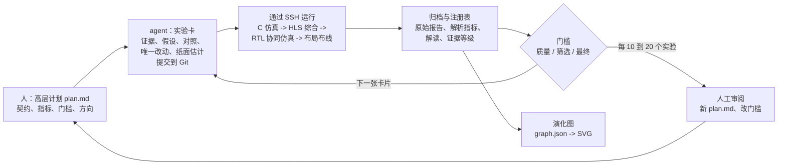

# 报告章节草稿：Agent 驱动的设计空间探索（中文版）

> 本文是 [0006-report-agent-driven-dse.md](0006-report-agent-driven-dse.md) 的中文对照版，面向课程报告的读者（授课老师和评分人），假定读者了解 HLS 但没看过本仓库。两个版本内容一致，若有出入以英文版为准，修改时同步更新。图位用 `[图 n]` 标出，文末列出每张图贴什么文件、怎么写图注。数字取自 2026-10-25 的 `experiments/results.csv`、`experiments/ARCH_SUMMARY.md`、`experiments/LOG.md`、`experiments/route_calibration.csv`、`docs/0004`、`docs/0005` 和各实验归档；注册表更新后需要复核。

---

## 3.x Agent 驱动的设计空间探索

### 3.x.1 为什么用 agent

优化一个 HLS 加速器本质上是搜索。每一轮迭代走的都是同一条固定流程：选一个优化点，改代码，跑 C 仿真，跑 HLS 综合，读报告；有希望的候选再做 C/RTL 协同仿真和 Vivado 布局布线。这条流程很慢（在我们的主机上，一次综合要 10 到 60 分钟，一次实现最多三小时），报告很长，而可选的技术又很多：精度、分块、行缓存、循环流水与展开、数据流、DSP 打包、Winograd、参数存储、FIFO 深度、时钟目标，组合方式数不清。我们是没有硬件直觉的初学者，既选不准组合，也没有人力逐个手试。

Vitis HLS 和 Vivado 都有完整的命令行流程，所以这条循环可以交给程序来驱动。我们把它交给了通用的 LLM 编程 agent（OpenAI Codex 和 Anthropic Claude Code）：agent 在笔记本上运行，通过 SSH 在装有 Xilinx 工具的 Linux 主机（12 个逻辑 CPU，15 GiB 内存）上执行工具。本节说明我们如何约束 agent、搜索实际是什么样子，以及这套方法抓住了哪些我们本来会漏掉的问题。硬件结果本身在第 4 节分析。

### 3.x.2 难点不在模型

最初的尝试表明，模型能力强并不够。放任不管时，agent 倾向于：

- 一次改好几处，测到的收益说不清归功于哪一处；
- 事后解释结果，把预期调整到工具报什么就是什么；
- 把弱证据当强证据说，比如把 HLS 的延迟估计当成帧时间，或者把功能通过说成加速成功；
- 在持续数小时的会话里忘掉已经试过什么。

这些都不是硬件知识上的失误，而是实验纪律上的失误，和学生会犯的错一模一样。于是我们把这套纪律写成规则文件（`AGENTS.md`）和一个可复用的技能文件，agent 每次开始会话都先加载。本节余下部分就是这套方法。

`[图 1：实验循环]`

### 3.x.3 协议

**先计划再实验。** 计划分两层。高层计划（`docs/000N-*.md`）规定什么不能变、优化什么、探索哪些方向。本项目固定不变的契约是：`srcnn` 的浮点数组函数签名、运行时加载参数、复制填充、1-64-32-1 的网络结构，以及在全部 13 张 Set14 图上与定点参考逐位一致。唯一主指标是每帧毫秒数，公式写死为周期数乘以时钟周期。三道门槛把"跑过了"和"算数"分开：

| 门槛 | 问题 | 本项目采用的判据 |
|---|---|---|
| 质量 | 输出对不对？ | 每张图都与 10 位 `ap_fixed` 参考 E017（或混合精度参考 E065）逐位一致；Set14 平均 PSNR 变化不差于 -0.1 dB |
| 筛选 | 值不值得往下验证？ | HLS 综合完成，计算循环 II = 1，资源在明确的筛选线内（T4 设计：DSP <= 1100，LUT <= 170 k，FF <= 230 k） |
| 最终 | 能不能称为可行？ | 在实现时钟下布线后时序收敛、无未布线网络、布线后资源在器件内，且有限 FIFO 下两帧以上的 C/RTL 协同仿真逐位一致 |

只有通过最终门槛的设计才进入排名。我们审阅已完成的实验后发布新的高层计划；agent 自己不改门槛。

**先登记再运行。** 每个实验有不可复用的编号（按方向分 E、P、W、G、S、C、F 系列）和一张实验卡，卡片在任何工具运行之前提交到 Git。卡片包含瓶颈证据（某份报告的某一行）、一个假设、一个对照实验、相对对照唯一改动的那一处，以及 DSP、BRAM、LUT、FF 和周期数的纸面估计及推导。因为卡片先提交，估计事后改不了。列表 1 是一张卡片的相关部分。

```
列表 1. 实验卡 C13（节选），计划时间 2026-10-12T04:58 UTC，对照 W21。
改动：T=4 折叠；仅 Conv2 改用 E065 的有符号 8 位权重，每帧一次把两个系数预打包进
      一个 27 位 DSP 操作数；其余全部冻结。
纸面估计：DSP 1032（576+256+200），BRAM18K 146，LUT 150000，FF 220000，
      延迟 292000 周期。依据：Conv1 2304/4，Conv2 2048/(4*2) 对，Conv3 800/4；
      C11 在旧加载器下实测 1036 DSP / 198436 LUT / 231297 FF。
实测（HLS）：DSP 1032，BRAM18K 146，LUT 127966（-14.7 %），FF 192308（-12.6 %），
      263090 周期（-9.9 %）。所有偏差都在 20 % 以内。
```

**全部记录，并标注证据等级。** 每次运行归档到 `experiments/<编号>_<简名>/`，包括卡片、源码快照、原始日志、解析后的报告和一页解读。失败、超时和配置无效的运行同样归档；231 个已登记实验里有 100 个以 `fail`、`infeasible`、`invalid_config` 或 `timeout` 结束。注册表 `results.csv` 由解析脚本从报告生成，从不手改。每个数字都带证据等级，由弱到强为：

纸面估计 < C 仿真 < HLS 综合估计 < C/RTL 协同仿真 < 布线后实现 < 板上实测。

agent 不得把低等级说成高等级。日志里记录着这条规则被执行的时刻："功能 PASS 不算加速"（F45）、"由 slack 推导的周期不是已验证的时钟"（W22）、"时钟和线程数同时变化，不能把耗时变化单独归因于线程"。实际上正是这条规则迫使我们注意到 HLS 估计对这个设计系统性地偏差（3.x.4 节）。

**画演化图，做交接。** 后面的实验建立在前面实验的结果或假设上，所以实验构成一张有向图。agent 维护 `graph.json`，每个实验一个节点，每条依赖一条边（设计演进、修复后重试、集成、数值依据、对照、验证），由脚本渲染。每次会话结束时，进度文件记录当前分支、正在运行的任务、未决事项和恢复方法，新会话或换一个模型都能接着做，不必重新推导状态。

### 3.x.4 协议抓住了什么

规则的价值最好用它抓住的问题来说明。

**被静默忽略的配置。** 最早的指令实验（E023 到 E025）得到的结果和未改动的基线一模一样。因为卡片预测会有变化，相同的数字被标记出来，而不是被报告成"流水线没用"。原因是工具会静默忽略未知的 `syn.directive` 键。运行器随后改为按工具 schema 生成指令并拒绝未知键，实验以 E028、E029、E032 重跑。同样的检查后来抓住了 S01：它的 DDR 暂存缓冲从未被导出为 AXI 端口，静默变成了 11,286 个 BRAM18K 的片上存储。没有事先提交的预测，这两个都会被记成负面结果。

**估计对实测。** 每张卡片的纸面估计都与解析出的报告比较，偏差超过 20 % 的必须先解释再计划下一个实验。图 2 是全部数据。多数整帧设计落在 20 % 带内，带外的点反而最有信息量。早期的 Winograd 网络 W07 预测 140 万周期，实测 570 万，因为条件分块扫描在每个位置都走了慢分支；对此的解释直接导出了连续 Winograd 设计 W10。分块融合系列 S03 到 S06 的预测乐观了一个数量级，因为模型里没算重算的边缘，四个实验之后这个方向就关闭了。

`[图 2：纸面估计与实测周期]`

**HLS 估计对布线结果。** 第一个布线的设计 E070 在 10 ns 目标下时序失败（WNS -1.277 ns，落在一条未加寄存器的 8 级 DSP 级联上），而 HLS 估计有充裕余量；它用的 LUT 只有 HLS 预测的 0.46 倍。布线的设计多了以后，规律得到确认（图 3）。在 18 个布线设计上，布线后 LUT 是 HLS 估计的 0.46 到 0.66 倍，FF 是 0.52 到 0.80 倍，也就是 HLS 对逻辑资源悲观约两倍。时钟估计则乐观相近的倍数：W21 估计周期 2.43 ns，实际在 4.95 ns 收敛；F25 按 2.5 ns 规划，三小时布线预算用尽仍然拥塞，最终在 5.0 ns 收敛；C17 估计 2.92 ns，5.0 ns 收敛，4.5 ns 失败。HLS 层面"1.05 ms"的设计布线后就是 1.37 ms，而按 HLS 排名会因 LUT 把 T4 设计淘汰（C13 的 HLS LUT 是 127,966，超过旧的 70 % 门槛，布线后只有 58,529）。基于这些证据，是我们而不是 agent 在 2026-10-12 改了门槛：筛选门槛改用明确的、能放行可布线设计的 HLS 上限，最终门槛只看布线后数字。

`[图 3：HLS 资源与布线结果的校准]`

**只有 RTL 才能暴露的行为。** 有两个缺陷在 C 仿真和 HLS 综合里都看不见。F97 对 W21 做 C/RTL 协同仿真，记录到变换窗 FIFO 上 45,974 个周期的停顿，周期数比 HLS 预测多 6.4 %；一个单改动实验（F47，FIFO 深度 2 改 16）消除了大部分停顿，成为之后所有设计的基础。C27 对参数重载设计 C23 做四次调用的协同仿真，发现本应跳过加载的那次调用仍然发出了一次 4 字节的 AXI 读，原因是 HLS 把一个标量化的偏置读提升到了保护区域之外；C28 修复，C31 验证跳过调用时参数读为零。两者都是因为协议要求有限 FIFO、死锁检测和 AXI 监视下的协同仿真通过后才能进入排名，才被发现。

**留在记录上的失败。** 主线最早的三次实现（F81、F84、F87）全部被内核 OOM 杀掉，因为 Vivado 综合在 15 GiB 的主机上派生了约四个各 2.4 GiB 的工作进程；重试改为用单综合线程运行生成的流程。后来我们为了提高主机利用率要求同时跑两个实现，W23 又以同样方式被杀，规则于是变成一次只跑一个重任务，轻任务按实测内存余量准入。在最快的 RTL 上收紧时钟的三次尝试都时序失败并如实记录：W36（C17 在 4.5 ns，WNS -0.216 ns，最差路径在 Winograd 算术，8 到 11 级逻辑）、C36（C32 在 5.0 ns，WNS -0.102 ns）和 C40（C37 在 4.5 ns，WNS -0.278 ns）。这些失败框定了最终结果：最快的已验证设计运行在 5.0 ns，不是 4.5 ns。

### 3.x.5 整体的搜索

agent 在 71 个设计目录上登记了 231 个实验；注册表时间戳从 2026-10-10 到 2026-10-13，基线搭建从 2026-09-29 开始。20 个实验到达 Vivado 实现，16 个到达 C/RTL 协同仿真。图 4 把搜索浓缩为 51 个转折点；完整的图和各路线的分图在仓库里。

`[图 4：实验演化总览]`

表 2 列出各个里程碑及其数字的证据等级。有两点值得注意。第一，同一设计的 HLS 数字和布线后数字差约两倍，所以表格把它们分开。第二，收益不是来自某一个点子，而是一条链：流式结构去掉了 23.8 MiB 的中间特征图（E033）；把乘积绑定到 DSP、权重改放 LUTRAM 解决了 LUT 爆炸（E047、E039）；连续直接卷积引擎去掉了保持窗的多路选择器（F08、F13）；把加载器移出关键路径、再移进私有参数银行换来了时钟（F24、F25、F28）；Conv1 上的 Winograd（W21）和 Conv2 上的 8 位打包（C13）把每个乘积的 DSP 数减半；窗 FIFO 消除了剩余的停顿（F47、C17）。几个纸面上有吸引力的方向被实测关闭：输出分块融合（S03 到 S06，130 到 228 ms）、DDR 暂存缓冲（S01，配置从未生效）、基于 scatter 的 Conv3（G03，44 ms，对照 gather 为 30 ms）、T8 的直接卷积（F29、F30，1,004 个 DSP），以及 Winograd 与打包的直接叠加（C11，HLS 层面 1.08 ms，但需要 249 k LUT 和 308 k FF）。

表 2. 搜索的里程碑。"HLS"是 HLS 估计周期乘目标时钟；"RTL x 布线"是 C/RTL 协同仿真周期乘独立收敛的布线后时钟。没有任何值是板上实测。

| 编号 | 设计 | 证据 | ms/帧 | 说明 |
|---|---|---|---|---|
| E000 | 原始浮点源码，10 ns | HLS | 19,601 | 需要 BRAM18K 11,064，器件只有 288 |
| E039 | 第一个资源可行的流式设计，T=32，10 ns | HLS | 29.83 | E070 布线后 10 ns 时序失败 |
| E043 | 参数扫描最佳点，T=16，3.33 ns | HLS | 6.94 | 第一阶段选定；505 DSP |
| F25 / F92 | 连续直接卷积，嵌套加载器，T=16 | HLS / RTL x 布线 5.0 ns | 2.64 / 5.34 | 第一个通过最终门槛的设计；WNS +0.568 ns |
| W21 / W32 | Conv1 Winograd，T8，私有参数 | HLS / RTL x 布线 4.5 ns | 1.75 / 2.51 | 644 DSP |
| C16 / C21 | 深窗 FIFO，自由运行流水线，T8 | HLS / RTL x 布线 4.5 ns | 1.75 / 2.41 | 最快的 T8 点 |
| C13 / C18 | T4，Conv2 8 位预打包 | HLS / RTL x 布线 5.0 ns | 1.05 / 1.50 | 1,032 DSP |
| **C17 / C22** | **C13 + 32 项窗 FIFO** | **HLS / RTL x 布线 5.0 ns** | **1.05 / 1.365** | **选定；WNS +0.013 ns** |
| W36 | C17 在 4.5 ns | 实现 | 失败 | WNS -0.216 ns |

在 HLS 层面，帧时间从 19,601 ms（E000）降到 1.05 ms（C17）。在布线层面，也就是我们唯一用来排名的层面，从第一个通过最终门槛的设计 F92 的 5.34 ms 降到 C22 的 1.365 ms，3.9 倍，DSP 从 592 增加到 1,032。选定的设计已经过 C/RTL 协同仿真（273,023 周期，换参数的两帧逐位一致）和 xck26 器件上 5.0 ns 的 Vivado 布局布线验证；它没有在板上运行过，1.365 ms 不含 DDR 传输和驱动。

`[图 5：已验证设计，帧时间对布线后 DSP 数]`

### 3.x.6 分工

agent 做机械和文书性的工作：写卡片、复制和修改设计、通过 SSH 运行工具、解析报告、更新注册表、画图、起草每次运行的解读。大多数单个实验也是它从报告里的瓶颈证据提出来的：F23 时序报告里的加载器地址乘法器导出了 F24 和 F25；发现 F25 有 46 % 的 LUT 在数据流区域之外的权重银行和选择器里，导出了流式参数设计 F27 和 F28；F97 的 FIFO 停顿画像导出了 F47。

我们做的是需要对目标而不是对下一步作判断的工作：

- 写和修订高层计划，决定探索哪些方向（Winograd 和 DSP 打包是因为课上讲过；INT16 打包研究 P13 到 P16 是我们要求的）；
- 2026-10-12 在校准数据出现后把门槛从 HLS 估计改为布线结果，并把提供的 13 张图定义为完整测试集；
- 制定主机策略：同时跑几个任务、内存预算、启用 zram、清理 55 GiB 的旧工作区；
- 排优先级，例如要求先布线 C18 再做计划中的 T8 实验、接受 F48 为新的 T8 基线、拒绝对 C36 做补救重布线而保留已验证的 C22；
- 在发布下一个计划前读完每一份解读，大约每 10 到 20 个实验一次审阅。

人的决定并不都对。我们要求同时跑两个实现，直接导致了 W23 的 OOM 失败；取而代之的"一次一个重任务"规则来自 agent 对内存峰值的实测。

### 3.x.7 局限与教训

- **方法很贵。** 231 个实验远多于人工会做的数量，其中大部分是负面结果，或者同一设计在另一证据等级上的验证运行。归档占了数 GB，主机连续跑了三天，综合超时 60 分钟、协同仿真 6 小时、实现 3 小时。这个代价之所以值得，只是因为每次运行启动成本低，而且纪律让负面结果也有用。
- **HLS 估计不能当排名。** 对这个设计，HLS 时钟估计乐观 1.7 到 2 倍，逻辑资源估计悲观约两倍。任何按 HLS 估计排名的搜索都会选错设计。布线很慢，所以折中是用 HLS 筛选、只用布线数字排名。
- **agent 仍然需要审阅者，也仍然会出错。** 规则能阻止 agent 一次改多处或夸大证据，但不能阻止它在已经没有意义的方向上继续花实验；高层计划的审阅就是纠正这一点的地方。日志还记录了协议事后抓住的文书性失误：一个实验（W26）在设计还不存在时就被启动，一份计划写了三次协同仿真调用而实际需要四次，还有条件触发的实现任务一直没被启动，让主机闲置了数小时。
- **计数取决于计数规则。** 我们把每一次登记的运行都算在内，包括重试、对照和验证运行；存在 71 个设计目录，其中约 50 个是不同的架构点。写给老师的信里的数字（约 200 个实验、66 个设计）取自最后一个工作流之前。
- **没有任何板上实测。** 最后计划的一步，即把 C22 IP 与 DDR 和驱动封装起来在 KV260 上端到端测量，在写报告时尚未执行。

近期关于 LLM 驱动 HLS 优化和 agent 做设计空间探索的工作有类似想法；我们是在设计方法之后才检索到这些文献的。我们的贡献不是新的搜索算法，而是一套可复现的协议，使通用编程 agent 的搜索可以被审计。

---

## 要贴的图

| 图位 | 文件 | 建议图注 | 说明 |
|---|---|---|---|
| 图 1 | `docs/figs/experiment-loop.zh.svg`（PNG：`docs/figs/experiment-loop.zh.png`；英文版 `experiment-loop.svg`） | *实验循环。人写高层计划并审阅已完成的实验；agent 登记卡片、运行工具链并归档每个结果；门槛决定哪些运行进一步验证。* | 半栏宽。橙色框是人的步骤，蓝色是 agent 的步骤，灰色是工具链。需要用别的工具重画时可参照下面的 Mermaid 源码。 |
| 图 2 | `experiments/figs/estimate_actual_cycles.png` | *每次运行前提交的纸面估计与 HLS 实测周期，对数坐标，带 20 % 带。左：整帧和单层；右：处理单元。带外的点必须解释后才能计划下一个实验。* | 通栏。 |
| 图 3 | `experiments/figs/route_calibration.png` | *18 个已实现设计的布线后资源除以 HLS 估计。DSP 精确，LUT 高估约两倍，FF 高估 1.3 到 2 倍。时钟估计乐观相近倍数（见正文）。* | 通栏。版面紧时只保留 DSP 和 LUT 两栏。 |
| 图 4 | `experiments/evolution/overview.svg`（Mermaid 源码在 `overview.mmd`） | *搜索的有向图：231 个已登记实验中的 51 个转折点。实线是设计演进，虚线是依据或验证；红色节点未过门槛，绿色节点通过且有可比数字；星号标出选定设计 C22。* | 整页横放或放附录。正文用 `experiments/evolution/t4.svg`（最后一个工作流）或 `mainline.svg`。用 `rsvg-convert -f pdf` 把 SVG 转 PDF 保持文字清晰。带悬浮提示的交互版：https://claude.ai/artifact/1uE5hZz59PmCCMVqMAyGGW |
| 图 5 | `experiments/figs/verified_ip_pareto.png` | *所有通过最终门槛的设计：协同仿真周期乘布线时钟得到的帧时间，对布线后 DSP48E2 数量。T4 设计用 1,032 个 DSP 换 1.4 到 1.5 ms；T8 设计用 630 到 644 个 DSP，2.4 到 2.8 ms。* | 半栏宽。 |
| 列表 1 | `experiments/C13_runtime_prepacked_conv2_T4/C13.md` | 如正文 | 正文已节选；完整卡片在归档里。 |

图 1 的 Mermaid 源码：



## 提交前要核对的事项

- 给老师的信里说第一个能跑的版本约 2.2 s/帧。注册表里没有这个数（E029 是最好的"只改指令"结果，HLS 层面 3.8 s；E039 是第一个可行设计，29.8 ms）。决定报告用哪个基线并注明来源。
- 信里说"约 1.5 ms，200 MHz"。已验证的数字是 C22：5.0 ns（200 MHz）下 1.365 ms。全文统一用 C22 的数字。
- `ARCH_SUMMARY.md` 仍把 C39 列为运行中、C40 列为未启动；`ROM_CLOCK.md` 和 `docs/0005` 记录两者都已完成，C40 时序失败。引用前先重新生成摘要。
- 如果提交前拿到板上实测，把它作为最高证据等级加进表 2，并更新 3.x.5 和 3.x.7。
