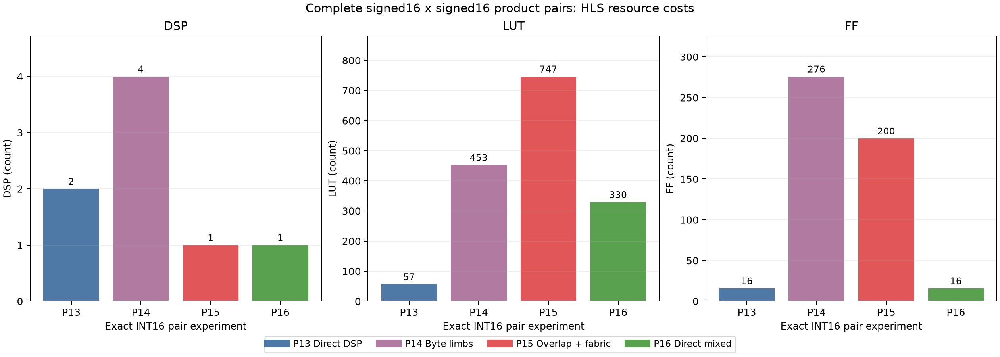
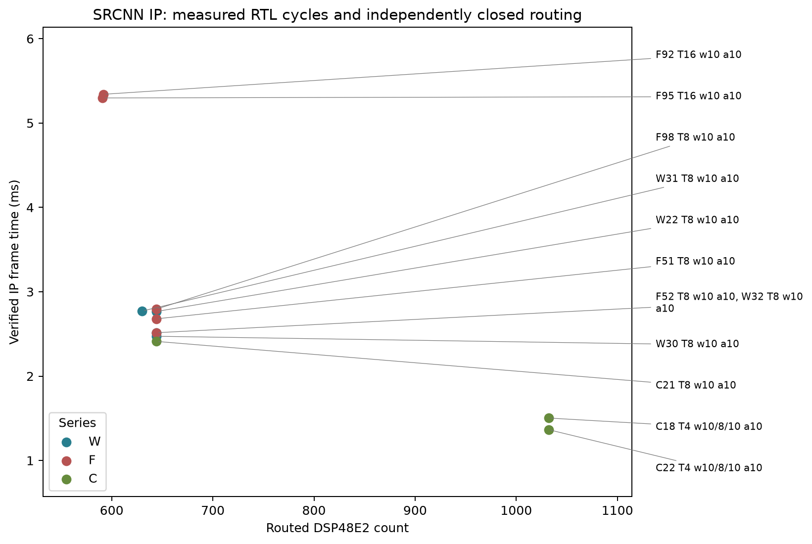
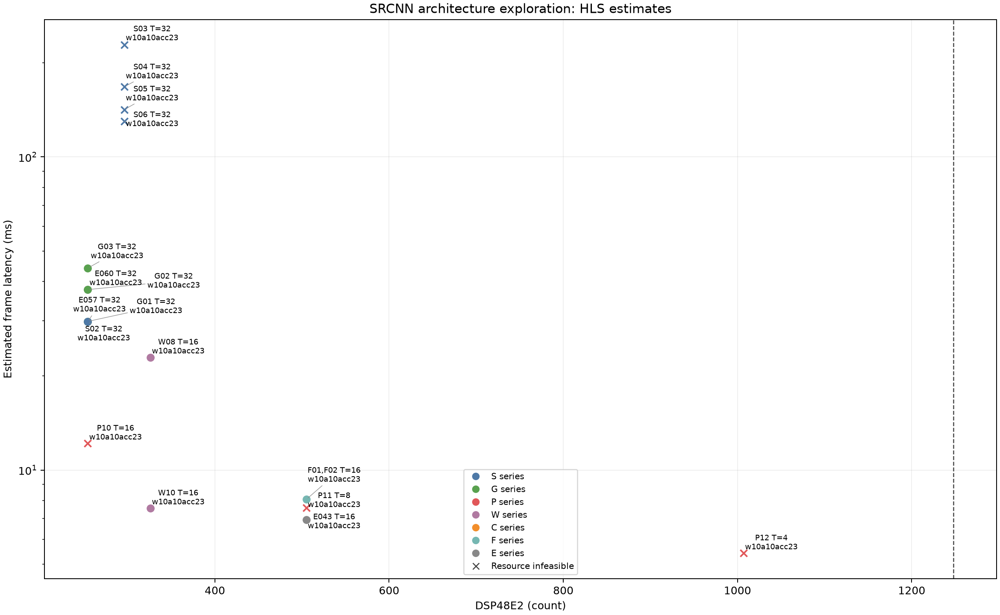
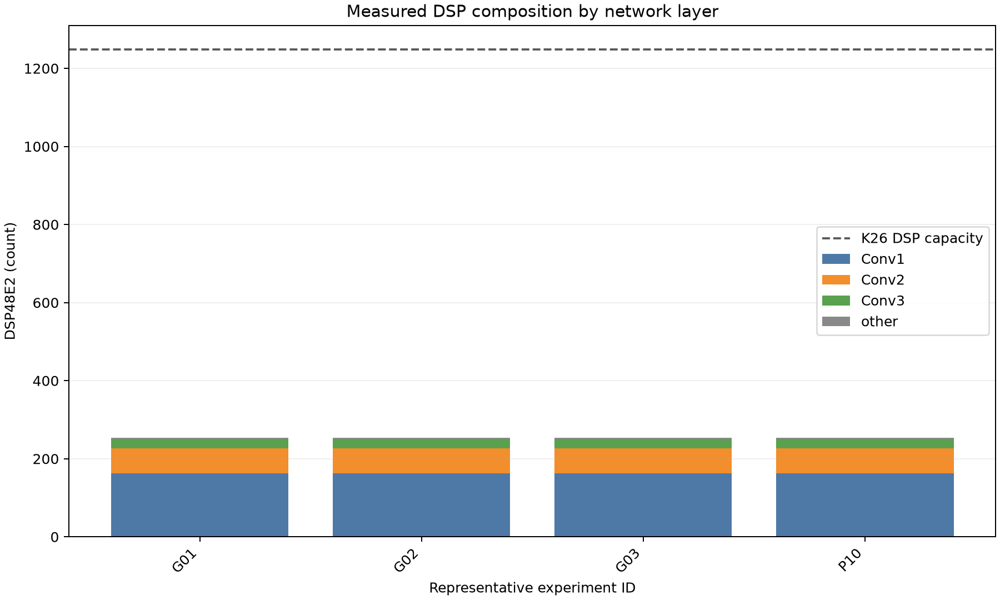
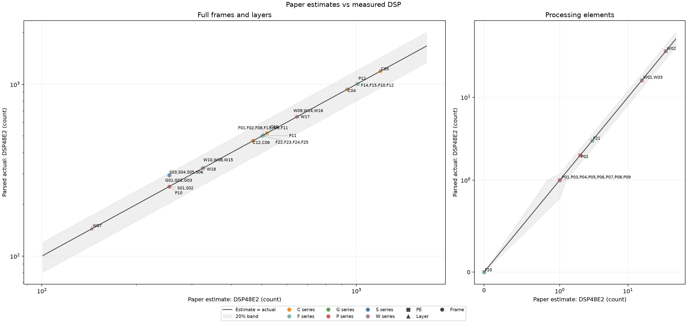
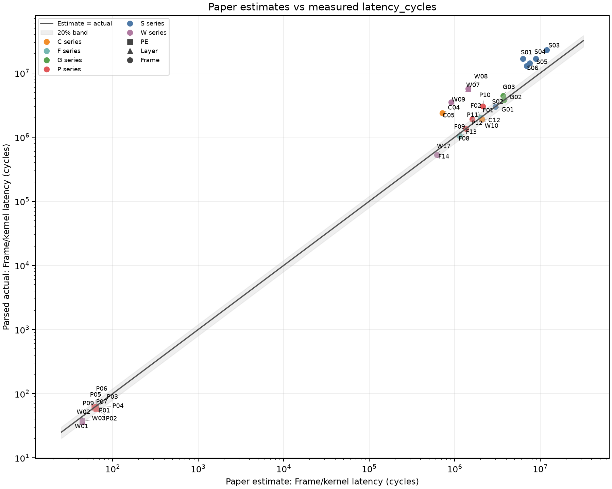
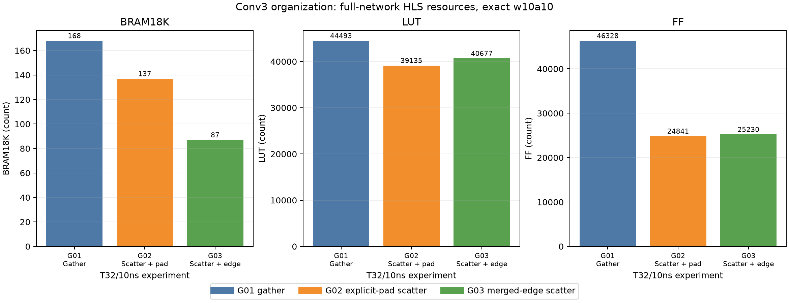
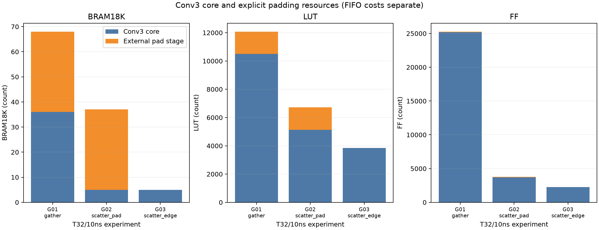

# SRCNN K26 architecture exploration

Current follow-up: [ROM_CLOCK.md](ROM_CLOCK.md), following [docs/0005](../docs/0005-rom-clock-t4-plan.md). The complete course Set14 has13 images; final feasibility now uses independently routed resource/timing gates. Historical HLS statuses and earlier provisional wording below remain original records.

The lowest HLS estimate satisfying the original HLS resource screen is [W24](W24_constant_rom_T8/W24.md) at 1.7460189000000002ms HLS-estimated latency. Packing and integer Winograd primitives pass exact checks, while full-network results include fabric, memory and scheduling costs absent from DSP-only budgets. Routed timing, measured RTL cycles and board validation remain distinct; the HLS leader cannot establish final feasibility.

Re-run frozen HLS records with fresh IDs using the [reproduction guide](REPRODUCE.md). Original reserved IDs remain immutable.

Weight loading and T8 follow-up: [WEIGHT_LOADING.md](WEIGHT_LOADING.md), following [docs/0004](../docs/0004-t8-weight-loading-plan.md). That workstream is archived; current acceptance and remaining tasks follow docs/0005.

## HLS Screening Leader

| id | design | precision_w_a_acc | T_target | clock_target_ns | clock_est_ns | latency_cycles | interval_cycles | latency_ms_est | DSP | BRAM18K | URAM | LUT | FF | delta_psnr | status |
| --- | --- | --- | --- | --- | --- | --- | --- | --- | --- | --- | --- | --- | --- | --- | --- |
| [W24](W24_constant_rom_T8/W24.md) | designs/winograd_rom_v1 | w10a10acc23 | 8 | 3.33 | 2.431 | 524330.0 | 524331.0 | 1.7460189000000002 | 630.0 | 138.0 | 0.0 | 53316.0 | 103695.0 | -0.0695141811880653 | pass |

HLS-estimate improvement over first-phase E043: 3.9743x. This ratio is not a measured board speedup.

Actual verification of the current HLS winner:

| id | operation | status | impl_target_clock_ns | impl_WNS_ns | timing_met | impl_DSP | impl_LUT | impl_FF | impl_BRAM36 | impl_URAM | rtl_status | rtl_latency_max | rtl_interval_max | cycle_deviation_pct |
| --- | --- | --- | --- | --- | --- | --- | --- | --- | --- | --- | --- | --- | --- | --- |
| [W25](W25_rom_changed_input_cosim_W24/W25.md) | cosim | cosim_complete | unknown | unknown | unknown | unknown | unknown | unknown | unknown | unknown | Pass | 554226.0 | 554237.0 | 5.701752712986097 |
| [W29](W29_ws_impl_W24/W29.md) | impl | fail | unknown | unknown | unknown | unknown | unknown | unknown | unknown | unknown | unknown | unknown | unknown | unknown |
| [W31](W31_ws_impl_W24/W31.md) | impl | impl_complete | 5.0 | 0.47 | True | 630.0 | 33771.0 | 82635.0 | 50.5 | 0.0 | unknown | unknown | unknown | unknown |

## Current Verified IP Timing

Matching-parent successful RTL latency times an independently closed, resource-feasible routed clock. No DDR, driver or board measurement is included.

| id | parent | rtl_source | rtl_cycles | route_clock_ns | route_WNS_ns | route_DSP | route_BRAM18K | route_LUT | route_FF | rtl_frame_ms |
| --- | --- | --- | --- | --- | --- | --- | --- | --- | --- | --- |
| [C22](C22_ws_impl_C17/C22.md) | C17 | C20 | 273023.0 | 5.0 | 0.013 | 1032.0 | 109.0 | 59552.0 | 100499.0 | 1.365115 |
| [C18](C18_ws_impl_C13/C18.md) | C13 | C14 | 300632.0 | 5.0 | 0.047 | 1032.0 | 109.0 | 58529.0 | 102072.0 | 1.50316 |
| [C21](C21_ws_impl_C16/C21.md) | C16 | C19 | 535976.0 | 4.5 | 0.053 | 644.0 | 109.0 | 54139.0 | 78445.0 | 2.411892 |
| [W30](W30_ws_impl_W27/W30.md) | W27 | W28 | 549438.0 | 4.5 | 0.027 | 644.0 | 109.0 | 54091.0 | 77784.0 | 2.472471 |
| [F52](F52_ws_impl_F39/F52.md) | F39 | F43 | 558758.0 | 4.5 | 0.072 | 644.0 | 109.0 | 43468.0 | 89030.0 | 2.514411 |
| [W32](W32_ws_clock_strategy_4p5_retry_W21/W32.md) | W21 | F97 | 558758.0 | 4.5 | 0.144 | 644.0 | 109.0 | 45030.0 | 89096.0 | 2.514411 |
| [F51](F51_ws_impl_F47/F51.md) | F47 | F48 | 535771.0 | 5.0 | 0.055 | 644.0 | 109.0 | 43617.0 | 87203.0 | 2.678855 |
| [W22](W22_ws_clock_4p95_W21/W22.md) | W21 | F97 | 558758.0 | 4.95 | 0.047 | 644.0 | 109.0 | 42592.0 | 88806.0 | 2.7658521 |
| [W31](W31_ws_impl_W24/W31.md) | W24 | W25 | 554226.0 | 5.0 | 0.47 | 630.0 | 101.0 | 33771.0 | 82635.0 | 2.77113 |
| [F98](F98_ws_impl_W21/F98.md) | W21 | F97 | 558758.0 | 5.0 | 0.14 | 644.0 | 109.0 | 42594.0 | 88806.0 | 2.79379 |

Verified candidate IP packages and register maps: [C18](board_handoff/C18/HANDOFF.md), [C22](board_handoff/C22/HANDOFF.md), [C21](board_handoff/C21/HANDOFF.md). The [F98 handoff](BOARD_HANDOFF.md) remains available; board performance is unmeasured.

## ROM, Clock, FIFO And T4

Measured follow-up records from docs/0005; their routed acceptance remains separate from historical HLS statuses. WS-D functional cosimulation and its2% latency goal are separate columns. See [ROM_CLOCK.md](ROM_CLOCK.md) for counters and memory evidence.

| id | parent | status | T | HLS_cycles | HLS_DSP | HLS_LUT | rtl_cycles | rtl_hls_excess_pct | wsD_goal_met | route_feasible | rtl_frame_ms |
| --- | --- | --- | --- | --- | --- | --- | --- | --- | --- | --- | --- |
| [W23](W23_ws_clock_strategy_4p5_W21/W23.md) | W21 | fail | 8 | 525237.0 | 644.0 | 81086.0 | 558758.0 | 6.382071331608397 | unknown | unknown | unknown |
| [W24](W24_constant_rom_T8/W24.md) | W19 | pass | 8 | 524330.0 | 630.0 | 53316.0 | 554226.0 | 5.701752712986097 | unknown | unknown | unknown |
| [W25](W25_rom_changed_input_cosim_W24/W25.md) | W24 | cosim_complete | 8 | 524330.0 | 630.0 | 53316.0 | 554226.0 | 5.701752712986097 | unknown | unknown | unknown |
| [W26](W26_frp_W21_T8/W26.md) | W21 | fail | 8 | unknown | unknown | unknown | unknown | unknown | unknown | unknown | unknown |
| [W27](W27_frp_W21_T8/W27.md) | W21 | pass | 8 | 525237.0 | 644.0 | 81484.0 | 549438.0 | 4.6076342679590265 | unknown | unknown | unknown |
| [F39](F39_c3_select_W21_T8/F39.md) | W21 | pass | 8 | 525237.0 | 644.0 | 81518.0 | 558758.0 | 6.382071331608397 | unknown | unknown | unknown |
| [F40](F40_fifo16_W21_T8/F40.md) | W21 | pass | 8 | 525237.0 | 644.0 | 81086.0 | 558758.0 | 6.382071331608397 | False | unknown | unknown |
| [F41](F41_fifo32_W21_T8/F41.md) | W21 | pass | 8 | 525237.0 | 644.0 | 81105.0 | 558758.0 | 6.382071331608397 | False | unknown | unknown |
| [F42](F42_reorder_W21_T8/F42.md) | W21 | pass | 8 | 525237.0 | 644.0 | 81550.0 | 558760.0 | 6.382452112094161 | False | unknown | unknown |
| [C13](C13_runtime_prepacked_conv2_T4/C13.md) | W21 | infeasible | 4 | 263090.0 | 1032.0 | 127966.0 | 300632.0 | 14.269641567524417 | unknown | unknown | unknown |
| [F43](F43_ws_cosim_F39/F43.md) | F39 | cosim_complete | 8 | 525237.0 | 644.0 | 81518.0 | 558758.0 | 6.382071331608397 | unknown | unknown | unknown |
| [F44](F44_ws_cosim_F40/F44.md) | F40 | cosim_complete | 8 | 525237.0 | 644.0 | 81086.0 | 558758.0 | 6.382071331608397 | False | unknown | unknown |
| [F45](F45_ws_cosim_F41/F45.md) | F41 | cosim_complete | 8 | 525237.0 | 644.0 | 81105.0 | 558758.0 | 6.382071331608397 | False | unknown | unknown |
| [F47](F47_windows16_W21_T8/F47.md) | W21 | pass | 8 | 525237.0 | 644.0 | 81086.0 | 535771.0 | 2.0055708185066967 | False | unknown | unknown |
| [W28](W28_ws_cosim_W27/W28.md) | W27 | fail | 8 | 525237.0 | 644.0 | 81484.0 | 549438.0 | 4.6076342679590265 | unknown | unknown | unknown |
| [W29](W29_ws_impl_W24/W29.md) | W24 | fail | 8 | 524330.0 | 630.0 | 53316.0 | 554226.0 | 5.701752712986097 | unknown | unknown | unknown |
| [W30](W30_ws_impl_W27/W30.md) | W27 | impl_complete | 8 | 525237.0 | 644.0 | 81484.0 | 549438.0 | 4.6076342679590265 | unknown | True | 2.472471 |
| [F48](F48_ws_cosim_F47/F48.md) | F47 | cosim_complete | 8 | 525237.0 | 644.0 | 81086.0 | 535771.0 | 2.0055708185066967 | False | unknown | unknown |
| [F46](F46_ws_cosim_F42/F46.md) | F42 | fail | 8 | 525237.0 | 644.0 | 81550.0 | unknown | unknown | unknown | unknown | unknown |
| [C14](C14_ws_cosim_C13/C14.md) | C13 | cosim_complete | 4 | 263090.0 | 1032.0 | 127966.0 | 300632.0 | 14.269641567524417 | unknown | unknown | unknown |
| [C15](C15_ws_impl_C13/C15.md) | C13 | fail | 4 | 263090.0 | 1032.0 | 127966.0 | 300632.0 | 14.269641567524417 | unknown | unknown | unknown |
| [F49](F49_ws_impl_F39/F49.md) | F39 | fail | 8 | 525237.0 | 644.0 | 81518.0 | 558758.0 | 6.382071331608397 | unknown | unknown | unknown |
| [F50](F50_ws_cosim_F42/F50.md) | F42 | cosim_complete | 8 | 525237.0 | 644.0 | 81550.0 | 558760.0 | 6.382452112094161 | False | unknown | unknown |
| [F51](F51_ws_impl_F47/F51.md) | F47 | impl_complete | 8 | 525237.0 | 644.0 | 81086.0 | 535771.0 | 2.0055708185066967 | unknown | True | 2.678855 |
| [F52](F52_ws_impl_F39/F52.md) | F39 | impl_complete | 8 | 525237.0 | 644.0 | 81518.0 | 558758.0 | 6.382071331608397 | unknown | True | 2.514411 |
| [W31](W31_ws_impl_W24/W31.md) | W24 | impl_complete | 8 | 524330.0 | 630.0 | 53316.0 | 554226.0 | 5.701752712986097 | unknown | True | 2.77113 |
| [W32](W32_ws_clock_strategy_4p5_retry_W21/W32.md) | W21 | impl_complete | 8 | 525237.0 | 644.0 | 81086.0 | 558758.0 | 6.382071331608397 | unknown | True | 2.514411 |
| [C16](C16_t8_fifo_frp/C16.md) | F47 | pass | 8 | 525237.0 | 644.0 | 81485.0 | 535976.0 | 2.044600818297271 | unknown | unknown | unknown |
| [C17](C17_t4_fifo/C17.md) | C13 | infeasible | 4 | 263090.0 | 1032.0 | 127985.0 | 273023.0 | 3.7755140826333244 | unknown | unknown | unknown |
| [C18](C18_ws_impl_C13/C18.md) | C13 | impl_complete | 4 | 263090.0 | 1032.0 | 127966.0 | 300632.0 | 14.269641567524417 | unknown | True | 1.50316 |
| [C19](C19_ws_cosim_C16/C19.md) | C16 | cosim_complete | 8 | 525237.0 | 644.0 | 81485.0 | 535976.0 | 2.044600818297271 | unknown | unknown | unknown |
| [C20](C20_ws_cosim_C17/C20.md) | C17 | cosim_complete | 4 | 263090.0 | 1032.0 | 127985.0 | 273023.0 | 3.7755140826333244 | unknown | unknown | unknown |
| [C21](C21_ws_impl_C16/C21.md) | C16 | impl_complete | 8 | 525237.0 | 644.0 | 81485.0 | 535976.0 | 2.044600818297271 | unknown | True | 2.411892 |
| [C22](C22_ws_impl_C17/C22.md) | C17 | impl_complete | 4 | 263090.0 | 1032.0 | 127985.0 | 273023.0 | 3.7755140826333244 | unknown | True | 1.365115 |

Unmeasured plans have no actual result and do not enter rankings:

| id | parent | operation | status | condition |
| --- | --- | --- | --- | --- |
| [W33](W33_ws_impl_W24/W33.md) | W24 | impl | queued_or_running | W25 same-ROM/changed-input exact RTL and W31 independently closed5ns permit a fresh staged4.5ns implementation; unique heavy slot after C21 |
| [C23](C23_reload_switch_quality/C23.md) | C13 | csim/csynth | queued_or_running | After C21 completes, validate all13 loaded/reused images and synthesize the independent reload top under unchanged memory admission; hardware verification requires allC checks and HLS screening |
| [C24](C24_reload_switch_sequence/C24.md) | C13 | csim/csynth | queued_or_running | After C21 completes, independently test load/reuse/reload/retain with ignored incoming pointers; no HLS/RTL result is inferred |
| [C25](C25_reload_switch_cold/C25.md) | C13 | csim/csynth | unlaunched_conditional | After C21 completes, independently test fresh-process first-call load=0 forced loading |
| [F53](F53_legacy_C13_regression/F53.md) | C13 | csim/csynth | unlaunched_conditional | After C21 completes, regress frozen C13 on all13images with the new shared testbench macro disabled |

## P Direction

Signed INT8 packing is exact when shared operands, field range and negative borrowing are handled explicitly. P01 exhausts16777216 signed8 triples; P03/P06 compare unpack-every7/every2 schedules under their respective safe bounds. P05 tests the DSP builtin and P08 inspects actual primitive attributes. Full-network exact10 residual variants retain the passing precision point but add fabric and pipeline overhead. P13-P16 additionally compare complete INT16 product pairs, byte limbs, explicit overlap/fabric recovery and ordinary DSP/fabric mixing. Uniform w8a8 remains rejected by first-phase precision evidence.

Measured direction result: none of its completed frame points satisfies all resource/precision gates. Their estimated latency cannot establish a feasible speedup.

Complete signed16x16 pair controls at equal requested II1. Each call contains64 pairs and checks both complete32-bit outputs. Every16-bit value is swept in each input role under four companion cases, with a boundary cube and deterministic random triples; this does not exhaust all2^48 triples. These PE results do not establish SRCNN16-bit packing or image quality.

| id | mode | DSP | LUT | FF | clock_est_ns | latency_cycles | interval_cycles | ii_ok | checked_products | bit_exact | status |
| --- | --- | --- | --- | --- | --- | --- | --- | --- | --- | --- | --- |
| [P13](P13_int16_direct_pair/P13.md) | 0 | 2.0 | 57.0 | 16.0 | 1.813 | 66.0 | 64.0 | True | 3832448 | True | pass |
| [P14](P14_int16_limb_packing/P14.md) | 1 | 4.0 | 453.0 | 276.0 | 2.818 | 68.0 | 64.0 | True | 3832448 | True | pass |
| [P15](P15_int16_overlap_fabric_repair/P15.md) | 2 | 1.0 | 747.0 | 200.0 | 3.392 | 69.0 | 64.0 | True | 3832448 | True | pass |
| [P16](P16_int16_direct_mixed_control/P16.md) | 3 | 1.0 | 330.0 | 16.0 | 2.48 | 66.0 | 64.0 | True | 3832448 | True | pass |

Measured DSP counts for direct/limbs/overlap/mixed are 2.0/4.0/1.0/1.0. Overlap recovery uses 747.0 LUT versus 330.0 LUT for ordinary mixing (difference 417.0). The one-DSP variants still use fabric multiplication; they are not two unrestricted INT16 multiplications implemented solely by one DSP48E2.

At equal II1 and one DSP, overlap repair does not beat the ordinary mixed control: its FF count is 200.0 versus 16.0, and estimated clock is 3.392ns versus 2.48ns. Byte-limb reconstruction is exact but uses more DSP than the direct pair. This measured result gives no resource or timing basis for integrating these INT16 packing variants into the network. See [parsed utilization categories](int16_area_breakdown.csv) for multiplier/repair/control costs.

| id | scope | T_target | latency_cycles | latency_ms_est | DSP | BRAM18K | URAM | LUT | FF | bit_exact | border_mse | ii_ok | status |
| --- | --- | --- | --- | --- | --- | --- | --- | --- | --- | --- | --- | --- | --- |
| [P01](P01_signed8_pair/P01.md) | PE | 1 | 61.0 | 0.000244 | 1.0 | 0.0 | 0.0 | 132.0 | 86.0 | True | unknown | True | pass |
| [P02](P02_signed8_direct_control/P02.md) | PE | 1 | 58.0 | 0.000232 | 2.0 | 0.0 | 0.0 | 57.0 | 16.0 | True | unknown | True | pass |
| [P03](P03_signed8_group7/P03.md) | PE | 1 | 62.0 | 0.000248 | 1.0 | 0.0 | 0.0 | 299.0 | 309.0 | True | unknown | True | pass |
| [P04](P04_signed8_auto_mapping/P04.md) | PE | 1 | 61.0 | 0.000244 | 1.0 | 0.0 | 0.0 | 132.0 | 86.0 | True | unknown | True | pass |
| [P05](P05_signed8_builtin_preadder/P05.md) | PE | 1 | 63.0 | 0.000252 | 1.0 | 0.0 | 0.0 | 127.0 | 162.0 | True | unknown | True | pass |
| [P06](P06_nonnegative10_group2/P06.md) | PE | 1 | 62.0 | 0.000248 | 1.0 | 0.0 | 0.0 | 274.0 | 424.0 | True | unknown | True | pass |
| [P07](P07_exact10_residual_pair/P07.md) | PE | 1 | 62.0 | 0.000248 | 1.0 | 0.0 | 0.0 | 454.0 | 453.0 | True | unknown | True | pass |
| [P10](P10_exact10_packing_T16/P10.md) | frame | 16 | 3039083.0 | 12.156332 | 254.0 | 168.0 | 0.0 | 101488.0 | 80563.0 | True | 1.661846957728205e-05 | True | infeasible |
| [P11](P11_exact10_packing_T8/P11.md) | frame | 8 | 1894302.0 | 7.577208 | 505.0 | 168.0 | 0.0 | 165606.0 | 106599.0 | True | 1.661846957728205e-05 | True | infeasible |
| [P12](P12_exact10_packing_T4/P12.md) | frame | 4 | 1355582.0 | 5.422328 | 1007.0 | 168.0 | 0.0 | 292053.0 | 159828.0 | True | 1.661846957728205e-05 | True | infeasible |
| [P09](P09_reproduction_P01/P09.md) | PE | 1 | 61.0 | 0.000244 | 1.0 | 0.0 | 0.0 | 132.0 | 86.0 | True | unknown | True | pass |
| [P13](P13_int16_direct_pair/P13.md) | PE | 1 | 66.0 | 0.000264 | 2.0 | 0.0 | 0.0 | 57.0 | 16.0 | True | unknown | True | pass |
| [P14](P14_int16_limb_packing/P14.md) | PE | 1 | 68.0 | 0.000272 | 4.0 | 0.0 | 0.0 | 453.0 | 276.0 | True | unknown | True | pass |
| [P15](P15_int16_overlap_fabric_repair/P15.md) | PE | 1 | 69.0 | 0.000276 | 1.0 | 0.0 | 0.0 | 747.0 | 200.0 | True | unknown | True | pass |
| [P16](P16_int16_direct_mixed_control/P16.md) | PE | 1 | 66.0 | 0.000264 | 1.0 | 0.0 | 0.0 | 330.0 | 16.0 | True | unknown | True | pass |

## W Direction

G2=2G makes the F2 inverse exactly divisible by4 before the ordinary layer cast. W01/W03 confirm one DSP per transformed product at10/16-bit operands. The layer and network designs retain complete transform precision, split9x9 into nine3x3 pieces, generate128x128 tiles and reorder two rows into raster streams. Equivalent offline tensors are archived; runtime transforms preserve the fixed incoming-weight contract. Header-order compilation failures and independent retries remain visible.

Measured direction result: [W24](W24_constant_rom_T8/W24.md) is its fastest provisional resource-feasible point at 1.7460189000000002ms, with 630.0 DSP and 53316.0 LUT. RTL and routing must be assessed separately.

| id | scope | T_target | latency_cycles | latency_ms_est | DSP | BRAM18K | URAM | LUT | FF | bit_exact | border_mse | ii_ok | status |
| --- | --- | --- | --- | --- | --- | --- | --- | --- | --- | --- | --- | --- | --- |
| [W01](W01_integer_f2_10bit/W01.md) | PE | 1 | 36.0 | 0.000144 | 16.0 | 0.0 | 0.0 | 1499.0 | 1124.0 | True | unknown | True | pass |
| [W02](W02_direct_f2_control/W02.md) | PE | 1 | 38.0 | 0.000152 | 36.0 | 0.0 | 0.0 | 503.0 | 1025.0 | True | unknown | True | pass |
| [W03](W03_integer_f2_16bit/W03.md) | PE | 1 | 37.0 | 0.000148 | 16.0 | 0.0 | 0.0 | 2155.0 | 1932.0 | True | unknown | True | pass |
| [W07](W07_winograd_conv1_T16_header_retry/W07.md) | layer | 16 | 5721420.0 | 22.88568 | 145.0 | 99.0 | 0.0 | 30872.0 | 25564.0 | True | 4.121844856441791e-06 | True | provisional |
| [W04](W04_winograd_conv1_T16/W04.md) | layer | 16 | unknown | unknown | unknown | unknown | unknown | unknown | unknown | unknown | unknown | unknown | fail |
| [W05](W05_winograd_network_T16/W05.md) | frame | 16 | unknown | unknown | unknown | unknown | unknown | unknown | unknown | unknown | unknown | unknown | fail |
| [W06](W06_winograd_network_T8/W06.md) | frame | 8 | unknown | unknown | unknown | unknown | unknown | unknown | unknown | unknown | unknown | unknown | fail |
| [W10](W10_fixed_tiles_T16_c1only_4ns/W10.md) | frame | 16 | 1887051.0 | 7.548204 | 326.0 | 241.0 | 0.0 | 79158.0 | 76052.0 | True | 1.661846957728205e-05 | True | provisional |
| [W11](W11_fixed_tiles_T8_allcontinuous_4ns/W11.md) | frame | 8 | unknown | unknown | unknown | unknown | unknown | unknown | unknown | True | 1.661846957728205e-05 | unknown | fail |
| [W12](W12_fixed_tiles_T16_allcontinuous_4ns/W12.md) | frame | 16 | unknown | unknown | unknown | unknown | unknown | unknown | unknown | True | 1.661846957728205e-05 | unknown | fail |
| [W08](W08_winograd_network_T16_header_retry/W08.md) | frame | 16 | 5723851.0 | 22.895404 | 326.0 | 241.0 | 0.0 | 75814.0 | 69105.0 | True | 1.661846957728205e-05 | True | provisional |
| [W09](W09_winograd_network_T8_header_retry/W09.md) | frame | 8 | 3493579.0 | 13.974316 | 648.0 | 241.0 | 0.0 | 135496.0 | 148761.0 | True | 1.661846957728205e-05 | True | infeasible |
| [W13](W13_fixed_tiles_T8_allcontinuous_3p33ns/W13.md) | frame | 8 | unknown | unknown | unknown | unknown | unknown | unknown | unknown | True | 1.661846957728205e-05 | unknown | fail |
| [W17](W17_narrow_raw_banks_T8/W17.md) | frame | 8 | 532562.0 | 2.130248 | 648.0 | 146.0 | 0.0 | 93166.0 | 122399.0 | True | 1.661846957728205e-05 | True | infeasible |
| [W18](W18_narrow_raw_banks_T16/W18.md) | frame | 16 | 1056850.0 | 4.2274 | 326.0 | 146.0 | 0.0 | 74480.0 | 87869.0 | True | 1.661846957728205e-05 | True | provisional |
| [W14](W14_fixed_tiles_T8_allcontinuous_4ns_split4000/W14.md) | frame | 8 | 532562.0 | 2.130248 | 648.0 | 146.0 | 0.0 | 148013.0 | 182409.0 | True | 1.661846957728205e-05 | True | infeasible |
| [W15](W15_fixed_tiles_T16_allcontinuous_4ns_split4000/W15.md) | frame | 16 | 1056850.0 | 4.2274 | 326.0 | 146.0 | 0.0 | 89114.0 | 92946.0 | True | 1.661846957728205e-05 | True | infeasible |
| [W16](W16_fixed_tiles_T8_allcontinuous_3p33ns_split4000/W16.md) | frame | 8 | 532569.0 | 1.77345477 | 648.0 | 146.0 | 0.0 | 145767.0 | 192756.0 | True | 1.661846957728205e-05 | True | infeasible |
| [W19](W19_streamed_winograd_T8/W19.md) | frame | 8 | 525237.0 | 1.74903921 | 645.0 | 146.0 | 0.0 | 83623.0 | 130843.0 | True | 1.661846957728205e-05 | True | infeasible |
| [W21](W21_subkernel_raw_cache_T8/W21.md) | frame | 8 | 525237.0 | 1.74903921 | 644.0 | 146.0 | 0.0 | 81086.0 | 130057.0 | True | 1.661846957728205e-05 | True | provisional |
| [W24](W24_constant_rom_T8/W24.md) | frame | 8 | 524330.0 | 1.7460189000000002 | 630.0 | 138.0 | 0.0 | 53316.0 | 103695.0 | True | 1.661846957728205e-05 | True | pass |
| [W26](W26_frp_W21_T8/W26.md) | frame | 8 | unknown | unknown | unknown | unknown | unknown | unknown | unknown | unknown | unknown | unknown | fail |
| [W27](W27_frp_W21_T8/W27.md) | frame | 8 | 525237.0 | 1.74903921 | 644.0 | 146.0 | 0.0 | 81484.0 | 130117.0 | True | 1.661846957728205e-05 | True | pass |

## G Direction

Three Conv3 organizations share precision,T32 and10ns. Gather keeps four channel-wide lines; explicit-pad scatter keeps five32-bit partial rows plus a channel-wide pad row; merged-edge scatter replaces replicate padding with nine exact source-position kernels. Every output and border is checked on two butterfly frames. Memory savings carry control, load and cycle costs.

Measured direction result: [G01](G01_gather_control/G01.md) is its fastest provisional resource-feasible point at 29.83024ms, with 254.0 DSP and 44493.0 LUT. RTL and routing must be assessed separately.

| id | scope | T_target | latency_cycles | latency_ms_est | DSP | BRAM18K | URAM | LUT | FF | bit_exact | border_mse | ii_ok | status |
| --- | --- | --- | --- | --- | --- | --- | --- | --- | --- | --- | --- | --- | --- |
| [G01](G01_gather_control/G01.md) | frame | 32 | 2983024.0 | 29.83024 | 254.0 | 168.0 | 0.0 | 44493.0 | 46328.0 | True | 1.661846957728205e-05 | True | provisional |
| [G02](G02_scatter_pad_control/G02.md) | frame | 32 | 3770206.0 | 37.70206 | 254.0 | 137.0 | 0.0 | 39135.0 | 24841.0 | True | 1.661846957728205e-05 | True | provisional |
| [G03](G03_scatter_edge_kernels/G03.md) | frame | 32 | 4413926.0 | 44.13926 | 254.0 | 87.0 | 0.0 | 40677.0 | 25230.0 | True | 1.661846957728205e-05 | True | provisional |

## S Direction

Whole-network DATAFLOW is compared to sequential layers and8/16/32/64 output tiles. S01 did not export the required global scratch AXI bundles and is invalid as a DDR implementation; its oversized on-chip result is retained. Tile fusion preserves Conv3 replicate semantics by clamping feature centers before their input neighborhoods, and counts complete partial-edge halos. DDR payload divided by19.2GB/s (DS98764-bit DDR4-2400) and9.6GB/s (assumed50% efficiency) is a lower-bound model, never measured bandwidth. Requested256-word bursts are distinguished from actual compiler inference in bursts.csv.

Measured direction result: [S02](S02_whole_dataflow_control/S02.md) is its fastest provisional resource-feasible point at 29.83024ms, with 254.0 DSP and 44493.0 LUT. RTL and routing must be assessed separately.

| id | scope | T_target | latency_cycles | latency_ms_est | DSP | BRAM18K | URAM | LUT | FF | bit_exact | border_mse | ii_ok | status |
| --- | --- | --- | --- | --- | --- | --- | --- | --- | --- | --- | --- | --- | --- |
| [S01](S01_ddr_global_probe/S01.md) | frame | 32 | 16730473.0 | 167.30473 | 254.0 | 11286.0 | 0.0 | 48121.0 | 49034.0 | True | 1.661846957728205e-05 | unknown | invalid_config |
| [S02](S02_whole_dataflow_control/S02.md) | frame | 32 | 2983024.0 | 29.83024 | 254.0 | 168.0 | 0.0 | 44493.0 | 46328.0 | True | 1.661846957728205e-05 | True | provisional |
| [S03](S03_tile_fusion_B8/S03.md) | frame | 32 | 22803545.0 | 228.03545 | 296.0 | 18.0 | 0.0 | 113576.0 | 73880.0 | True | 1.661846957728205e-05 | True | infeasible |
| [S04](S04_tile_fusion_B16/S04.md) | frame | 32 | 16753977.0 | 167.53977 | 296.0 | 18.0 | 0.0 | 114061.0 | 73901.0 | True | 1.661846957728205e-05 | True | infeasible |
| [S05](S05_tile_fusion_B32/S05.md) | frame | 32 | 14166377.0 | 141.66377 | 296.0 | 18.0 | 0.0 | 120033.0 | 74038.0 | True | 1.661846957728205e-05 | True | infeasible |
| [S06](S06_tile_fusion_B64/S06.md) | frame | 32 | 12981873.0 | 129.81873 | 296.0 | 18.0 | 0.0 | 136162.0 | 74127.0 | True | 1.661846957728205e-05 | True | infeasible |

Traffic/cache models and inferred image burst lengths (words):

| id | ddr_bytes_per_frame | feature_recompute_ratio | cache_bits | inferred_image_read_bursts | inferred_image_write_bursts | ddr_theoretical_lower_bound_ms | ddr_50pct_lower_bound_ms | status |
| --- | --- | --- | --- | --- | --- | --- | --- | --- |
| [S01](S01_ddr_global_probe/S01.md) | 50491916 | unknown | unknown | none reported | none reported | 2.629787291666667 | 5.259574583333334 | invalid_config |
| [S02](S02_whole_dataflow_control/S02.md) | 552716 | unknown | unknown | none reported | none reported | unknown | unknown | provisional |
| [S03](S03_tile_fusion_B8/S03.md) | 1931016 | 2.267681660899654 | 50080 | none reported | none reported | 0.10057375 | 0.2011475 | infeasible |
| [S04](S04_tile_fusion_B16/S04.md) | 1095432 | 1.5747789311803153 | 135840 | none reported | none reported | 0.05705375 | 0.1141075 | infeasible |
| [S05](S05_tile_fusion_B32/S05.md) | 788232 | 1.2755709342560553 | 434080 | none reported | none reported | 0.04105375 | 0.0821075 | infeasible |
| [S06](S06_tile_fusion_B64/S06.md) | 662280 | 1.1377777777777778 | 1537440 | none reported | none reported | 0.03449375 | 0.0689875 | infeasible |

Bandwidth inputs are from [DS987 and calculation sources](SOURCES.md). S01's traffic is a hypothetical sequential-DDR payload because its scratch ports were absent; tile/dataflow payloads describe their implemented interfaces. Missing burst inference is shown as 'none reported'; requested256-word limits remain configuration bounds.

## C Direction

Exact Winograd Conv1 combines with output-channel packing Conv2 and/or adjacent-pixel packing Conv3. The paper T4 MAC budgets are932 DSP for both packed layers and1188 for only packed Conv3, before interfaces/converters. Exact10 residual restoration avoids the failed uniform INT8 precision point but adds LUT cost. C10/C11 instead use independently verified Conv2-only8-bit weights and ten-bit activations, removing coefficient residual repair in that layer. HLS estimates include transform/load/reorder overhead.

Measured direction result: [C16](C16_t8_fifo_frp/C16.md) is its fastest provisional resource-feasible point at 1.74903921ms, with 644.0 DSP and 81485.0 LUT. RTL and routing must be assessed separately.

An unimplemented raw-bank combination follow-up would still need about 96004.0 LUT if [C10](C10_wino_conv2w8_continuous_T8_split4000/C10.md) reused the measured 54847.0-LUT whole-network saving from [W14](W14_fixed_tiles_T8_allcontinuous_4ns_split4000/W14.md) to [W17](W17_narrow_raw_banks_T8/W17.md). This transfer projection is above the unchanged 81984.0-LUT gate and is not a synthesis result; no follow-up is treated as feasible on that assumption.

| id | scope | T_target | latency_cycles | latency_ms_est | DSP | BRAM18K | URAM | LUT | FF | bit_exact | border_mse | ii_ok | status |
| --- | --- | --- | --- | --- | --- | --- | --- | --- | --- | --- | --- | --- | --- |
| [C01](C01_wino_packing_T4_all/C01.md) | frame | 4 | unknown | unknown | unknown | unknown | unknown | unknown | unknown | unknown | unknown | unknown | fail |
| [C02](C02_wino_packing_T4_conv3/C02.md) | frame | 4 | unknown | unknown | unknown | unknown | unknown | unknown | unknown | unknown | unknown | unknown | fail |
| [C03](C03_wino_packing_T8_all/C03.md) | frame | 8 | unknown | unknown | unknown | unknown | unknown | unknown | unknown | unknown | unknown | unknown | fail |
| [C08](C08_wino_conv2w8_continuous_T8/C08.md) | frame | 8 | unknown | unknown | unknown | unknown | unknown | unknown | unknown | True | 1.405191888267716e-05 | unknown | fail |
| [C09](C09_wino_conv2w8_continuous_T4/C09.md) | frame | 4 | unknown | unknown | unknown | unknown | unknown | unknown | unknown | True | 1.405191888267716e-05 | unknown | fail |
| [C04](C04_wino_packing_T4_all_header_retry/C04.md) | frame | 4 | 2378443.0 | 9.513772 | 936.0 | 241.0 | 0.0 | 293222.0 | 253809.0 | True | 1.661846957728205e-05 | True | infeasible |
| [C07](C07_continuous_wino_packing_T8/C07.md) | frame | 8 | unknown | unknown | unknown | unknown | unknown | unknown | unknown | unknown | unknown | unknown | fail |
| [C12](C12_continuous_wino_packing_T8_guard_retry/C12.md) | frame | 8 | 1894303.0 | 7.577212 | 470.0 | 169.0 | 0.0 | 174591.0 | 161653.0 | True | 1.661846957728205e-05 | True | infeasible |
| [C05](C05_wino_packing_T4_conv3_header_retry/C05.md) | frame | 4 | 2378443.0 | 9.513772 | 1192.0 | 241.0 | 0.0 | 260882.0 | 263747.0 | True | 1.661846957728205e-05 | True | infeasible |
| [C06](C06_wino_packing_T8_all_header_retry/C06.md) | frame | 8 | 3493579.0 | 13.974316 | 470.0 | 169.0 | 0.0 | 170165.0 | 153644.0 | True | 1.661846957728205e-05 | True | infeasible |
| [C10](C10_wino_conv2w8_continuous_T8_split4000/C10.md) | frame | 8 | 532562.0 | 2.130248 | 520.0 | 146.0 | 0.0 | 150851.0 | 179452.0 | True | 1.405191888267716e-05 | True | infeasible |
| [C11](C11_wino_conv2w8_continuous_T4_split4000/C11.md) | frame | 4 | 270418.0 | 1.081672 | 1036.0 | 146.0 | 0.0 | 248797.0 | 307525.0 | True | 1.405191888267716e-05 | True | infeasible |
| [C13](C13_runtime_prepacked_conv2_T4/C13.md) | frame | 4 | 263090.0 | 1.05236 | 1032.0 | 146.0 | 0.0 | 127966.0 | 192308.0 | True | 1.405191888267716e-05 | True | infeasible |
| [C17](C17_t4_fifo/C17.md) | frame | 4 | 263090.0 | 1.05236 | 1032.0 | 146.0 | 0.0 | 127985.0 | 192308.0 | True | 1.405191888267716e-05 | True | infeasible |
| [C16](C16_t8_fifo_frp/C16.md) | frame | 8 | 525237.0 | 1.74903921 | 644.0 | 146.0 | 0.0 | 81485.0 | 130117.0 | True | 1.661846957728205e-05 | True | pass |

## F Direction

Storage controls map shallow wide FIFOs to LUTRAM and Conv3 line banks to20 URAM. Continuous engines separate window generation, flatten pixel/fold iterations, shift fixed channel registers and register balanced fabric reductions. Old padding versus online read/emit padding isolates finite-FIFO row serialization. Clock/T controls test actual II, resource and timing limits; final RTL and routed measurements are separate from HLS estimates.

Measured direction result: [F33](F33_ws0_memory_control_W21/F33.md) is its fastest provisional resource-feasible point at 1.74903921ms, with 644.0 DSP and 81086.0 LUT. RTL and routing must be assessed separately.

The exact IEEE output encoder [F20](F20_ieee_decode_bit_exact_sdk_retry_unique_object/F20.md) uses 0.0 DSP, 242.0 LUT and 52.0 FF at 2.051ns estimated clock; its legacy control [F21](F21_ieee_decode_legacy_control_sdk_retry_unique_object/F21.md) uses 3.0 DSP at 3.239ns. The independent network copy [F23](F23_continuous_ieee_T16_2p5ns/F23.md) keeps the same quantization and weights, reaches 2.822ns estimated clock and removes the legacy output scaling DSPs. Continuous folds reduce the repeated per-pixel pipeline fill/drain; assess finite-FIFO RTL cycles and routed timing in the final verification table independently of that HLS estimate.

Loader controls preserve all inference engines, precision and runtime parameters. F24 removes the quotient-address multiplier; F25 tests the flattened counter versus repeated inner-loop drain. Compare the measured top clock/frame product:

| id | clock_target_ns | clock_est_ns | latency_cycles | latency_ms_est | DSP | BRAM18K | LUT | FF | status |
| --- | --- | --- | --- | --- | --- | --- | --- | --- | --- |
| [F23](F23_continuous_ieee_T16_2p5ns/F23.md) | 2.5 | 2.822 | 1048730.0 | 2.95951606 | 502.0 | 73.0 | 70449.0 | 125618.0 | provisional |
| [F24](F24_affine_weight_loader_T16_2p5ns/F24.md) | 2.5 | 2.699 | 1048723.0 | 2.830503377 | 502.0 | 73.0 | 69290.0 | 124577.0 | provisional |
| [F25](F25_nested_weight_loader_T16_2p5ns/F25.md) | 2.5 | 2.377 | 1056904.0 | 2.64226 | 502.0 | 73.0 | 69976.0 | 125404.0 | provisional |

| id | scope | T_target | latency_cycles | latency_ms_est | DSP | BRAM18K | URAM | LUT | FF | bit_exact | border_mse | ii_ok | status |
| --- | --- | --- | --- | --- | --- | --- | --- | --- | --- | --- | --- | --- | --- |
| [F01](F01_fifo_lutram_control/F01.md) | frame | 16 | 2014678.0 | 8.058712 | 505.0 | 96.0 | 0.0 | 56081.0 | 62800.0 | True | 1.661846957728205e-05 | True | provisional |
| [F02](F02_uram_line_control/F02.md) | frame | 16 | 2014678.0 | 8.058712 | 505.0 | 132.0 | 20.0 | 56007.0 | 62948.0 | True | 1.661846957728205e-05 | True | provisional |
| [F03](F03_continuous_T16_oldpad_4ns/F03.md) | frame | 16 | unknown | unknown | unknown | unknown | unknown | unknown | unknown | True | 1.661846957728205e-05 | unknown | fail |
| [F08](F08_continuous_T16_oldpad_4ns_split4000/F08.md) | frame | 16 | 1048677.0 | 4.194708 | 505.0 | 96.0 | 0.0 | 69362.0 | 106171.0 | True | 1.661846957728205e-05 | True | provisional |
| [F16](F16_ieee_decode_bit_exact/F16.md) | PE | 1 | unknown | unknown | unknown | unknown | unknown | unknown | unknown | unknown | unknown | unknown | fail |
| [F17](F17_ieee_decode_legacy_control/F17.md) | PE | 1 | unknown | unknown | unknown | unknown | unknown | unknown | unknown | unknown | unknown | unknown | fail |
| [F18](F18_ieee_decode_bit_exact_sdk_retry/F18.md) | PE | 1 | unknown | unknown | unknown | unknown | unknown | unknown | unknown | unknown | unknown | unknown | fail |
| [F19](F19_ieee_decode_legacy_control_sdk_retry/F19.md) | PE | 1 | unknown | unknown | unknown | unknown | unknown | unknown | unknown | unknown | unknown | unknown | fail |
| [F04](F04_continuous_T16_online_4ns/F04.md) | frame | 16 | unknown | unknown | unknown | unknown | unknown | unknown | unknown | True | 1.661846957728205e-05 | unknown | fail |
| [F13](F13_rotate_c3_T16_tree1_4ns/F13.md) | frame | 16 | 1048687.0 | 4.194748 | 505.0 | 73.0 | 0.0 | 68903.0 | 106661.0 | True | 1.661846957728205e-05 | True | provisional |
| [F05](F05_continuous_T8_online_4ns/F05.md) | frame | 8 | unknown | unknown | unknown | unknown | unknown | unknown | unknown | True | 1.661846957728205e-05 | unknown | fail |
| [F06](F06_continuous_T16_online_3p33ns/F06.md) | frame | 16 | unknown | unknown | unknown | unknown | unknown | unknown | unknown | True | 1.661846957728205e-05 | unknown | fail |
| [F14](F14_rotate_c3_T8_tree1_4ns/F14.md) | frame | 8 | 528488.0 | 2.113952 | 1007.0 | 73.0 | 0.0 | 96488.0 | 171235.0 | True | 1.661846957728205e-05 | True | infeasible |
| [F07](F07_continuous_T8_online_3p33ns/F07.md) | frame | 8 | unknown | unknown | unknown | unknown | unknown | unknown | unknown | True | 1.661846957728205e-05 | unknown | fail |
| [F09](F09_continuous_T16_online_4ns_split4000/F09.md) | frame | 16 | 1048687.0 | 4.194748 | 505.0 | 73.0 | 0.0 | 69179.0 | 106647.0 | True | 1.661846957728205e-05 | True | provisional |
| [F15](F15_rotate_c3_T8_tree0_4ns/F15.md) | frame | 8 | 528481.0 | 2.113924 | 1007.0 | 73.0 | 0.0 | 101994.0 | 86073.0 | True | 1.661846957728205e-05 | True | infeasible |
| [F10](F10_continuous_T8_online_4ns_split4000/F10.md) | frame | 8 | 528488.0 | 2.113952 | 1007.0 | 73.0 | 0.0 | 96764.0 | 171240.0 | True | 1.661846957728205e-05 | True | infeasible |
| [F20](F20_ieee_decode_bit_exact_sdk_retry_unique_object/F20.md) | PE | 1 | 1027.0 | 0.00341991 | 0.0 | 0.0 | 0.0 | 242.0 | 52.0 | True | unknown | True | pass |
| [F11](F11_continuous_T16_online_3p33ns_split4000/F11.md) | frame | 16 | 1048700.0 | 3.492171 | 505.0 | 73.0 | 0.0 | 69427.0 | 121372.0 | True | 1.661846957728205e-05 | True | provisional |
| [F21](F21_ieee_decode_legacy_control_sdk_retry_unique_object/F21.md) | PE | 1 | 1039.0 | 0.00345987 | 3.0 | 0.0 | 0.0 | 220.0 | 343.0 | True | unknown | True | pass |
| [F22](F22_continuous_ieee_T16_3ns/F22.md) | frame | 16 | 1048711.0 | 3.146133 | 502.0 | 73.0 | 0.0 | 69483.0 | 121696.0 | True | 1.661846957728205e-05 | True | provisional |
| [F12](F12_continuous_T8_online_3p33ns_split4000/F12.md) | frame | 8 | 528501.0 | 1.75990833 | 1007.0 | 73.0 | 0.0 | 97112.0 | 196314.0 | True | 1.661846957728205e-05 | True | infeasible |
| [F23](F23_continuous_ieee_T16_2p5ns/F23.md) | frame | 16 | 1048730.0 | 2.95951606 | 502.0 | 73.0 | 0.0 | 70449.0 | 125618.0 | True | 1.661846957728205e-05 | True | provisional |
| [F24](F24_affine_weight_loader_T16_2p5ns/F24.md) | frame | 16 | 1048723.0 | 2.830503377 | 502.0 | 73.0 | 0.0 | 69290.0 | 124577.0 | True | 1.661846957728205e-05 | True | provisional |
| [F25](F25_nested_weight_loader_T16_2p5ns/F25.md) | frame | 16 | 1056904.0 | 2.64226 | 502.0 | 73.0 | 0.0 | 69976.0 | 125404.0 | True | 1.661846957728205e-05 | True | provisional |
| [F80](F80_final_all_supplied_F25/F80.md) | frame | 16 | unknown | unknown | unknown | unknown | unknown | unknown | unknown | True | 1.661846957728205e-05 | unknown | csim_pass |
| [F83](F83_final_all_supplied_F24/F83.md) | frame | 16 | unknown | unknown | unknown | unknown | unknown | unknown | unknown | True | 1.661846957728205e-05 | unknown | csim_pass |
| [F86](F86_final_all_supplied_F23/F86.md) | frame | 16 | unknown | unknown | unknown | unknown | unknown | unknown | unknown | True | 1.661846957728205e-05 | unknown | csim_pass |
| [F26](F26_s2p_bias_shift_T16/F26.md) | frame | 16 | 1056908.0 | 2.64227 | 502.0 | 73.0 | 0.0 | 70808.0 | 126285.0 | True | 1.661846957728205e-05 | True | provisional |
| [F27](F27_local_streamed_params_T16/F27.md) | frame | 16 | 1045713.0 | 2.6142825 | 502.0 | 73.0 | 0.0 | 61656.0 | 122055.0 | True | 1.661846957728205e-05 | True | provisional |
| [F94](F94_ws_all_F28/F94.md) | frame | 16 | unknown | unknown | unknown | unknown | unknown | unknown | unknown | True | 1.661846957728205e-05 | unknown | csim_pass |
| [F31](F31_reload_testbench_csim_F28/F31.md) | frame | 16 | unknown | unknown | unknown | unknown | unknown | unknown | unknown | True | 1.661846957728205e-05 | unknown | csim_pass |
| [F28](F28_local_load_no_flatten_T16/F28.md) | frame | 16 | 1046029.0 | 2.6150725 | 502.0 | 73.0 | 0.0 | 61553.0 | 122061.0 | True | 1.661846957728205e-05 | True | provisional |
| [F29](F29_streamed_direct_T8_tree1/F29.md) | frame | 8 | 525761.0 | 1.7507841300000002 | 1004.0 | 73.0 | 0.0 | 87869.0 | 194668.0 | True | 1.661846957728205e-05 | True | infeasible |
| [F30](F30_streamed_direct_T8_tree0/F30.md) | frame | 8 | 525757.0 | 1.7507708100000001 | 1004.0 | 73.0 | 0.0 | 93631.0 | 104834.0 | True | 1.661846957728205e-05 | True | infeasible |
| [F96](F96_ws_all_W21/F96.md) | frame | 8 | unknown | unknown | unknown | unknown | unknown | unknown | unknown | True | 1.661846957728205e-05 | unknown | csim_pass |
| [F34](F34_ws0_memory_control_F96/F34.md) | frame | 8 | unknown | unknown | unknown | unknown | unknown | unknown | unknown | True | 1.661846957728205e-05 | unknown | csim_pass |
| [F32](F32_ws0_memory_control_F28/F32.md) | frame | 16 | 1046029.0 | 2.6150725 | 502.0 | 73.0 | 0.0 | 61553.0 | 122061.0 | True | 1.661846957728205e-05 | True | provisional |
| [F33](F33_ws0_memory_control_W21/F33.md) | frame | 8 | 525237.0 | 1.74903921 | 644.0 | 146.0 | 0.0 | 81086.0 | 130057.0 | True | 1.661846957728205e-05 | True | provisional |
| [F38](F38_ws0_memory_control_F96/F38.md) | frame | 8 | unknown | unknown | unknown | unknown | unknown | unknown | unknown | True | 1.661846957728205e-05 | unknown | csim_pass |
| [F35](F35_runtime_rom_bank_equivalence/F35.md) | frame | 8 | unknown | unknown | unknown | unknown | unknown | unknown | unknown | True | 1.661846957728205e-05 | unknown | csim_pass |
| [F36](F36_ws0_memory_control_F28/F36.md) | frame | 16 | 1046029.0 | 2.6150725 | 502.0 | 73.0 | 0.0 | 61553.0 | 122061.0 | True | 1.661846957728205e-05 | True | provisional |
| [F37](F37_ws0_memory_control_W21/F37.md) | frame | 8 | 525237.0 | 1.74903921 | 644.0 | 146.0 | 0.0 | 81086.0 | 130057.0 | True | 1.661846957728205e-05 | True | provisional |
| [F41](F41_fifo32_W21_T8/F41.md) | frame | 8 | 525237.0 | 1.74903921 | 644.0 | 146.0 | 0.0 | 81105.0 | 130057.0 | True | 1.661846957728205e-05 | True | pass |
| [F42](F42_reorder_W21_T8/F42.md) | frame | 8 | 525237.0 | 1.74903921 | 644.0 | 146.0 | 0.0 | 81550.0 | 130176.0 | True | 1.661846957728205e-05 | True | pass |
| [F47](F47_windows16_W21_T8/F47.md) | frame | 8 | 525237.0 | 1.74903921 | 644.0 | 146.0 | 0.0 | 81086.0 | 130057.0 | True | 1.661846957728205e-05 | True | pass |
| [F40](F40_fifo16_W21_T8/F40.md) | frame | 8 | 525237.0 | 1.74903921 | 644.0 | 146.0 | 0.0 | 81086.0 | 130057.0 | True | 1.661846957728205e-05 | True | pass |
| [F39](F39_c3_select_W21_T8/F39.md) | frame | 8 | 525237.0 | 1.74903921 | 644.0 | 146.0 | 0.0 | 81518.0 | 130422.0 | True | 1.661846957728205e-05 | True | pass |

## All Architectures

Frame records only, ordered by HLS-estimated latency. Microkernels and validation operations are excluded; infeasible/failed results remain visible.

| id | series | design | T_target | latency_ms_est | DSP | BRAM18K | LUT | FF | delta_psnr | status |
| --- | --- | --- | --- | --- | --- | --- | --- | --- | --- | --- |
| [C13](C13_runtime_prepacked_conv2_T4/C13.md) | C | designs/winograd_prepacked_t4_v1 | 4 | 1.05236 | 1032.0 | 146.0 | 127966.0 | 192308.0 | -0.07589037644656216 | infeasible |
| [C17](C17_t4_fifo/C17.md) | C | designs/winograd_t4_windows32_v1 | 4 | 1.05236 | 1032.0 | 146.0 | 127985.0 | 192308.0 | -0.07589037644656216 | infeasible |
| [C11](C11_wino_conv2w8_continuous_T4_split4000/C11.md) | C | designs/winograd_mixed_packing_r2 | 4 | 1.081672 | 1036.0 | 146.0 | 248797.0 | 307525.0 | -0.07589037644656216 | infeasible |
| [W24](W24_constant_rom_T8/W24.md) | W | designs/winograd_rom_v1 | 8 | 1.7460189000000002 | 630.0 | 138.0 | 53316.0 | 103695.0 | -0.0695141811880653 | pass |
| [W19](W19_streamed_winograd_T8/W19.md) | W | designs/winograd_param_stream_v1 | 8 | 1.74903921 | 645.0 | 146.0 | 83623.0 | 130843.0 | -0.0695141811880653 | infeasible |
| [W21](W21_subkernel_raw_cache_T8/W21.md) | W | designs/winograd_subkernel_cache_v1 | 8 | 1.74903921 | 644.0 | 146.0 | 81086.0 | 130057.0 | -0.0695141811880653 | provisional |
| [F33](F33_ws0_memory_control_W21/F33.md) | F | designs/winograd_subkernel_cache_v1 | 8 | 1.74903921 | 644.0 | 146.0 | 81086.0 | 130057.0 | -0.0695141811880653 | provisional |
| [F37](F37_ws0_memory_control_W21/F37.md) | F | designs/winograd_subkernel_cache_v1 | 8 | 1.74903921 | 644.0 | 146.0 | 81086.0 | 130057.0 | -0.0695141811880653 | provisional |
| [F41](F41_fifo32_W21_T8/F41.md) | F | designs/winograd_feature_fifo32_v1 | 8 | 1.74903921 | 644.0 | 146.0 | 81105.0 | 130057.0 | -0.0695141811880653 | pass |
| [W27](W27_frp_W21_T8/W27.md) | W | designs/winograd_frp_v1 | 8 | 1.74903921 | 644.0 | 146.0 | 81484.0 | 130117.0 | -0.0695141811880653 | pass |
| [F42](F42_reorder_W21_T8/F42.md) | F | designs/winograd_reorder_buffer_v1 | 8 | 1.74903921 | 644.0 | 146.0 | 81550.0 | 130176.0 | -0.0695141811880653 | pass |
| [F47](F47_windows16_W21_T8/F47.md) | F | designs/winograd_window_fifo16_v1 | 8 | 1.74903921 | 644.0 | 146.0 | 81086.0 | 130057.0 | -0.0695141811880653 | pass |
| [F40](F40_fifo16_W21_T8/F40.md) | F | designs/winograd_feature_fifo16_v1 | 8 | 1.74903921 | 644.0 | 146.0 | 81086.0 | 130057.0 | -0.0695141811880653 | pass |
| [F39](F39_c3_select_W21_T8/F39.md) | F | designs/winograd_c3_select_reg_v1 | 8 | 1.74903921 | 644.0 | 146.0 | 81518.0 | 130422.0 | -0.0695141811880653 | pass |
| [C16](C16_t8_fifo_frp/C16.md) | C | designs/winograd_windows16_frp_v1 | 8 | 1.74903921 | 644.0 | 146.0 | 81485.0 | 130117.0 | -0.0695141811880653 | pass |
| [F30](F30_streamed_direct_T8_tree0/F30.md) | F | designs/continuous_param_T8_tree0_v1 | 8 | 1.7507708100000001 | 1004.0 | 73.0 | 93631.0 | 104834.0 | -0.0695141811880653 | infeasible |
| [F29](F29_streamed_direct_T8_tree1/F29.md) | F | designs/continuous_param_T8_tree1_v1 | 8 | 1.7507841300000002 | 1004.0 | 73.0 | 87869.0 | 194668.0 | -0.0695141811880653 | infeasible |
| [F12](F12_continuous_T8_online_3p33ns_split4000/F12.md) | F | designs/continuous_direct_r2 | 8 | 1.75990833 | 1007.0 | 73.0 | 97112.0 | 196314.0 | -0.0695141811880653 | infeasible |
| [W16](W16_fixed_tiles_T8_allcontinuous_3p33ns_split4000/W16.md) | W | designs/winograd_continuous_r2 | 8 | 1.77345477 | 648.0 | 146.0 | 145767.0 | 192756.0 | -0.0695141811880653 | infeasible |
| [F15](F15_rotate_c3_T8_tree0_4ns/F15.md) | F | designs/continuous_rotate_v1 | 8 | 2.113924 | 1007.0 | 73.0 | 101994.0 | 86073.0 | -0.0695141811880653 | infeasible |
| [F14](F14_rotate_c3_T8_tree1_4ns/F14.md) | F | designs/continuous_rotate_v1 | 8 | 2.113952 | 1007.0 | 73.0 | 96488.0 | 171235.0 | -0.0695141811880653 | infeasible |
| [F10](F10_continuous_T8_online_4ns_split4000/F10.md) | F | designs/continuous_direct_r2 | 8 | 2.113952 | 1007.0 | 73.0 | 96764.0 | 171240.0 | -0.0695141811880653 | infeasible |
| [W17](W17_narrow_raw_banks_T8/W17.md) | W | designs/winograd_rawbank_v1 | 8 | 2.130248 | 648.0 | 146.0 | 93166.0 | 122399.0 | -0.0695141811880653 | infeasible |
| [W14](W14_fixed_tiles_T8_allcontinuous_4ns_split4000/W14.md) | W | designs/winograd_continuous_r2 | 8 | 2.130248 | 648.0 | 146.0 | 148013.0 | 182409.0 | -0.0695141811880653 | infeasible |
| [C10](C10_wino_conv2w8_continuous_T8_split4000/C10.md) | C | designs/winograd_mixed_packing_r2 | 8 | 2.130248 | 520.0 | 146.0 | 150851.0 | 179452.0 | -0.07589037644656216 | infeasible |
| [F27](F27_local_streamed_params_T16/F27.md) | F | designs/continuous_param_stream_v1 | 16 | 2.6142825 | 502.0 | 73.0 | 61656.0 | 122055.0 | -0.0695141811880653 | provisional |
| [F28](F28_local_load_no_flatten_T16/F28.md) | F | designs/continuous_param_noflat_v1 | 16 | 2.6150725 | 502.0 | 73.0 | 61553.0 | 122061.0 | -0.0695141811880653 | provisional |
| [F32](F32_ws0_memory_control_F28/F32.md) | F | designs/continuous_param_noflat_v1 | 16 | 2.6150725 | 502.0 | 73.0 | 61553.0 | 122061.0 | -0.0695141811880653 | provisional |
| [F36](F36_ws0_memory_control_F28/F36.md) | F | designs/continuous_param_noflat_v1 | 16 | 2.6150725 | 502.0 | 73.0 | 61553.0 | 122061.0 | -0.0695141811880653 | provisional |
| [F25](F25_nested_weight_loader_T16_2p5ns/F25.md) | F | designs/continuous_nested_load_v1 | 16 | 2.64226 | 502.0 | 73.0 | 69976.0 | 125404.0 | -0.0695141811880653 | provisional |
| [F26](F26_s2p_bias_shift_T16/F26.md) | F | designs/continuous_s2p_load_v1 | 16 | 2.64227 | 502.0 | 73.0 | 70808.0 | 126285.0 | -0.0695141811880653 | provisional |
| [F24](F24_affine_weight_loader_T16_2p5ns/F24.md) | F | designs/continuous_affine_load_v1 | 16 | 2.830503377 | 502.0 | 73.0 | 69290.0 | 124577.0 | -0.0695141811880653 | provisional |
| [F23](F23_continuous_ieee_T16_2p5ns/F23.md) | F | designs/continuous_ieee_v1 | 16 | 2.95951606 | 502.0 | 73.0 | 70449.0 | 125618.0 | -0.0695141811880653 | provisional |
| [F22](F22_continuous_ieee_T16_3ns/F22.md) | F | designs/continuous_ieee_v1 | 16 | 3.146133 | 502.0 | 73.0 | 69483.0 | 121696.0 | -0.0695141811880653 | provisional |
| [F11](F11_continuous_T16_online_3p33ns_split4000/F11.md) | F | designs/continuous_direct_r2 | 16 | 3.492171 | 505.0 | 73.0 | 69427.0 | 121372.0 | -0.0695141811880653 | provisional |
| [F08](F08_continuous_T16_oldpad_4ns_split4000/F08.md) | F | designs/continuous_direct_r2 | 16 | 4.194708 | 505.0 | 96.0 | 69362.0 | 106171.0 | -0.0695141811880653 | provisional |
| [F13](F13_rotate_c3_T16_tree1_4ns/F13.md) | F | designs/continuous_rotate_v1 | 16 | 4.194748 | 505.0 | 73.0 | 68903.0 | 106661.0 | -0.0695141811880653 | provisional |
| [F09](F09_continuous_T16_online_4ns_split4000/F09.md) | F | designs/continuous_direct_r2 | 16 | 4.194748 | 505.0 | 73.0 | 69179.0 | 106647.0 | -0.0695141811880653 | provisional |
| [W18](W18_narrow_raw_banks_T16/W18.md) | W | designs/winograd_rawbank_v1 | 16 | 4.2274 | 326.0 | 146.0 | 74480.0 | 87869.0 | -0.0695141811880653 | provisional |
| [W15](W15_fixed_tiles_T16_allcontinuous_4ns_split4000/W15.md) | W | designs/winograd_continuous_r2 | 16 | 4.2274 | 326.0 | 146.0 | 89114.0 | 92946.0 | -0.0695141811880653 | infeasible |
| [P12](P12_exact10_packing_T4/P12.md) | P | designs/packing_network | 4 | 5.422328 | 1007.0 | 168.0 | 292053.0 | 159828.0 | -0.0695141811880653 | infeasible |
| [E043](E043_scan_clock_T16_E043/E043.md) | unknown | designs/dataflow_int | 16 | 6.93923049 | 505.0 | 168.0 | 55325.0 | 67025.0 | -0.0695141811880653 | provisional |
| [W10](W10_fixed_tiles_T16_c1only_4ns/W10.md) | W | designs/winograd_continuous | 16 | 7.548204 | 326.0 | 241.0 | 79158.0 | 76052.0 | -0.0695141811880653 | provisional |
| [P11](P11_exact10_packing_T8/P11.md) | P | designs/packing_network | 8 | 7.577208 | 505.0 | 168.0 | 165606.0 | 106599.0 | -0.0695141811880653 | infeasible |
| [C12](C12_continuous_wino_packing_T8_guard_retry/C12.md) | C | designs/combination_continuous_r1 | 8 | 7.577212 | 470.0 | 169.0 | 174591.0 | 161653.0 | -0.0695141811880653 | infeasible |
| [E042](E042_scan_clock_T16_E042/E042.md) | unknown | designs/dataflow_int | 16 | 8.058712 | 505.0 | 168.0 | 56007.0 | 62948.0 | -0.0695141811880653 | provisional |
| [F01](F01_fifo_lutram_control/F01.md) | F | designs/fifo_lutram_control | 16 | 8.058712 | 505.0 | 96.0 | 56081.0 | 62800.0 | -0.0695141811880653 | provisional |
| [F02](F02_uram_line_control/F02.md) | F | designs/uram_line_control | 16 | 8.058712 | 505.0 | 132.0 | 56007.0 | 62948.0 | -0.0695141811880653 | provisional |
| [C04](C04_wino_packing_T4_all_header_retry/C04.md) | C | designs/combination_network_r1 | 4 | 9.513772 | 936.0 | 241.0 | 293222.0 | 253809.0 | -0.0695141811880653 | infeasible |
| [C05](C05_wino_packing_T4_conv3_header_retry/C05.md) | C | designs/combination_network_r1 | 4 | 9.513772 | 1192.0 | 241.0 | 260882.0 | 263747.0 | -0.0695141811880653 | infeasible |
| [E041](E041_scan_clock_T16_E041/E041.md) | unknown | designs/dataflow_int | 16 | 9.7275 | 505.0 | 168.0 | 55553.0 | 59959.0 | -0.0695141811880653 | provisional |
| [E056](E056_mixed_T4_feasibility/E056.md) | unknown | designs/dataflow_mix | 4 | 10.46292 | 1160.0 | 168.0 | 237025.0 | 120073.0 | -0.0695141811880653 | infeasible |
| [P10](P10_exact10_packing_T16/P10.md) | P | designs/packing_network | 16 | 12.156332 | 254.0 | 168.0 | 101488.0 | 80563.0 | -0.0695141811880653 | infeasible |
| [E059](E059_integer_lutram_T8/E059.md) | unknown | designs/dataflow_int | 8 | 13.22968 | 1007.0 | 168.0 | 85147.0 | 88822.0 | -0.0695141811880653 | infeasible |
| [W09](W09_winograd_network_T8_header_retry/W09.md) | W | designs/winograd_network_r1 | 8 | 13.974316 | 648.0 | 241.0 | 135496.0 | 148761.0 | -0.0695141811880653 | infeasible |
| [C06](C06_wino_packing_T8_all_header_retry/C06.md) | C | designs/combination_network_r1 | 8 | 13.974316 | 470.0 | 169.0 | 170165.0 | 153644.0 | -0.0695141811880653 | infeasible |
| [E064](E064_storage_0_T16/E064.md) | unknown | designs/dataflow_int | 16 | 18.07151 | 505.0 | 168.0 | 88306.0 | 138588.0 | -0.0695141811880653 | infeasible |
| [E058](E058_integer_lutram_T16/E058.md) | unknown | designs/dataflow_int | 16 | 18.7632 | 505.0 | 168.0 | 55212.0 | 57723.0 | -0.0695141811880653 | provisional |
| [E037](E037_scan_split_T16_E037/E037.md) | unknown | designs/dataflow_int | 16 | 18.7632 | 505.0 | 168.0 | 60050.0 | 56509.0 | -0.0695141811880653 | provisional |
| [E067](E067_storage_2_T16/E067.md) | unknown | designs/dataflow_int | 16 | 18.7632 | 505.0 | 670.0 | 53706.0 | 47716.0 | -0.0695141811880653 | infeasible |
| [E038](E038_scan_split_T16_E038/E038.md) | unknown | designs/dataflow_int | 16 | 21.55352 | 519.0 | 168.0 | 64526.0 | 57346.0 | -0.0695141811880653 | provisional |
| [W08](W08_winograd_network_T16_header_retry/W08.md) | W | designs/winograd_network_r1 | 16 | 22.895404 | 326.0 | 241.0 | 75814.0 | 69105.0 | -0.0695141811880653 | provisional |
| [E047](E047_dataflow_dsp_T32/E047.md) | unknown | designs/dataflow_dsp | 32 | 29.13855 | 251.0 | 168.0 | 89341.0 | 132430.0 | -0.0695141811880653 | infeasible |
| [E063](E063_dataflow_wrap_T32_retry/E063.md) | unknown | designs/dataflow_wrap | 32 | 29.13855 | 148.0 | 168.0 | 95727.0 | 132430.0 | -0.0695141811880653 | infeasible |
| [E048](E048_dataflow_integer_T32/E048.md) | unknown | designs/dataflow_int | 32 | 29.13855 | 254.0 | 168.0 | 89304.0 | 132635.0 | -0.0695141811880653 | infeasible |
| [E039](E039_scan_storage_T32_E039/E039.md) | unknown | designs/dataflow_dsp | 32 | 29.83024 | 251.0 | 168.0 | 44530.0 | 46123.0 | -0.0695141811880653 | provisional |
| [E057](E057_integer_lutram_T32/E057.md) | unknown | designs/dataflow_int | 32 | 29.83024 | 254.0 | 168.0 | 44493.0 | 46328.0 | -0.0695141811880653 | provisional |
| [E040](E040_scan_storage_T32_E040/E040.md) | unknown | designs/dataflow_dsp | 32 | 29.83024 | 251.0 | 419.0 | 43275.0 | 41136.0 | -0.0695141811880653 | infeasible |
| [G01](G01_gather_control/G01.md) | G | designs/gather_control | 32 | 29.83024 | 254.0 | 168.0 | 44493.0 | 46328.0 | -0.0695141811880653 | provisional |
| [S02](S02_whole_dataflow_control/S02.md) | S | designs/gather_control | 32 | 29.83024 | 254.0 | 168.0 | 44493.0 | 46328.0 | -0.0695141811880653 | provisional |
| [E060](E060_scatter_integer_T32/E060.md) | unknown | designs/scatter_int | 32 | 37.70206 | 254.0 | 137.0 | 39135.0 | 24841.0 | -0.0695141811880653 | provisional |
| [G02](G02_scatter_pad_control/G02.md) | G | designs/scatter_pad_control | 32 | 37.70206 | 254.0 | 137.0 | 39135.0 | 24841.0 | -0.0695141811880653 | provisional |
| [E050](E050_scatter_T32/E050.md) | unknown | designs/scatter_v1 | 32 | 38.82221 | 34.0 | 137.0 | 127718.0 | 128434.0 | -0.0695141811880653 | infeasible |
| [G03](G03_scatter_edge_kernels/G03.md) | G | designs/scatter_edge | 32 | 44.13926 | 254.0 | 87.0 | 40677.0 | 25230.0 | -0.0695141811880653 | provisional |
| [E036](E036_scan_split_T16_E036/E036.md) | unknown | designs/dataflow_int | 16 | 78.94023 | 565.0 | 168.0 | 79846.0 | 76416.0 | -0.0695141811880653 | provisional |
| [E033](E033_dataflow_fixed_T32_single/E033.md) | unknown | designs/dataflow_v1 | 32 | 123.540036662 | 9.0 | 168.0 | 136868.0 | 149111.0 | -0.0695141811880653 | infeasible |
| [E031](E031_dataflow_fixed_T32/E031.md) | unknown | designs/dataflow_v1 | 32 | 123.540036662 | 9.0 | 168.0 | 136868.0 | 149111.0 | -0.0695141811880653 | infeasible |
| [S06](S06_tile_fusion_B64/S06.md) | S | designs/tile_fusion | 32 | 129.81873 | 296.0 | 18.0 | 136162.0 | 74127.0 | -0.0695141811880653 | infeasible |
| [S05](S05_tile_fusion_B32/S05.md) | S | designs/tile_fusion | 32 | 141.66377 | 296.0 | 18.0 | 120033.0 | 74038.0 | -0.0695141811880653 | infeasible |
| [S01](S01_ddr_global_probe/S01.md) | S | designs/ddr_global_probe | 32 | 167.30473 | 254.0 | 11286.0 | 48121.0 | 49034.0 | -0.0695141811880653 | invalid_config |
| [S04](S04_tile_fusion_B16/S04.md) | S | designs/tile_fusion | 32 | 167.53977 | 296.0 | 18.0 | 114061.0 | 73901.0 | -0.0695141811880653 | infeasible |
| [E044](E044_scan_T_T16_E034_retry/E044.md) | unknown | designs/dataflow_v1 | 16 | 175.462633706 | 18.0 | 168.0 | 167715.0 | 135714.0 | -0.0695141811880653 | infeasible |
| [S03](S03_tile_fusion_B8/S03.md) | S | designs/tile_fusion | 32 | 228.03545 | 296.0 | 18.0 | 113576.0 | 73880.0 | -0.0695141811880653 | infeasible |
| [E045](E045_scan_T_T8_E035_retry/E045.md) | unknown | designs/dataflow_v1 | 8 | 280.01056732 | 36.0 | 168.0 | 266266.0 | 142153.0 | -0.0695141811880653 | infeasible |
| [E030](E030_dataflow_float/E030.md) | unknown | designs/dataflow_v1 | 32 | unknown | unknown | unknown | unknown | unknown | unknown | csim_pass |
| [E034](E034_scan_T_T16_E034/E034.md) | unknown | designs/dataflow_v1 | 16 | unknown | unknown | unknown | unknown | unknown | unknown | fail |
| [E035](E035_scan_T_T8_E035/E035.md) | unknown | designs/dataflow_v1 | 8 | unknown | unknown | unknown | unknown | unknown | unknown | fail |
| [E046](E046_dataflow_wrap_T32/E046.md) | unknown | designs/dataflow_wrap | 32 | unknown | unknown | unknown | unknown | unknown | -0.0695141811880653 | fail |
| [C01](C01_wino_packing_T4_all/C01.md) | C | designs/combination_network | 4 | unknown | unknown | unknown | unknown | unknown | unknown | fail |
| [C02](C02_wino_packing_T4_conv3/C02.md) | C | designs/combination_network | 4 | unknown | unknown | unknown | unknown | unknown | unknown | fail |
| [C03](C03_wino_packing_T8_all/C03.md) | C | designs/combination_network | 8 | unknown | unknown | unknown | unknown | unknown | unknown | fail |
| [W05](W05_winograd_network_T16/W05.md) | W | designs/winograd_network | 16 | unknown | unknown | unknown | unknown | unknown | unknown | fail |
| [W06](W06_winograd_network_T8/W06.md) | W | designs/winograd_network | 8 | unknown | unknown | unknown | unknown | unknown | unknown | fail |
| [W11](W11_fixed_tiles_T8_allcontinuous_4ns/W11.md) | W | designs/winograd_continuous | 8 | unknown | unknown | unknown | unknown | unknown | -0.0695141811880653 | fail |
| [C08](C08_wino_conv2w8_continuous_T8/C08.md) | C | designs/winograd_mixed_packing | 8 | unknown | unknown | unknown | unknown | unknown | -0.07589037644656216 | fail |
| [W12](W12_fixed_tiles_T16_allcontinuous_4ns/W12.md) | W | designs/winograd_continuous | 16 | unknown | unknown | unknown | unknown | unknown | -0.0695141811880653 | fail |
| [F03](F03_continuous_T16_oldpad_4ns/F03.md) | F | designs/continuous_direct | 16 | unknown | unknown | unknown | unknown | unknown | -0.0695141811880653 | fail |
| [C09](C09_wino_conv2w8_continuous_T4/C09.md) | C | designs/winograd_mixed_packing | 4 | unknown | unknown | unknown | unknown | unknown | -0.07589037644656216 | fail |
| [F04](F04_continuous_T16_online_4ns/F04.md) | F | designs/continuous_direct | 16 | unknown | unknown | unknown | unknown | unknown | -0.0695141811880653 | fail |
| [W13](W13_fixed_tiles_T8_allcontinuous_3p33ns/W13.md) | W | designs/winograd_continuous | 8 | unknown | unknown | unknown | unknown | unknown | -0.0695141811880653 | fail |
| [C07](C07_continuous_wino_packing_T8/C07.md) | C | designs/combination_continuous | 8 | unknown | unknown | unknown | unknown | unknown | unknown | fail |
| [F05](F05_continuous_T8_online_4ns/F05.md) | F | designs/continuous_direct | 8 | unknown | unknown | unknown | unknown | unknown | -0.0695141811880653 | fail |
| [F06](F06_continuous_T16_online_3p33ns/F06.md) | F | designs/continuous_direct | 16 | unknown | unknown | unknown | unknown | unknown | -0.0695141811880653 | fail |
| [F07](F07_continuous_T8_online_3p33ns/F07.md) | F | designs/continuous_direct | 8 | unknown | unknown | unknown | unknown | unknown | -0.0695141811880653 | fail |
| [F31](F31_reload_testbench_csim_F28/F31.md) | F | designs/ws_reload_F31 | 16 | unknown | unknown | unknown | unknown | unknown | unknown | csim_pass |
| [F35](F35_runtime_rom_bank_equivalence/F35.md) | F | designs/rom_bank_probe_v1 | 8 | unknown | unknown | unknown | unknown | unknown | -0.0695141811880653 | csim_pass |
| [W26](W26_frp_W21_T8/W26.md) | W | designs/winograd_frp_v1 | 8 | unknown | unknown | unknown | unknown | unknown | unknown | fail |

## Estimates And Actuals

All numeric values come from frozen plans and parsed reports. Actual means csynth for ordinary runs, routed resources for implementation, and RTL latency for cosim; no cycle measurement is inferred from implementation. Memory/LUT audits are in estimate_actual.csv and each experiment.

| id | scope | DSP_estimate | DSP_actual | DSP_deviation_pct | cycles_estimate | cycles_actual | cycles_deviation_pct | status |
| --- | --- | --- | --- | --- | --- | --- | --- | --- |
| [P01](P01_signed8_pair/P01.md) | PE | 1.0 | 1.0 | 0.0 | 64.0 | 61.0 | -4.6875 | pass |
| [P02](P02_signed8_direct_control/P02.md) | PE | 2.0 | 2.0 | 0.0 | 64.0 | 58.0 | -9.375 | pass |
| [W01](W01_integer_f2_10bit/W01.md) | PE | 16.0 | 16.0 | 0.0 | 44.0 | 36.0 | -18.181818181818176 | pass |
| [P03](P03_signed8_group7/P03.md) | PE | 1.0 | 1.0 | 0.0 | 64.0 | 62.0 | -3.125 | pass |
| [W02](W02_direct_f2_control/W02.md) | PE | 36.0 | 36.0 | 0.0 | 44.0 | 38.0 | -13.636363636363635 | pass |
| [P04](P04_signed8_auto_mapping/P04.md) | PE | 1.0 | 1.0 | 0.0 | 64.0 | 61.0 | -4.6875 | pass |
| [W03](W03_integer_f2_16bit/W03.md) | PE | 16.0 | 16.0 | 0.0 | 44.0 | 37.0 | -15.909090909090907 | pass |
| [P05](P05_signed8_builtin_preadder/P05.md) | PE | 1.0 | 1.0 | 0.0 | 64.0 | 63.0 | -1.5625 | pass |
| [P06](P06_nonnegative10_group2/P06.md) | PE | 1.0 | 1.0 | 0.0 | 64.0 | 62.0 | -3.125 | pass |
| [P07](P07_exact10_residual_pair/P07.md) | PE | 1.0 | 1.0 | 0.0 | 64.0 | 62.0 | -3.125 | pass |
| [G01](G01_gather_control/G01.md) | frame | 254.0 | 254.0 | 0.0 | 2983024.0 | 2983024.0 | 0.0 | provisional |
| [G02](G02_scatter_pad_control/G02.md) | frame | 254.0 | 254.0 | 0.0 | 3770206.0 | 3770206.0 | 0.0 | provisional |
| [S01](S01_ddr_global_probe/S01.md) | frame | 254.0 | 254.0 | 0.0 | 6250529.0 | 16730473.0 | 167.6649128417771 | invalid_config |
| [G03](G03_scatter_edge_kernels/G03.md) | frame | 254.0 | 254.0 | 0.0 | 3700000.0 | 4413926.0 | 19.29529729729729 | provisional |
| [S02](S02_whole_dataflow_control/S02.md) | frame | 254.0 | 254.0 | 0.0 | 2983024.0 | 2983024.0 | 0.0 | provisional |
| [P10](P10_exact10_packing_T16/P10.md) | frame | 254.0 | 254.0 | 0.0 | 2130800.0 | 3039083.0 | 42.62638445654214 | infeasible |
| [C01](C01_wino_packing_T4_all/C01.md) | frame | 935.0 | unknown | unknown | 715360.0 | unknown | unknown | fail |
| [C02](C02_wino_packing_T4_conv3/C02.md) | frame | 1191.0 | unknown | unknown | 715360.0 | unknown | unknown | fail |
| [C03](C03_wino_packing_T8_all/C03.md) | frame | 469.0 | unknown | unknown | 977504.0 | unknown | unknown | fail |
| [S03](S03_tile_fusion_B8/S03.md) | frame | 254.0 | 296.0 | 16.535433070866134 | 11935713.0 | 22803545.0 | 91.05306067597303 | infeasible |
| [P11](P11_exact10_packing_T8/P11.md) | frame | 505.0 | 505.0 | 0.0 | 1610600.0 | 1894302.0 | 17.614677759841047 | infeasible |
| [S04](S04_tile_fusion_B16/S04.md) | frame | 254.0 | 296.0 | 16.535433070866134 | 8843233.0 | 16753977.0 | 89.45533833610399 | infeasible |
| [W07](W07_winograd_conv1_T16_header_retry/W07.md) | layer | 144.0 | 145.0 | 0.694444444444442 | 1431256.0 | 5721420.0 | 299.7481931953473 | provisional |
| [S05](S05_tile_fusion_B32/S05.md) | frame | 254.0 | 296.0 | 16.535433070866134 | 7521249.0 | 14166377.0 | 88.3513895099072 | infeasible |
| [P12](P12_exact10_packing_T4/P12.md) | frame | 1007.0 | 1007.0 | 0.0 | 1350500.0 | 1355582.0 | 0.3763050721954819 | infeasible |
| [W04](W04_winograd_conv1_T16/W04.md) | layer | 144.0 | unknown | unknown | 1431256.0 | unknown | unknown | fail |
| [W05](W05_winograd_network_T16/W05.md) | frame | 325.0 | unknown | unknown | 1431256.0 | unknown | unknown | fail |
| [W06](W06_winograd_network_T8/W06.md) | frame | 647.0 | unknown | unknown | 906968.0 | unknown | unknown | fail |
| [S06](S06_tile_fusion_B64/S06.md) | frame | 254.0 | 296.0 | 16.535433070866134 | 6916321.0 | 12981873.0 | 87.69911055313946 | infeasible |
| [F01](F01_fifo_lutram_control/F01.md) | frame | 505.0 | 505.0 | 0.0 | 2014678.0 | 2014678.0 | 0.0 | provisional |
| [W10](W10_fixed_tiles_T16_c1only_4ns/W10.md) | frame | 325.0 | 326.0 | 0.3076923076922977 | 2100000.0 | 1887051.0 | -10.140428571428572 | provisional |
| [F02](F02_uram_line_control/F02.md) | frame | 505.0 | 505.0 | 0.0 | 2014678.0 | 2014678.0 | 0.0 | provisional |
| [W11](W11_fixed_tiles_T8_allcontinuous_4ns/W11.md) | frame | 647.0 | unknown | unknown | 620200.0 | unknown | unknown | fail |
| [C08](C08_wino_conv2w8_continuous_T8/C08.md) | frame | 519.0 | unknown | unknown | 620200.0 | unknown | unknown | fail |
| [W12](W12_fixed_tiles_T16_allcontinuous_4ns/W12.md) | frame | 325.0 | unknown | unknown | 1140400.0 | unknown | unknown | fail |
| [P08](P08_builtin_mapping_implementation/P08.md) | PE | 1.0 | 1.0 | 0.0 | 63.0 | unknown | unknown | impl_complete |
| [F03](F03_continuous_T16_oldpad_4ns/F03.md) | frame | 505.0 | unknown | unknown | 1140400.0 | unknown | unknown | fail |
| [W08](W08_winograd_network_T16_header_retry/W08.md) | frame | 325.0 | 326.0 | 0.3076923076922977 | 1431256.0 | 5723851.0 | 299.9180440116932 | provisional |
| [C09](C09_wino_conv2w8_continuous_T4/C09.md) | frame | 1035.0 | unknown | unknown | 360100.0 | unknown | unknown | fail |
| [W09](W09_winograd_network_T8_header_retry/W09.md) | frame | 647.0 | 648.0 | 0.15455950540959051 | 906968.0 | 3493579.0 | 285.1931931446313 | infeasible |
| [F08](F08_continuous_T16_oldpad_4ns_split4000/F08.md) | frame | 505.0 | 505.0 | 0.0 | 1140400.0 | 1048677.0 | -8.043055068397054 | provisional |
| [F16](F16_ieee_decode_bit_exact/F16.md) | PE | 0.0 | unknown | unknown | 1045.0 | unknown | unknown | fail |
| [F17](F17_ieee_decode_legacy_control/F17.md) | PE | 3.0 | unknown | unknown | 1045.0 | unknown | unknown | fail |
| [F18](F18_ieee_decode_bit_exact_sdk_retry/F18.md) | PE | 0.0 | unknown | unknown | 1045.0 | unknown | unknown | fail |
| [F19](F19_ieee_decode_legacy_control_sdk_retry/F19.md) | PE | 3.0 | unknown | unknown | 1045.0 | unknown | unknown | fail |
| [C04](C04_wino_packing_T4_all_header_retry/C04.md) | frame | 935.0 | 936.0 | 0.10695187165774556 | 715360.0 | 2378443.0 | 232.48196712144934 | infeasible |
| [F04](F04_continuous_T16_online_4ns/F04.md) | frame | 505.0 | unknown | unknown | 1140400.0 | unknown | unknown | fail |
| [W13](W13_fixed_tiles_T8_allcontinuous_3p33ns/W13.md) | frame | 647.0 | unknown | unknown | 620200.0 | unknown | unknown | fail |
| [C07](C07_continuous_wino_packing_T8/C07.md) | frame | 469.0 | unknown | unknown | 2100000.0 | unknown | unknown | fail |
| [F13](F13_rotate_c3_T16_tree1_4ns/F13.md) | frame | 505.0 | 505.0 | 0.0 | 1140400.0 | 1048687.0 | -8.04217818309365 | provisional |
| [F05](F05_continuous_T8_online_4ns/F05.md) | frame | 1007.0 | unknown | unknown | 620200.0 | unknown | unknown | fail |
| [C12](C12_continuous_wino_packing_T8_guard_retry/C12.md) | frame | 469.0 | 470.0 | 0.2132196162046851 | 2100000.0 | 1894303.0 | -9.795095238095241 | infeasible |
| [F06](F06_continuous_T16_online_3p33ns/F06.md) | frame | 505.0 | unknown | unknown | 1140400.0 | unknown | unknown | fail |
| [F14](F14_rotate_c3_T8_tree1_4ns/F14.md) | frame | 1007.0 | 1007.0 | 0.0 | 620200.0 | 528488.0 | -14.787487907126728 | infeasible |
| [F07](F07_continuous_T8_online_3p33ns/F07.md) | frame | 1007.0 | unknown | unknown | 620200.0 | unknown | unknown | fail |
| [W17](W17_narrow_raw_banks_T8/W17.md) | frame | 648.0 | 648.0 | 0.0 | 620200.0 | 532562.0 | -14.13060303128023 | infeasible |
| [C05](C05_wino_packing_T4_conv3_header_retry/C05.md) | frame | 1191.0 | 1192.0 | 0.08396305625524292 | 715360.0 | 2378443.0 | 232.48196712144934 | infeasible |
| [P09](P09_reproduction_P01/P09.md) | PE | 1.0 | 1.0 | 0.0 | 61.0 | 61.0 | 0.0 | pass |
| [F09](F09_continuous_T16_online_4ns_split4000/F09.md) | frame | 505.0 | 505.0 | 0.0 | 1140400.0 | 1048687.0 | -8.04217818309365 | provisional |
| [C06](C06_wino_packing_T8_all_header_retry/C06.md) | frame | 469.0 | 470.0 | 0.2132196162046851 | 977504.0 | 3493579.0 | 257.39792369136086 | infeasible |
| [F15](F15_rotate_c3_T8_tree0_4ns/F15.md) | frame | 1007.0 | 1007.0 | 0.0 | 620200.0 | 528481.0 | -14.788616575298285 | infeasible |
| [W18](W18_narrow_raw_banks_T16/W18.md) | frame | 326.0 | 326.0 | 0.0 | 1140400.0 | 1056850.0 | -7.3263767099263415 | provisional |
| [F10](F10_continuous_T8_online_4ns_split4000/F10.md) | frame | 1007.0 | 1007.0 | 0.0 | 620200.0 | 528488.0 | -14.787487907126728 | infeasible |
| [F20](F20_ieee_decode_bit_exact_sdk_retry_unique_object/F20.md) | PE | 0.0 | 0.0 | unknown | 1045.0 | 1027.0 | -1.7224880382775143 | pass |
| [F11](F11_continuous_T16_online_3p33ns_split4000/F11.md) | frame | 505.0 | 505.0 | 0.0 | 1140400.0 | 1048700.0 | -8.041038232199227 | provisional |
| [F21](F21_ieee_decode_legacy_control_sdk_retry_unique_object/F21.md) | PE | 3.0 | 3.0 | 0.0 | 1045.0 | 1039.0 | -0.5741626794258381 | pass |
| [F22](F22_continuous_ieee_T16_3ns/F22.md) | frame | 502.0 | 502.0 | 0.0 | 1140400.0 | 1048711.0 | -8.040073658365488 | provisional |
| [F12](F12_continuous_T8_online_3p33ns_split4000/F12.md) | frame | 1007.0 | 1007.0 | 0.0 | 620200.0 | 528501.0 | -14.78539180909384 | infeasible |
| [F23](F23_continuous_ieee_T16_2p5ns/F23.md) | frame | 502.0 | 502.0 | 0.0 | 1140400.0 | 1048730.0 | -8.03840757628902 | provisional |
| [W14](W14_fixed_tiles_T8_allcontinuous_4ns_split4000/W14.md) | frame | 647.0 | 648.0 | 0.15455950540959051 | 620200.0 | 532562.0 | -14.13060303128023 | infeasible |
| [W15](W15_fixed_tiles_T16_allcontinuous_4ns_split4000/W15.md) | frame | 325.0 | 326.0 | 0.3076923076922977 | 1140400.0 | 1056850.0 | -7.3263767099263415 | infeasible |
| [W16](W16_fixed_tiles_T8_allcontinuous_3p33ns_split4000/W16.md) | frame | 647.0 | 648.0 | 0.15455950540959051 | 620200.0 | 532569.0 | -14.129474363108674 | infeasible |
| [F24](F24_affine_weight_loader_T16_2p5ns/F24.md) | frame | 502.0 | 502.0 | 0.0 | 1068730.0 | 1048723.0 | -1.8720350322345203 | provisional |
| [C10](C10_wino_conv2w8_continuous_T8_split4000/C10.md) | frame | 519.0 | 520.0 | 0.19267822736031004 | 620200.0 | 532562.0 | -14.13060303128023 | infeasible |
| [F25](F25_nested_weight_loader_T16_2p5ns/F25.md) | frame | 502.0 | 502.0 | 0.0 | 1068723.0 | 1056904.0 | -1.1058992835374593 | provisional |
| [C11](C11_wino_conv2w8_continuous_T4_split4000/C11.md) | frame | 1035.0 | 1036.0 | 0.09661835748793202 | 360100.0 | 270418.0 | -24.904748680921962 | infeasible |
| [F80](F80_final_all_supplied_F25/F80.md) | frame | 502.0 | unknown | unknown | 1056904.0 | unknown | unknown | csim_pass |
| [F81](F81_final_impl_F25/F81.md) | frame | 502.0 | unknown | unknown | 1056904.0 | unknown | unknown | fail |
| [F82](F82_final_cosim_F25/F82.md) | frame | 502.0 | unknown | unknown | 1056904.0 | 1068183.0 | 1.067173555971035 | cosim_complete |
| [F83](F83_final_all_supplied_F24/F83.md) | frame | 502.0 | unknown | unknown | 1048723.0 | unknown | unknown | csim_pass |
| [F84](F84_final_impl_F24/F84.md) | frame | 502.0 | unknown | unknown | 1048723.0 | unknown | unknown | fail |
| [F85](F85_final_cosim_F24/F85.md) | frame | 502.0 | unknown | unknown | 1048723.0 | 1061153.0 | 1.1852510148056217 | cosim_complete |
| [P13](P13_int16_direct_pair/P13.md) | PE | 2.0 | 2.0 | 0.0 | 72.0 | 66.0 | -8.333333333333337 | pass |
| [P14](P14_int16_limb_packing/P14.md) | PE | 4.0 | 4.0 | 0.0 | 80.0 | 68.0 | -15.000000000000002 | pass |
| [P15](P15_int16_overlap_fabric_repair/P15.md) | PE | 1.0 | 1.0 | 0.0 | 80.0 | 69.0 | -13.749999999999996 | pass |
| [P16](P16_int16_direct_mixed_control/P16.md) | PE | 1.0 | 1.0 | 0.0 | 76.0 | 66.0 | -13.157894736842103 | pass |
| [F86](F86_final_all_supplied_F23/F86.md) | frame | 502.0 | unknown | unknown | 1048730.0 | unknown | unknown | csim_pass |
| [F87](F87_final_impl_F23/F87.md) | frame | 502.0 | unknown | unknown | 1048730.0 | unknown | unknown | fail |
| [F88](F88_final_cosim_F23/F88.md) | frame | 502.0 | unknown | unknown | 1048730.0 | unknown | unknown | fail |
| [F89](F89_serial_vivado_impl_F25/F89.md) | frame | 502.0 | unknown | unknown | 1056904.0 | unknown | unknown | timeout |
| [F26](F26_s2p_bias_shift_T16/F26.md) | frame | 502.0 | 502.0 | 0.0 | 1056904.0 | 1056908.0 | 0.00037846389076001685 | provisional |
| [F27](F27_local_streamed_params_T16/F27.md) | frame | 502.0 | 502.0 | 0.0 | 1052000.0 | 1045713.0 | -0.5976235741444902 | provisional |
| [F94](F94_ws_all_F28/F94.md) | frame | 502.0 | unknown | unknown | 1046500.0 | unknown | unknown | csim_pass |
| [F31](F31_reload_testbench_csim_F28/F31.md) | frame | 502.0 | unknown | unknown | 1046500.0 | unknown | unknown | csim_pass |
| [F92](F92_ws_impl_F25/F92.md) | frame | 502.0 | 592.0 | 17.928286852589647 | 1056904.0 | unknown | unknown | impl_complete |
| [F28](F28_local_load_no_flatten_T16/F28.md) | frame | 502.0 | 502.0 | 0.0 | 1046500.0 | 1046029.0 | -0.04500716674630256 | provisional |
| [F93](F93_ws_reload_cosim_F28/F93.md) | frame | 502.0 | unknown | unknown | 1057900.0 | 1059506.0 | 0.1518101899990576 | cosim_complete |
| [W19](W19_streamed_winograd_T8/W19.md) | frame | 648.0 | 645.0 | -0.462962962962965 | 538500.0 | 525237.0 | -2.462952646239558 | infeasible |
| [F29](F29_streamed_direct_T8_tree1/F29.md) | frame | 1004.0 | 1004.0 | 0.0 | 526300.0 | 525761.0 | -0.10241307239217123 | infeasible |
| [F30](F30_streamed_direct_T8_tree0/F30.md) | frame | 1004.0 | 1004.0 | 0.0 | 526300.0 | 525757.0 | -0.10317309519285445 | infeasible |
| [W20](W20_ws_impl_W17/W20.md) | frame | 648.0 | 696.0 | 7.407407407407418 | 532562.0 | unknown | unknown | impl_complete |
| [W21](W21_subkernel_raw_cache_T8/W21.md) | frame | 645.0 | 644.0 | -0.15503875968991832 | 527000.0 | 525237.0 | -0.33453510436433076 | provisional |
| [F96](F96_ws_all_W21/F96.md) | frame | 644.0 | unknown | unknown | 525237.0 | unknown | unknown | csim_pass |
| [F95](F95_ws_impl_F28/F95.md) | frame | 502.0 | 591.0 | 17.729083665338653 | 1046029.0 | unknown | unknown | impl_complete |
| [F97](F97_ws_cosim_W21/F97.md) | frame | 644.0 | unknown | unknown | 525237.0 | 558758.0 | 6.382071331608397 | cosim_complete |
| [F98](F98_ws_impl_W21/F98.md) | frame | 644.0 | 644.0 | 0.0 | 525237.0 | unknown | unknown | impl_complete |
| [W22](W22_ws_clock_4p95_W21/W22.md) | frame | 644.0 | 644.0 | 0.0 | 558758.0 | unknown | unknown | impl_complete |
| [F34](F34_ws0_memory_control_F96/F34.md) | frame | 644.0 | unknown | unknown | 525237.0 | unknown | unknown | csim_pass |
| [F32](F32_ws0_memory_control_F28/F32.md) | frame | 502.0 | 502.0 | 0.0 | 1046029.0 | 1046029.0 | 0.0 | provisional |
| [F33](F33_ws0_memory_control_W21/F33.md) | frame | 644.0 | 644.0 | 0.0 | 525237.0 | 525237.0 | 0.0 | provisional |
| [F38](F38_ws0_memory_control_F96/F38.md) | frame | 644.0 | unknown | unknown | 525237.0 | unknown | unknown | csim_pass |
| [F35](F35_runtime_rom_bank_equivalence/F35.md) | frame | 644.0 | unknown | unknown | 525237.0 | unknown | unknown | csim_pass |
| [F36](F36_ws0_memory_control_F28/F36.md) | frame | 502.0 | 502.0 | 0.0 | 1046029.0 | 1046029.0 | 0.0 | provisional |
| [F37](F37_ws0_memory_control_W21/F37.md) | frame | 644.0 | 644.0 | 0.0 | 525237.0 | 525237.0 | 0.0 | provisional |
| [W24](W24_constant_rom_T8/W24.md) | frame | 644.0 | 630.0 | -2.1739130434782594 | 547500.0 | 554226.0 | 1.2284931506849395 | pass |
| [W26](W26_frp_W21_T8/W26.md) | frame | 644.0 | unknown | unknown | 558758.0 | unknown | unknown | fail |
| [F41](F41_fifo32_W21_T8/F41.md) | frame | 644.0 | 644.0 | 0.0 | 543000.0 | 558758.0 | 2.9020257826887663 | pass |
| [W27](W27_frp_W21_T8/W27.md) | frame | 644.0 | 644.0 | 0.0 | 558758.0 | 525237.0 | -5.999198221770429 | pass |
| [F42](F42_reorder_W21_T8/F42.md) | frame | 644.0 | 644.0 | 0.0 | 540000.0 | 558760.0 | 3.474074074074074 | pass |
| [F47](F47_windows16_W21_T8/F47.md) | frame | 644.0 | 644.0 | 0.0 | 535500.0 | 535771.0 | 0.05060690943043955 | pass |
| [C13](C13_runtime_prepacked_conv2_T4/C13.md) | frame | 1032.0 | 1032.0 | 0.0 | 292000.0 | 300632.0 | 2.9561643835616547 | infeasible |
| [W25](W25_rom_changed_input_cosim_W24/W25.md) | frame | 630.0 | unknown | unknown | 547500.0 | 554226.0 | 1.2284931506849395 | cosim_complete |
| [F40](F40_fifo16_W21_T8/F40.md) | frame | 644.0 | 644.0 | 0.0 | 550000.0 | 558758.0 | 1.5923636363636362 | pass |
| [F39](F39_c3_select_W21_T8/F39.md) | frame | 644.0 | 644.0 | 0.0 | 558760.0 | 558758.0 | -0.00035793542845219406 | pass |
| [F45](F45_ws_cosim_F41/F45.md) | frame | 644.0 | unknown | unknown | 525237.0 | 558758.0 | 6.382071331608397 | cosim_complete |
| [F46](F46_ws_cosim_F42/F46.md) | frame | 644.0 | unknown | unknown | 525237.0 | unknown | unknown | fail |
| [F43](F43_ws_cosim_F39/F43.md) | frame | 644.0 | unknown | unknown | 525237.0 | 558758.0 | 6.382071331608397 | cosim_complete |
| [C14](C14_ws_cosim_C13/C14.md) | frame | 1032.0 | unknown | unknown | 263090.0 | 300632.0 | 14.269641567524417 | cosim_complete |
| [W28](W28_ws_cosim_W27/W28.md) | frame | 644.0 | unknown | unknown | 525237.0 | 549438.0 | 4.6076342679590265 | fail |
| [F44](F44_ws_cosim_F40/F44.md) | frame | 644.0 | unknown | unknown | 525237.0 | 558758.0 | 6.382071331608397 | cosim_complete |
| [F49](F49_ws_impl_F39/F49.md) | frame | 644.0 | unknown | unknown | 525237.0 | unknown | unknown | fail |
| [F48](F48_ws_cosim_F47/F48.md) | frame | 644.0 | unknown | unknown | 525237.0 | 535771.0 | 2.0055708185066967 | cosim_complete |
| [W29](W29_ws_impl_W24/W29.md) | frame | 630.0 | unknown | unknown | 524330.0 | unknown | unknown | fail |
| [W23](W23_ws_clock_strategy_4p5_W21/W23.md) | frame | 644.0 | unknown | unknown | 558758.0 | unknown | unknown | fail |
| [C15](C15_ws_impl_C13/C15.md) | frame | 1032.0 | unknown | unknown | 263090.0 | unknown | unknown | fail |
| [F52](F52_ws_impl_F39/F52.md) | frame | 644.0 | 644.0 | 0.0 | 525237.0 | unknown | unknown | impl_complete |
| [W32](W32_ws_clock_strategy_4p5_retry_W21/W32.md) | frame | 644.0 | 644.0 | 0.0 | 558758.0 | unknown | unknown | impl_complete |
| [C18](C18_ws_impl_C13/C18.md) | frame | 1032.0 | 1032.0 | 0.0 | 263090.0 | unknown | unknown | impl_complete |
| [W30](W30_ws_impl_W27/W30.md) | frame | 644.0 | 644.0 | 0.0 | 525237.0 | unknown | unknown | impl_complete |
| [F51](F51_ws_impl_F47/F51.md) | frame | 644.0 | 644.0 | 0.0 | 525237.0 | unknown | unknown | impl_complete |
| [C17](C17_t4_fifo/C17.md) | frame | 1032.0 | 1032.0 | 0.0 | 272000.0 | 273023.0 | 0.3761029411764705 | infeasible |
| [C16](C16_t8_fifo_frp/C16.md) | frame | 644.0 | 644.0 | 0.0 | 535771.0 | 535976.0 | 0.038262615931050625 | pass |
| [F50](F50_ws_cosim_F42/F50.md) | frame | 644.0 | unknown | unknown | 525237.0 | 558760.0 | 6.382452112094161 | cosim_complete |
| [C20](C20_ws_cosim_C17/C20.md) | frame | 1032.0 | unknown | unknown | 263090.0 | 273023.0 | 3.7755140826333244 | cosim_complete |
| [C19](C19_ws_cosim_C16/C19.md) | frame | 644.0 | unknown | unknown | 525237.0 | 535976.0 | 2.044600818297271 | cosim_complete |
| [W31](W31_ws_impl_W24/W31.md) | frame | 630.0 | 630.0 | 0.0 | 524330.0 | unknown | unknown | impl_complete |
| [C22](C22_ws_impl_C17/C22.md) | frame | 1032.0 | 1032.0 | 0.0 | 263090.0 | unknown | unknown | impl_complete |
| [C21](C21_ws_impl_C16/C21.md) | frame | 644.0 | 644.0 | 0.0 | 525237.0 | unknown | unknown | impl_complete |

Largest percentage deviations (a zero paper denominator has no percentage):

| id | metric | estimate | actual | deviation_pct | status |
| --- | --- | --- | --- | --- | --- |
| [W08](W08_winograd_network_T16_header_retry/W08.md) | latency_cycles | 1431256.0 | 5723851.0 | 299.9180440116932 | provisional |
| [W07](W07_winograd_conv1_T16_header_retry/W07.md) | latency_cycles | 1431256.0 | 5721420.0 | 299.7481931953473 | provisional |
| [W09](W09_winograd_network_T8_header_retry/W09.md) | latency_cycles | 906968.0 | 3493579.0 | 285.1931931446313 | infeasible |
| [C06](C06_wino_packing_T8_all_header_retry/C06.md) | latency_cycles | 977504.0 | 3493579.0 | 257.39792369136086 | infeasible |
| [C04](C04_wino_packing_T4_all_header_retry/C04.md) | latency_cycles | 715360.0 | 2378443.0 | 232.48196712144934 | infeasible |
| [C05](C05_wino_packing_T4_conv3_header_retry/C05.md) | latency_cycles | 715360.0 | 2378443.0 | 232.48196712144934 | infeasible |
| [S01](S01_ddr_global_probe/S01.md) | latency_cycles | 6250529.0 | 16730473.0 | 167.6649128417771 | invalid_config |
| [C11](C11_wino_conv2w8_continuous_T4_split4000/C11.md) | LUT | 100100.0 | 248797.0 | 148.54845154845157 | infeasible |
| [C10](C10_wino_conv2w8_continuous_T8_split4000/C10.md) | LUT | 65100.0 | 150851.0 | 131.7219662058372 | infeasible |
| [W09](W09_winograd_network_T8_header_retry/W09.md) | LUT | 59000.0 | 135496.0 | 129.65423728813562 | infeasible |
| [W14](W14_fixed_tiles_T8_allcontinuous_4ns_split4000/W14.md) | LUT | 72100.0 | 148013.0 | 105.28848821081831 | infeasible |
| [W16](W16_fixed_tiles_T8_allcontinuous_3p33ns_split4000/W16.md) | LUT | 72100.0 | 145767.0 | 102.1733703190014 | infeasible |

Cause analysis is in each linked interpretation: ignored external scratch ports allocate full on-chip maps; dynamic tiled memory banks add address/multiplexer logic; packing residual/borrow stages increase both LUT and per-pixel pipeline drain; wider Winograd inverse arithmetic and raster FIFOs exceed pure-product budgets; explicit register reductions change timing and FF.

## Implementation And Cosim

HLS estimates are inherited only for provenance. Routed WNS/resources and two-frame RTL cycles are parsed independently; none is a board measurement.

| id | scope | parent | operation | status | impl_DSP | impl_BRAM36 | impl_LUT | impl_FF | impl_URAM | impl_WNS_ns | timing_met | rtl_status | rtl_latency_max | rtl_interval_max | cycle_deviation_pct |
| --- | --- | --- | --- | --- | --- | --- | --- | --- | --- | --- | --- | --- | --- | --- | --- |
| [E070](E070_first_feasible_implementation/E070.md) | frame | E039 | impl | impl_complete | 270.0 | 31.0 | 20454.0 | 33844.0 | 0.0 | -1.277 | False | unknown | unknown | unknown | unknown |
| [P08](P08_builtin_mapping_implementation/P08.md) | PE | P05 | impl | impl_complete | 1.0 | 0.0 | 21.0 | 41.0 | 0.0 | 2.805 | True | unknown | unknown | unknown | unknown |
| [F81](F81_final_impl_F25/F81.md) | frame | F25 | impl | fail | unknown | unknown | unknown | unknown | unknown | unknown | unknown | unknown | unknown | unknown | unknown |
| [F82](F82_final_cosim_F25/F82.md) | frame | F25 | cosim | cosim_complete | unknown | unknown | unknown | unknown | unknown | unknown | unknown | Pass | 1068183.0 | 1068212.0 | 1.067173555971035 |
| [F84](F84_final_impl_F24/F84.md) | frame | F24 | impl | fail | unknown | unknown | unknown | unknown | unknown | unknown | unknown | unknown | unknown | unknown | unknown |
| [F85](F85_final_cosim_F24/F85.md) | frame | F24 | cosim | cosim_complete | unknown | unknown | unknown | unknown | unknown | unknown | unknown | Pass | 1061153.0 | 1061182.0 | 1.1852510148056217 |
| [F87](F87_final_impl_F23/F87.md) | frame | F23 | impl | fail | unknown | unknown | unknown | unknown | unknown | unknown | unknown | unknown | unknown | unknown | unknown |
| [F88](F88_final_cosim_F23/F88.md) | frame | F23 | cosim | fail | unknown | unknown | unknown | unknown | unknown | unknown | unknown | unknown | unknown | unknown | unknown |
| [F89](F89_serial_vivado_impl_F25/F89.md) | frame | F25 | impl | timeout | unknown | unknown | unknown | unknown | unknown | unknown | unknown | unknown | unknown | unknown | unknown |
| [F92](F92_ws_impl_F25/F92.md) | frame | F25 | impl | impl_complete | 592.0 | 36.0 | 32400.0 | 77757.0 | 0.0 | 0.568 | True | unknown | unknown | unknown | unknown |
| [F93](F93_ws_reload_cosim_F28/F93.md) | frame | F28 | cosim | cosim_complete | unknown | unknown | unknown | unknown | unknown | unknown | unknown | Pass | 1059506.0 | 1059535.0 | 1.2883964020117933 |
| [W20](W20_ws_impl_W17/W20.md) | frame | W17 | impl | impl_complete | 696.0 | 54.5 | 42812.0 | 89690.0 | 0.0 | 0.188 | True | unknown | unknown | unknown | unknown |
| [F95](F95_ws_impl_F28/F95.md) | frame | F28 | impl | impl_complete | 591.0 | 36.0 | 30140.0 | 76498.0 | 0.0 | 0.282 | True | unknown | unknown | unknown | unknown |
| [F97](F97_ws_cosim_W21/F97.md) | frame | W21 | cosim | cosim_complete | unknown | unknown | unknown | unknown | unknown | unknown | unknown | Pass | 558758.0 | 558787.0 | 6.382071331608397 |
| [F98](F98_ws_impl_W21/F98.md) | frame | W21 | impl | impl_complete | 644.0 | 54.5 | 42594.0 | 88806.0 | 0.0 | 0.14 | True | unknown | unknown | unknown | unknown |
| [W22](W22_ws_clock_4p95_W21/W22.md) | frame | W21 | impl | impl_complete | 644.0 | 54.5 | 42592.0 | 88806.0 | 0.0 | 0.047 | True | unknown | unknown | unknown | unknown |
| [W25](W25_rom_changed_input_cosim_W24/W25.md) | frame | W24 | cosim | cosim_complete | unknown | unknown | unknown | unknown | unknown | unknown | unknown | Pass | 554226.0 | 554237.0 | 5.701752712986097 |
| [F45](F45_ws_cosim_F41/F45.md) | frame | F41 | cosim | cosim_complete | unknown | unknown | unknown | unknown | unknown | unknown | unknown | Pass | 558758.0 | 558787.0 | 6.382071331608397 |
| [F46](F46_ws_cosim_F42/F46.md) | frame | F42 | cosim | fail | unknown | unknown | unknown | unknown | unknown | unknown | unknown | unknown | unknown | unknown | unknown |
| [F43](F43_ws_cosim_F39/F43.md) | frame | F39 | cosim | cosim_complete | unknown | unknown | unknown | unknown | unknown | unknown | unknown | Pass | 558758.0 | 558787.0 | 6.382071331608397 |
| [C14](C14_ws_cosim_C13/C14.md) | frame | C13 | cosim | cosim_complete | unknown | unknown | unknown | unknown | unknown | unknown | unknown | Pass | 300632.0 | 300661.0 | 14.269641567524417 |
| [W28](W28_ws_cosim_W27/W28.md) | frame | W27 | cosim | fail | unknown | unknown | unknown | unknown | unknown | unknown | unknown | Pass | 549438.0 | 549467.0 | unknown |
| [F44](F44_ws_cosim_F40/F44.md) | frame | F40 | cosim | cosim_complete | unknown | unknown | unknown | unknown | unknown | unknown | unknown | Pass | 558758.0 | 558787.0 | 6.382071331608397 |
| [F49](F49_ws_impl_F39/F49.md) | frame | F39 | impl | fail | unknown | unknown | unknown | unknown | unknown | unknown | unknown | unknown | unknown | unknown | unknown |
| [F48](F48_ws_cosim_F47/F48.md) | frame | F47 | cosim | cosim_complete | unknown | unknown | unknown | unknown | unknown | unknown | unknown | Pass | 535771.0 | 535800.0 | 2.0055708185066967 |
| [W29](W29_ws_impl_W24/W29.md) | frame | W24 | impl | fail | unknown | unknown | unknown | unknown | unknown | unknown | unknown | unknown | unknown | unknown | unknown |
| [W23](W23_ws_clock_strategy_4p5_W21/W23.md) | frame | W21 | impl | fail | unknown | unknown | unknown | unknown | unknown | unknown | unknown | unknown | unknown | unknown | unknown |
| [C15](C15_ws_impl_C13/C15.md) | frame | C13 | impl | fail | unknown | unknown | unknown | unknown | unknown | unknown | unknown | unknown | unknown | unknown | unknown |
| [F52](F52_ws_impl_F39/F52.md) | frame | F39 | impl | impl_complete | 644.0 | 54.5 | 43468.0 | 89030.0 | 0.0 | 0.072 | True | unknown | unknown | unknown | unknown |
| [W32](W32_ws_clock_strategy_4p5_retry_W21/W32.md) | frame | W21 | impl | impl_complete | 644.0 | 54.5 | 45030.0 | 89096.0 | 0.0 | 0.144 | True | unknown | unknown | unknown | unknown |
| [C18](C18_ws_impl_C13/C18.md) | frame | C13 | impl | impl_complete | 1032.0 | 54.5 | 58529.0 | 102072.0 | 0.0 | 0.047 | True | unknown | unknown | unknown | unknown |
| [W30](W30_ws_impl_W27/W30.md) | frame | W27 | impl | impl_complete | 644.0 | 54.5 | 54091.0 | 77784.0 | 0.0 | 0.027 | True | unknown | unknown | unknown | unknown |
| [F51](F51_ws_impl_F47/F51.md) | frame | F47 | impl | impl_complete | 644.0 | 54.5 | 43617.0 | 87203.0 | 0.0 | 0.055 | True | unknown | unknown | unknown | unknown |
| [F50](F50_ws_cosim_F42/F50.md) | frame | F42 | cosim | cosim_complete | unknown | unknown | unknown | unknown | unknown | unknown | unknown | Pass | 558760.0 | 558789.0 | 6.382452112094161 |
| [C20](C20_ws_cosim_C17/C20.md) | frame | C17 | cosim | cosim_complete | unknown | unknown | unknown | unknown | unknown | unknown | unknown | Pass | 273023.0 | 273052.0 | 3.7755140826333244 |
| [C19](C19_ws_cosim_C16/C19.md) | frame | C16 | cosim | cosim_complete | unknown | unknown | unknown | unknown | unknown | unknown | unknown | Pass | 535976.0 | 536005.0 | 2.044600818297271 |
| [W31](W31_ws_impl_W24/W31.md) | frame | W24 | impl | impl_complete | 630.0 | 50.5 | 33771.0 | 82635.0 | 0.0 | 0.47 | True | unknown | unknown | unknown | unknown |
| [C22](C22_ws_impl_C17/C22.md) | frame | C17 | impl | impl_complete | 1032.0 | 54.5 | 59552.0 | 100499.0 | 0.0 | 0.013 | True | unknown | unknown | unknown | unknown |
| [C21](C21_ws_impl_C16/C21.md) | frame | C16 | impl | impl_complete | 644.0 | 54.5 | 54139.0 | 78445.0 | 0.0 | 0.053 | True | unknown | unknown | unknown | unknown |

Finite-FIFO RTL counters span both transactions, including startup/inactive cycles. A fast producer blocking behind the T-fold consumer is expected; these parallel counters cannot be added to frame latency. Full process/module measurements and counter schemas are in each verification archive.

| id | name | peak_depth | write_block_pct | read_block_pct | data |
| --- | --- | --- | --- | --- | --- |
| [F82](F82_final_cosim_F25/F82.md) | raw_U | 512 | 89.14442182124553 | 0.011327201666315618 | [counters](F82_final_cosim_F25/profiling/channels.csv) |
| [F82](F82_final_cosim_F25/F82.md) | padded1_U | 16 | 91.14886844999883 | 0.03632193592173934 | [counters](F82_final_cosim_F25/profiling/channels.csv) |
| [F82](F82_final_cosim_F25/F82.md) | features2_U | 4 | 0.06646539820730651 | 91.44412459921833 | [counters](F82_final_cosim_F25/profiling/channels.csv) |
| [F82](F82_final_cosim_F25/F82.md) | features_U | 4 | 0.06075499075569286 | 0.23702871586042265 | [counters](F82_final_cosim_F25/profiling/channels.csv) |
| [F82](F82_final_cosim_F25/F82.md) | windows_U | 2 | 91.17442486367572 | 0.23431393198998338 | [counters](F82_final_cosim_F25/profiling/channels.csv) |
| [F82](F82_final_cosim_F25/F82.md) | padded3_U | 16 | 0.6914273678298112 | 91.39872217931615 | [counters](F82_final_cosim_F25/profiling/channels.csv) |
| [F82](F82_final_cosim_F25/F82.md) | result_U | 1 | 0.0 | 92.38409511104871 | [counters](F82_final_cosim_F25/profiling/channels.csv) |
| [F82](F82_final_cosim_F25/F82.md) | windows0_U | 2 | 0.8112523110767863 | 1.0749607994570431 | [counters](F82_final_cosim_F25/profiling/channels.csv) |
| [F82](F82_final_cosim_F25/F82.md) | windows1_1_U | 2 | 0.8112523110767863 | 1.0749607994570431 | [counters](F82_final_cosim_F25/profiling/channels.csv) |
| [F85](F85_final_cosim_F24/F85.md) | raw_U | 512 | 89.7349685967235 | 0.011402239927628758 | [counters](F85_final_cosim_F24/profiling/channels.csv) |
| [F85](F85_final_cosim_F24/F85.md) | padded1_U | 16 | 91.75269389697463 | 0.03656255447867734 | [counters](F85_final_cosim_F24/profiling/channels.csv) |
| [F85](F85_final_cosim_F24/F85.md) | features2_U | 4 | 0.06690570536046626 | 92.04990600219564 | [counters](F85_final_cosim_F24/profiling/channels.csv) |
| [F85](F85_final_cosim_F24/F85.md) | features_U | 4 | 0.06115746870273606 | 0.23859893798971915 | [counters](F85_final_cosim_F24/profiling/channels.csv) |
| [F85](F85_final_cosim_F24/F85.md) | windows_U | 2 | 91.77841961185267 | 0.2358661697426015 | [counters](F85_final_cosim_F24/profiling/channels.csv) |
| [F85](F85_final_cosim_F24/F85.md) | padded3_U | 16 | 0.6960078025245124 | 92.0042028090973 | [counters](F85_final_cosim_F24/profiling/channels.csv) |
| [F85](F85_final_cosim_F24/F85.md) | result_U | 1 | 0.0 | 92.99610344941316 | [counters](F85_final_cosim_F24/profiling/channels.csv) |
| [F85](F85_final_cosim_F24/F85.md) | windows0_U | 2 | 0.816626538949015 | 1.0820819924707523 | [counters](F85_final_cosim_F24/profiling/channels.csv) |
| [F85](F85_final_cosim_F24/F85.md) | windows1_1_U | 2 | 0.816626538949015 | 1.0820819924707523 | [counters](F85_final_cosim_F24/profiling/channels.csv) |
| [F93](F93_ws_reload_cosim_F28/F93.md) | raw_U | 512 | 90.58994967665457 | 0.011419963984642508 | [counters](F93_ws_reload_cosim_F28/profiling/channels.csv) |
| [F93](F93_ws_reload_cosim_F28/F93.md) | params1_U | 5 | 0.0 | 0.16997814162265418 | [counters](F93_ws_reload_cosim_F28/profiling/channels.csv) |
| [F93](F93_ws_reload_cosim_F28/F93.md) | params2_U | 5 | 0.0 | 0.7479604510602634 | [counters](F93_ws_reload_cosim_F28/profiling/channels.csv) |
| [F93](F93_ws_reload_cosim_F28/F93.md) | params3_U | 5 | 0.0 | 0.9723013964445216 | [counters](F93_ws_reload_cosim_F28/profiling/channels.csv) |
| [F93](F93_ws_reload_cosim_F28/F93.md) | padded1_U | 16 | 92.61024512339223 | 0.03652500877732769 | [counters](F93_ws_reload_cosim_F28/profiling/channels.csv) |
| [F93](F93_ws_reload_cosim_F28/F93.md) | features2_U | 4 | 0.06700970602558827 | 92.90782484606643 | [counters](F93_ws_reload_cosim_F28/profiling/channels.csv) |
| [F93](F93_ws_reload_cosim_F28/F93.md) | features_U | 4 | 0.3284419393930242 | 0.0 | [counters](F93_ws_reload_cosim_F28/profiling/channels.csv) |
| [F93](F93_ws_reload_cosim_F28/F93.md) | windows_U | 2 | 92.63601082725842 | 0.0 | [counters](F93_ws_reload_cosim_F28/profiling/channels.csv) |
| [F93](F93_ws_reload_cosim_F28/F93.md) | padded3_U | 16 | 0.6970897024014013 | 92.86205061026023 | [counters](F93_ws_reload_cosim_F28/profiling/channels.csv) |
| [F93](F93_ws_reload_cosim_F28/F93.md) | result_U | 1 | 0.0 | 93.85549309705648 | [counters](F93_ws_reload_cosim_F28/profiling/channels.csv) |
| [F93](F93_ws_reload_cosim_F28/F93.md) | windows0_U | 2 | 0.8178959329827435 | 0.7415426200606297 | [counters](F93_ws_reload_cosim_F28/profiling/channels.csv) |
| [F93](F93_ws_reload_cosim_F28/F93.md) | windows1_1_U | 2 | 0.8178959329827435 | 0.7415426200606297 | [counters](F93_ws_reload_cosim_F28/profiling/channels.csv) |
| [F97](F97_ws_cosim_W21/F97.md) | raw_U | 512 | 82.47619899785253 | 0.01807444523979957 | [counters](F97_ws_cosim_W21/profiling/channels.csv) |
| [F97](F97_ws_cosim_W21/F97.md) | params1_U | 2 | 0.0 | 1.1637437365783823 | [counters](F97_ws_cosim_W21/profiling/channels.csv) |
| [F97](F97_ws_cosim_W21/F97.md) | params2_U | 4 | 0.0 | 1.4289549033643523 | [counters](F97_ws_cosim_W21/profiling/channels.csv) |
| [F97](F97_ws_cosim_W21/F97.md) | params3_U | 4 | 0.0 | 1.854688618468146 | [counters](F97_ws_cosim_W21/profiling/channels.csv) |
| [F97](F97_ws_cosim_W21/F97.md) | raw1_U | 16 | 0.010200429491768075 | 0.006800286327845383 | [counters](F97_ws_cosim_W21/profiling/channels.csv) |
| [F97](F97_ws_cosim_W21/F97.md) | padded1_U | 16 | 86.63260558339299 | 0.0658554044380816 | [counters](F97_ws_cosim_W21/profiling/channels.csv) |
| [F97](F97_ws_cosim_W21/F97.md) | features2_U | 4 | 0.13439513242662848 | 87.28793843951324 | [counters](F97_ws_cosim_W21/profiling/channels.csv) |
| [F97](F97_ws_cosim_W21/F97.md) | features_U | 4 | 80.87240515390121 | 4.204545454545454 | [counters](F97_ws_cosim_W21/profiling/channels.csv) |
| [F97](F97_ws_cosim_W21/F97.md) | windows_U | 2 | 86.68432355046528 | 4.113636363636363 | [counters](F97_ws_cosim_W21/profiling/channels.csv) |
| [F97](F97_ws_cosim_W21/F97.md) | tiles_U | 1 | 0.0 | 87.51360057265569 | [counters](F97_ws_cosim_W21/profiling/channels.csv) |
| [F97](F97_ws_cosim_W21/F97.md) | top_U | 210 | 0.0 | 6.991410164638511 | [counters](F97_ws_cosim_W21/profiling/channels.csv) |
| [F97](F97_ws_cosim_W21/F97.md) | bottom_U | 330 | 0.0 | 0.0 | [counters](F97_ws_cosim_W21/profiling/channels.csv) |
| [F97](F97_ws_cosim_W21/F97.md) | padded3_U | 16 | 0.614352183249821 | 87.20150322118826 | [counters](F97_ws_cosim_W21/profiling/channels.csv) |
| [F97](F97_ws_cosim_W21/F97.md) | result_U | 1 | 0.0 | 88.34931997136721 | [counters](F97_ws_cosim_W21/profiling/channels.csv) |
| [F97](F97_ws_cosim_W21/F97.md) | windows0_U | 2 | 0.8192555476020043 | 4.881531853972799 | [counters](F97_ws_cosim_W21/profiling/channels.csv) |
| [F97](F97_ws_cosim_W21/F97.md) | windows1_U | 2 | 0.8192555476020043 | 4.881531853972799 | [counters](F97_ws_cosim_W21/profiling/channels.csv) |
| [W25](W25_rom_changed_input_cosim_W24/W25.md) | raw_U | 512 | 82.33800819499099 | 0.01822311954546849 | [counters](W25_rom_changed_input_cosim_W24/profiling/channels.csv) |
| [W25](W25_rom_changed_input_cosim_W24/W25.md) | padded1_U | 16 | 86.52968654430113 | 0.06621668191274192 | [counters](W25_rom_changed_input_cosim_W24/profiling/channels.csv) |
| [W25](W25_rom_changed_input_cosim_W24/W25.md) | features2_U | 4 | 0.13550062157076073 | 87.190409948019 | [counters](W25_rom_changed_input_cosim_W24/profiling/channels.csv) |
| [W25](W25_rom_changed_input_cosim_W24/W25.md) | features_U | 4 | 80.6912516396297 | 5.252047394544972 | [counters](W25_rom_changed_input_cosim_W24/profiling/channels.csv) |
| [W25](W25_rom_changed_input_cosim_W24/W25.md) | windows_U | 2 | 86.58182992597084 | 4.644549934053958 | [counters](W25_rom_changed_input_cosim_W24/profiling/channels.csv) |
| [W25](W25_rom_changed_input_cosim_W24/W25.md) | tiles_U | 1 | 0.0 | 87.41792830194807 | [counters](W25_rom_changed_input_cosim_W24/profiling/channels.csv) |
| [W25](W25_rom_changed_input_cosim_W24/W25.md) | top_U | 172 | 0.0 | 7.086267526220543 | [counters](W25_rom_changed_input_cosim_W24/profiling/channels.csv) |
| [W25](W25_rom_changed_input_cosim_W24/W25.md) | bottom_U | 293 | 0.0 | 0.0 | [counters](W25_rom_changed_input_cosim_W24/profiling/channels.csv) |
| [W25](W25_rom_changed_input_cosim_W24/W25.md) | padded3_U | 16 | 0.6194056376197358 | 87.10290288881552 | [counters](W25_rom_changed_input_cosim_W24/profiling/channels.csv) |
| [W25](W25_rom_changed_input_cosim_W24/W25.md) | result_U | 1 | 0.0 | 88.26016119341585 | [counters](W25_rom_changed_input_cosim_W24/profiling/channels.csv) |
| [W25](W25_rom_changed_input_cosim_W24/W25.md) | windows0_U | 2 | 0.825994468110443 | 6.131989513587049 | [counters](W25_rom_changed_input_cosim_W24/profiling/channels.csv) |
| [W25](W25_rom_changed_input_cosim_W24/W25.md) | windows1_U | 2 | 0.825994468110443 | 6.131989513587049 | [counters](W25_rom_changed_input_cosim_W24/profiling/channels.csv) |
| [F45](F45_ws_cosim_F41/F45.md) | raw_U | 512 | 82.47619899785253 | 0.01807444523979957 | [counters](F45_ws_cosim_F41/profiling/channels.csv) |
| [F45](F45_ws_cosim_F41/F45.md) | params1_U | 2 | 0.0 | 1.1637437365783823 | [counters](F45_ws_cosim_F41/profiling/channels.csv) |
| [F45](F45_ws_cosim_F41/F45.md) | params2_U | 4 | 0.0 | 1.4289549033643523 | [counters](F45_ws_cosim_F41/profiling/channels.csv) |
| [F45](F45_ws_cosim_F41/F45.md) | params3_U | 4 | 0.0 | 1.854688618468146 | [counters](F45_ws_cosim_F41/profiling/channels.csv) |
| [F45](F45_ws_cosim_F41/F45.md) | raw1_U | 16 | 0.010200429491768075 | 0.006800286327845383 | [counters](F45_ws_cosim_F41/profiling/channels.csv) |
| [F45](F45_ws_cosim_F41/F45.md) | padded1_U | 16 | 86.63260558339299 | 0.0658554044380816 | [counters](F45_ws_cosim_F41/profiling/channels.csv) |
| [F45](F45_ws_cosim_F41/F45.md) | features2_U | 4 | 0.13439513242662848 | 87.28793843951324 | [counters](F45_ws_cosim_F41/profiling/channels.csv) |
| [F45](F45_ws_cosim_F41/F45.md) | features_U | 32 | 71.70669291338582 | 4.204545454545454 | [counters](F45_ws_cosim_F41/profiling/channels.csv) |
| [F45](F45_ws_cosim_F41/F45.md) | windows_U | 2 | 86.68432355046528 | 4.113636363636363 | [counters](F45_ws_cosim_F41/profiling/channels.csv) |
| [F45](F45_ws_cosim_F41/F45.md) | tiles_U | 1 | 0.0 | 87.51360057265569 | [counters](F45_ws_cosim_F41/profiling/channels.csv) |
| [F45](F45_ws_cosim_F41/F45.md) | top_U | 196 | 0.0 | 16.159269863994272 | [counters](F45_ws_cosim_F41/profiling/channels.csv) |
| [F45](F45_ws_cosim_F41/F45.md) | bottom_U | 310 | 0.0 | 0.0 | [counters](F45_ws_cosim_F41/profiling/channels.csv) |
| [F45](F45_ws_cosim_F41/F45.md) | padded3_U | 16 | 0.614352183249821 | 87.20150322118826 | [counters](F45_ws_cosim_F41/profiling/channels.csv) |
| [F45](F45_ws_cosim_F41/F45.md) | result_U | 1 | 0.0 | 88.34931997136721 | [counters](F45_ws_cosim_F41/profiling/channels.csv) |
| [F45](F45_ws_cosim_F41/F45.md) | windows0_U | 2 | 0.8192555476020043 | 4.881531853972799 | [counters](F45_ws_cosim_F41/profiling/channels.csv) |
| [F45](F45_ws_cosim_F41/F45.md) | windows1_U | 2 | 0.8192555476020043 | 4.881531853972799 | [counters](F45_ws_cosim_F41/profiling/channels.csv) |
| [F43](F43_ws_cosim_F39/F43.md) | raw_U | 512 | 82.47619899785253 | 0.01807444523979957 | [counters](F43_ws_cosim_F39/profiling/channels.csv) |
| [F43](F43_ws_cosim_F39/F43.md) | params1_U | 2 | 0.0 | 1.1637437365783823 | [counters](F43_ws_cosim_F39/profiling/channels.csv) |
| [F43](F43_ws_cosim_F39/F43.md) | params2_U | 4 | 0.0 | 1.4289549033643523 | [counters](F43_ws_cosim_F39/profiling/channels.csv) |
| [F43](F43_ws_cosim_F39/F43.md) | params3_U | 4 | 0.0 | 1.854688618468146 | [counters](F43_ws_cosim_F39/profiling/channels.csv) |
| [F43](F43_ws_cosim_F39/F43.md) | raw1_U | 16 | 0.010200429491768075 | 0.006800286327845383 | [counters](F43_ws_cosim_F39/profiling/channels.csv) |
| [F43](F43_ws_cosim_F39/F43.md) | padded1_U | 16 | 86.63260558339299 | 0.0658554044380816 | [counters](F43_ws_cosim_F39/profiling/channels.csv) |
| [F43](F43_ws_cosim_F39/F43.md) | features2_U | 4 | 0.13439513242662848 | 87.28793843951324 | [counters](F43_ws_cosim_F39/profiling/channels.csv) |
| [F43](F43_ws_cosim_F39/F43.md) | features_U | 4 | 80.87240515390121 | 4.204545454545454 | [counters](F43_ws_cosim_F39/profiling/channels.csv) |
| [F43](F43_ws_cosim_F39/F43.md) | windows_U | 2 | 86.68432355046528 | 4.113636363636363 | [counters](F43_ws_cosim_F39/profiling/channels.csv) |
| [F43](F43_ws_cosim_F39/F43.md) | tiles_U | 1 | 0.0 | 87.51360057265569 | [counters](F43_ws_cosim_F39/profiling/channels.csv) |
| [F43](F43_ws_cosim_F39/F43.md) | top_U | 210 | 0.0 | 6.991410164638511 | [counters](F43_ws_cosim_F39/profiling/channels.csv) |
| [F43](F43_ws_cosim_F39/F43.md) | bottom_U | 330 | 0.0 | 0.0 | [counters](F43_ws_cosim_F39/profiling/channels.csv) |
| [F43](F43_ws_cosim_F39/F43.md) | padded3_U | 16 | 0.614352183249821 | 87.20150322118826 | [counters](F43_ws_cosim_F39/profiling/channels.csv) |
| [F43](F43_ws_cosim_F39/F43.md) | result_U | 1 | 0.0 | 88.34931997136721 | [counters](F43_ws_cosim_F39/profiling/channels.csv) |
| [F43](F43_ws_cosim_F39/F43.md) | windows0_U | 2 | 0.8192555476020043 | 4.881531853972799 | [counters](F43_ws_cosim_F39/profiling/channels.csv) |
| [F43](F43_ws_cosim_F39/F43.md) | windows1_U | 2 | 0.8192555476020043 | 4.881531853972799 | [counters](F43_ws_cosim_F39/profiling/channels.csv) |
| [C14](C14_ws_cosim_C13/C14.md) | raw_U | 512 | 70.6742185889036 | 0.03359119844083625 | [counters](C14_ws_cosim_C13/profiling/channels.csv) |
| [C14](C14_ws_cosim_C13/C14.md) | params1_U | 2 | 0.0 | 2.159814283908818 | [counters](C14_ws_cosim_C13/profiling/channels.csv) |
| [C14](C14_ws_cosim_C13/C14.md) | params2_U | 5 | 0.0 | 2.6184505477693447 | [counters](C14_ws_cosim_C13/profiling/channels.csv) |
| [C14](C14_ws_cosim_C13/C14.md) | params3_U | 4 | 0.0 | 3.404018970712466 | [counters](C14_ws_cosim_C13/profiling/channels.csv) |
| [C14](C14_ws_cosim_C13/C14.md) | raw1_U | 16 | 0.2038752935072537 | 0.0096449975721213 | [counters](C14_ws_cosim_C13/profiling/channels.csv) |
| [C14](C14_ws_cosim_C13/C14.md) | padded1_U | 16 | 75.9107870983191 | 0.12106134883628115 | [counters](C14_ws_cosim_C13/profiling/channels.csv) |
| [C14](C14_ws_cosim_C13/C14.md) | features2_U | 4 | 0.2550935564764496 | 77.06086991226378 | [counters](C14_ws_cosim_C13/profiling/channels.csv) |
| [C14](C14_ws_cosim_C13/C14.md) | features_U | 4 | 65.09674930323207 | 9.182370274782654 | [counters](C14_ws_cosim_C13/profiling/channels.csv) |
| [C14](C14_ws_cosim_C13/C14.md) | windows_U | 2 | 75.95834691393337 | 9.672602220344958 | [counters](C14_ws_cosim_C13/profiling/channels.csv) |
| [C14](C14_ws_cosim_C13/C14.md) | tiles_U | 1 | 0.0 | 77.48192394420535 | [counters](C14_ws_cosim_C13/profiling/channels.csv) |
| [C14](C14_ws_cosim_C13/C14.md) | top_U | 379 | 0.0 | 12.71144162780952 | [counters](C14_ws_cosim_C13/profiling/channels.csv) |
| [C14](C14_ws_cosim_C13/C14.md) | bottom_U | 505 | 0.0 | 0.0 | [counters](C14_ws_cosim_C13/profiling/channels.csv) |
| [C14](C14_ws_cosim_C13/C14.md) | padded3_U | 16 | 0.4862409120841842 | 76.81375842274358 | [counters](C14_ws_cosim_C13/profiling/channels.csv) |
| [C14](C14_ws_cosim_C13/C14.md) | result_U | 1 | 0.0 | 78.34764562283404 | [counters](C14_ws_cosim_C13/profiling/channels.csv) |
| [C14](C14_ws_cosim_C13/C14.md) | windows0_U | 2 | 0.8427732361294957 | 9.772378057297937 | [counters](C14_ws_cosim_C13/profiling/channels.csv) |
| [C14](C14_ws_cosim_C13/C14.md) | windows1_U | 2 | 0.8427732361294957 | 9.772378057297937 | [counters](C14_ws_cosim_C13/profiling/channels.csv) |
| [W28](W28_ws_cosim_W27/W28.md) | raw_U | 512 | 82.11163281648103 | 0.01838101477760792 | [counters](W28_ws_cosim_W27/profiling/channels.csv) |
| [W28](W28_ws_cosim_W27/W28.md) | params1_U | 2 | 0.0 | 1.183482565334498 | [counters](W28_ws_cosim_W27/profiling/channels.csv) |
| [W28](W28_ws_cosim_W27/W28.md) | params2_U | 4 | 0.0 | 1.453192108902963 | [counters](W28_ws_cosim_W27/profiling/channels.csv) |
| [W28](W28_ws_cosim_W27/W28.md) | params3_U | 4 | 0.0 | 1.8861469025260247 | [counters](W28_ws_cosim_W27/profiling/channels.csv) |
| [W28](W28_ws_cosim_W27/W28.md) | raw1_U | 16 | 0.01037344398340249 | 0.006915629322268326 | [counters](W28_ws_cosim_W27/profiling/channels.csv) |
| [W28](W28_ws_cosim_W27/W28.md) | padded1_U | 16 | 86.35109558127684 | 0.06697241027880906 | [counters](W28_ws_cosim_W27/profiling/channels.csv) |
| [W28](W28_ws_cosim_W27/W28.md) | features2_U | 20 | 0.0 | 87.065953264905 | [counters](W28_ws_cosim_W27/profiling/channels.csv) |
| [W28](W28_ws_cosim_W27/W28.md) | features_U | 5 | 82.0499381233166 | 0.0 | [counters](W28_ws_cosim_W27/profiling/channels.csv) |
| [W28](W28_ws_cosim_W27/W28.md) | windows_U | 5 | 86.40369076217515 | 0.0 | [counters](W28_ws_cosim_W27/profiling/channels.csv) |
| [W28](W28_ws_cosim_W27/W28.md) | tiles_U | 1 | 0.0 | 87.28998325689743 | [counters](W28_ws_cosim_W27/profiling/channels.csv) |
| [W28](W28_ws_cosim_W27/W28.md) | top_U | 207 | 0.0 | 5.635145956176749 | [counters](W28_ws_cosim_W27/profiling/channels.csv) |
| [W28](W28_ws_cosim_W27/W28.md) | bottom_U | 326 | 0.0 | 0.0 | [counters](W28_ws_cosim_W27/profiling/channels.csv) |
| [W28](W28_ws_cosim_W27/W28.md) | padded3_U | 16 | 0.6209507170415666 | 87.09106791875955 | [counters](W28_ws_cosim_W27/profiling/channels.csv) |
| [W28](W28_ws_cosim_W27/W28.md) | result_U | 1 | 0.0 | 88.15170706850112 | [counters](W28_ws_cosim_W27/profiling/channels.csv) |
| [W28](W28_ws_cosim_W27/W28.md) | windows0_U | 5 | 0.6697241027880906 | 0.0 | [counters](W28_ws_cosim_W27/profiling/channels.csv) |
| [W28](W28_ws_cosim_W27/W28.md) | windows1_U | 5 | 0.6697241027880906 | 0.0 | [counters](W28_ws_cosim_W27/profiling/channels.csv) |
| [F44](F44_ws_cosim_F40/F44.md) | raw_U | 512 | 82.47619899785253 | 0.01807444523979957 | [counters](F44_ws_cosim_F40/profiling/channels.csv) |
| [F44](F44_ws_cosim_F40/F44.md) | params1_U | 2 | 0.0 | 1.1637437365783823 | [counters](F44_ws_cosim_F40/profiling/channels.csv) |
| [F44](F44_ws_cosim_F40/F44.md) | params2_U | 4 | 0.0 | 1.4289549033643523 | [counters](F44_ws_cosim_F40/profiling/channels.csv) |
| [F44](F44_ws_cosim_F40/F44.md) | params3_U | 4 | 0.0 | 1.854688618468146 | [counters](F44_ws_cosim_F40/profiling/channels.csv) |
| [F44](F44_ws_cosim_F40/F44.md) | raw1_U | 16 | 0.010200429491768075 | 0.006800286327845383 | [counters](F44_ws_cosim_F40/profiling/channels.csv) |
| [F44](F44_ws_cosim_F40/F44.md) | padded1_U | 16 | 86.63260558339299 | 0.0658554044380816 | [counters](F44_ws_cosim_F40/profiling/channels.csv) |
| [F44](F44_ws_cosim_F40/F44.md) | features2_U | 4 | 0.13439513242662848 | 87.28793843951324 | [counters](F44_ws_cosim_F40/profiling/channels.csv) |
| [F44](F44_ws_cosim_F40/F44.md) | features_U | 16 | 76.95758768790265 | 4.204545454545454 | [counters](F44_ws_cosim_F40/profiling/channels.csv) |
| [F44](F44_ws_cosim_F40/F44.md) | windows_U | 2 | 86.68432355046528 | 4.113636363636363 | [counters](F44_ws_cosim_F40/profiling/channels.csv) |
| [F44](F44_ws_cosim_F40/F44.md) | tiles_U | 1 | 0.0 | 87.51360057265569 | [counters](F44_ws_cosim_F40/profiling/channels.csv) |
| [F44](F44_ws_cosim_F40/F44.md) | top_U | 204 | 0.0 | 10.90622763063708 | [counters](F44_ws_cosim_F40/profiling/channels.csv) |
| [F44](F44_ws_cosim_F40/F44.md) | bottom_U | 318 | 0.0 | 0.0 | [counters](F44_ws_cosim_F40/profiling/channels.csv) |
| [F44](F44_ws_cosim_F40/F44.md) | padded3_U | 16 | 0.614352183249821 | 87.20150322118826 | [counters](F44_ws_cosim_F40/profiling/channels.csv) |
| [F44](F44_ws_cosim_F40/F44.md) | result_U | 1 | 0.0 | 88.34931997136721 | [counters](F44_ws_cosim_F40/profiling/channels.csv) |
| [F44](F44_ws_cosim_F40/F44.md) | windows0_U | 2 | 0.8192555476020043 | 4.881531853972799 | [counters](F44_ws_cosim_F40/profiling/channels.csv) |
| [F44](F44_ws_cosim_F40/F44.md) | windows1_U | 2 | 0.8192555476020043 | 4.881531853972799 | [counters](F44_ws_cosim_F40/profiling/channels.csv) |
| [F48](F48_ws_cosim_F47/F48.md) | raw_U | 512 | 81.7053710902871 | 0.018849859932476443 | [counters](F48_ws_cosim_F47/profiling/channels.csv) |
| [F48](F48_ws_cosim_F47/F48.md) | params1_U | 2 | 0.0 | 1.2136696944643 | [counters](F48_ws_cosim_F47/profiling/channels.csv) |
| [F48](F48_ws_cosim_F47/F48.md) | params2_U | 4 | 0.0 | 1.490258728324994 | [counters](F48_ws_cosim_F47/profiling/channels.csv) |
| [F48](F48_ws_cosim_F47/F48.md) | params3_U | 4 | 0.0 | 1.9342569142592658 | [counters](F48_ws_cosim_F47/profiling/channels.csv) |
| [F48](F48_ws_cosim_F47/F48.md) | raw1_U | 16 | 0.010638039763872844 | 0.007092026509248562 | [counters](F48_ws_cosim_F47/profiling/channels.csv) |
| [F48](F48_ws_cosim_F47/F48.md) | padded1_U | 16 | 85.97551757796097 | 0.06868067777377555 | [counters](F48_ws_cosim_F47/profiling/channels.csv) |
| [F48](F48_ws_cosim_F47/F48.md) | features2_U | 4 | 0.1401608396959387 | 86.74257623461916 | [counters](F48_ws_cosim_F47/profiling/channels.csv) |
| [F48](F48_ws_cosim_F47/F48.md) | features_U | 4 | 85.25978279735654 | 0.09480919649205972 | [counters](F48_ws_cosim_F47/profiling/channels.csv) |
| [F48](F48_ws_cosim_F47/F48.md) | windows_U | 16 | 86.02945430588657 | 0.0 | [counters](F48_ws_cosim_F47/profiling/channels.csv) |
| [F48](F48_ws_cosim_F47/F48.md) | tiles_U | 1 | 0.0 | 86.97791953536029 | [counters](F48_ws_cosim_F47/profiling/channels.csv) |
| [F48](F48_ws_cosim_F47/F48.md) | top_U | 220 | 0.0 | 1.8885320065022686 | [counters](F48_ws_cosim_F47/profiling/channels.csv) |
| [F48](F48_ws_cosim_F47/F48.md) | bottom_U | 346 | 0.0 | 0.0 | [counters](F48_ws_cosim_F47/profiling/channels.csv) |
| [F48](F48_ws_cosim_F47/F48.md) | padded3_U | 16 | 0.6407086054276399 | 86.65243284504109 | [counters](F48_ws_cosim_F47/profiling/channels.csv) |
| [F48](F48_ws_cosim_F47/F48.md) | result_U | 1 | 0.0 | 87.84949226689162 | [counters](F48_ws_cosim_F47/profiling/channels.csv) |
| [F48](F48_ws_cosim_F47/F48.md) | windows0_U | 2 | 0.8544025620878926 | 0.80083909871541 | [counters](F48_ws_cosim_F47/profiling/channels.csv) |
| [F48](F48_ws_cosim_F47/F48.md) | windows1_U | 2 | 0.8544025620878926 | 0.80083909871541 | [counters](F48_ws_cosim_F47/profiling/channels.csv) |
| [F50](F50_ws_cosim_F42/F50.md) | raw_U | 512 | 82.47590380850463 | 0.018074380549819077 | [counters](F50_ws_cosim_F42/profiling/channels.csv) |
| [F50](F50_ws_cosim_F42/F50.md) | params1_U | 2 | 0.0 | 1.1637395714403314 | [counters](F50_ws_cosim_F42/profiling/channels.csv) |
| [F50](F50_ws_cosim_F42/F50.md) | params2_U | 4 | 0.0 | 1.4289497890129241 | [counters](F50_ws_cosim_F42/profiling/channels.csv) |
| [F50](F50_ws_cosim_F42/F50.md) | params3_U | 4 | 0.0 | 1.8546819803794545 | [counters](F50_ws_cosim_F42/profiling/channels.csv) |
| [F50](F50_ws_cosim_F42/F50.md) | raw1_U | 16 | 0.010200392983561261 | 0.006800261989040841 | [counters](F50_ws_cosim_F42/profiling/channels.csv) |
| [F50](F50_ws_cosim_F42/F50.md) | padded1_U | 16 | 86.63229551791153 | 0.06585516873597445 | [counters](F50_ws_cosim_F42/profiling/channels.csv) |
| [F50](F50_ws_cosim_F42/F50.md) | features2_U | 4 | 0.13439465141499135 | 87.28798393706536 | [counters](F50_ws_cosim_F42/profiling/channels.csv) |
| [F50](F50_ws_cosim_F42/F50.md) | features_U | 4 | 80.87175779614246 | 4.204888314644543 | [counters](F50_ws_cosim_F42/profiling/channels.csv) |
| [F50](F50_ws_cosim_F42/F50.md) | windows_U | 2 | 86.68401329988082 | 4.1136216405811 | [counters](F50_ws_cosim_F42/profiling/channels.csv) |
| [F50](F50_ws_cosim_F42/F50.md) | tiles_U | 1 | 0.0 | 87.51328735401806 | [counters](F50_ws_cosim_F42/profiling/channels.csv) |
| [F50](F50_ws_cosim_F42/F50.md) | top_U | 75 | 0.0 | 86.25380725194255 | [counters](F50_ws_cosim_F42/profiling/channels.csv) |
| [F50](F50_ws_cosim_F42/F50.md) | bottom_U | 255 | 0.0 | 0.0 | [counters](F50_ws_cosim_F42/profiling/channels.csv) |
| [F50](F50_ws_cosim_F42/F50.md) | raster_U | 256 | 1.3650631171685141 | 6.99210095883694 | [counters](F50_ws_cosim_F42/profiling/channels.csv) |
| [F50](F50_ws_cosim_F42/F50.md) | padded3_U | 16 | 0.6143499844309791 | 87.2015490280994 | [counters](F50_ws_cosim_F42/profiling/channels.csv) |
| [F50](F50_ws_cosim_F42/F50.md) | result_U | 1 | 0.0 | 88.34936167014435 | [counters](F50_ws_cosim_F42/profiling/channels.csv) |
| [F50](F50_ws_cosim_F42/F50.md) | windows0_U | 2 | 0.8192526154165518 | 4.881872291079846 | [counters](F50_ws_cosim_F42/profiling/channels.csv) |
| [F50](F50_ws_cosim_F42/F50.md) | windows1_U | 2 | 0.8192526154165518 | 4.881872291079846 | [counters](F50_ws_cosim_F42/profiling/channels.csv) |
| [C20](C20_ws_cosim_C17/C20.md) | raw_U | 512 | 66.91227363448263 | 0.036987530441469976 | [counters](C20_ws_cosim_C17/profiling/channels.csv) |
| [C20](C20_ws_cosim_C17/C20.md) | params1_U | 2 | 0.0 | 2.3781883434347133 | [counters](C20_ws_cosim_C17/profiling/channels.csv) |
| [C20](C20_ws_cosim_C17/C20.md) | params2_U | 5 | 0.0 | 2.883196308571219 | [counters](C20_ws_cosim_C17/profiling/channels.csv) |
| [C20](C20_ws_cosim_C17/C20.md) | params3_U | 4 | 0.0 | 3.748191822459854 | [counters](C20_ws_cosim_C17/profiling/channels.csv) |
| [C20](C20_ws_cosim_C17/C20.md) | raw1_U | 16 | 0.22448867485763463 | 0.010620182007946826 | [counters](C20_ws_cosim_C17/profiling/channels.csv) |
| [C20](C20_ws_cosim_C17/C20.md) | padded1_U | 16 | 72.88997125226594 | 0.13330159485836707 | [counters](C20_ws_cosim_C17/profiling/channels.csv) |
| [C20](C20_ws_cosim_C17/C20.md) | features2_U | 4 | 0.28088550345155916 | 74.74154505337557 | [counters](C20_ws_cosim_C17/profiling/channels.csv) |
| [C20](C20_ws_cosim_C17/C20.md) | features_U | 4 | 72.7079633054401 | 0.0 | [counters](C20_ws_cosim_C17/profiling/channels.csv) |
| [C20](C20_ws_cosim_C17/C20.md) | windows_U | 32 | 72.9423397359603 | 0.0 | [counters](C20_ws_cosim_C17/profiling/channels.csv) |
| [C20](C20_ws_cosim_C17/C20.md) | tiles_U | 2 | 0.13037188947686448 | 74.59066522622818 | [counters](C20_ws_cosim_C17/profiling/channels.csv) |
| [C20](C20_ws_cosim_C17/C20.md) | top_U | 397 | 0.0 | 2.680314210902166 | [counters](C20_ws_cosim_C17/profiling/channels.csv) |
| [C20](C20_ws_cosim_C17/C20.md) | bottom_U | 512 | 0.21423470602237563 | 0.0 | [counters](C20_ws_cosim_C17/profiling/channels.csv) |
| [C20](C20_ws_cosim_C17/C20.md) | padded3_U | 16 | 0.5354036584695951 | 74.46944866606852 | [counters](C20_ws_cosim_C17/profiling/channels.csv) |
| [C20](C20_ws_cosim_C17/C20.md) | result_U | 1 | 0.0 | 76.15842381850476 | [counters](C20_ws_cosim_C17/profiling/channels.csv) |
| [C20](C20_ws_cosim_C17/C20.md) | windows0_U | 2 | 0.9279841795909399 | 0.6496621683481955 | [counters](C20_ws_cosim_C17/profiling/channels.csv) |
| [C20](C20_ws_cosim_C17/C20.md) | windows1_U | 2 | 0.9279841795909399 | 0.6496621683481955 | [counters](C20_ws_cosim_C17/profiling/channels.csv) |
| [C19](C19_ws_cosim_C16/C19.md) | raw_U | 512 | 81.67412288393301 | 0.018842650806502766 | [counters](C19_ws_cosim_C16/profiling/channels.csv) |
| [C19](C19_ws_cosim_C16/C19.md) | params1_U | 2 | 0.0 | 1.213205526680074 | [counters](C19_ws_cosim_C16/profiling/channels.csv) |
| [C19](C19_ws_cosim_C16/C19.md) | params2_U | 4 | 0.0 | 1.4896887791081643 | [counters](C19_ws_cosim_C16/profiling/channels.csv) |
| [C19](C19_ws_cosim_C16/C19.md) | params3_U | 4 | 0.0 | 1.9335171580058879 | [counters](C19_ws_cosim_C16/profiling/channels.csv) |
| [C19](C19_ws_cosim_C16/C19.md) | raw1_U | 16 | 0.010633971247234234 | 0.007089314164822823 | [counters](C19_ws_cosim_C16/profiling/channels.csv) |
| [C19](C19_ws_cosim_C16/C19.md) | padded1_U | 16 | 85.94263625475264 | 0.06865441085933681 | [counters](C19_ws_cosim_C16/profiling/channels.csv) |
| [C19](C19_ws_cosim_C16/C19.md) | features2_U | 20 | 0.0 | 86.74111690279058 | [counters](C19_ws_cosim_C16/profiling/channels.csv) |
| [C19](C19_ws_cosim_C16/C19.md) | features_U | 5 | 85.18687805260271 | 0.0 | [counters](C19_ws_cosim_C16/profiling/channels.csv) |
| [C19](C19_ws_cosim_C16/C19.md) | windows_U | 16 | 85.9965523545851 | 0.0 | [counters](C19_ws_cosim_C16/profiling/channels.csv) |
| [C19](C19_ws_cosim_C16/C19.md) | tiles_U | 1 | 0.0 | 86.97077336955103 | [counters](C19_ws_cosim_C16/profiling/channels.csv) |
| [C19](C19_ws_cosim_C16/C19.md) | top_U | 214 | 0.0 | 1.976799286591122 | [counters](C19_ws_cosim_C16/profiling/channels.csv) |
| [C19](C19_ws_cosim_C16/C19.md) | bottom_U | 339 | 0.0 | 0.0 | [counters](C19_ws_cosim_C16/profiling/channels.csv) |
| [C19](C19_ws_cosim_C16/C19.md) | padded3_U | 16 | 0.6365457876414597 | 86.75231055673504 | [counters](C19_ws_cosim_C16/profiling/channels.csv) |
| [C19](C19_ws_cosim_C16/C19.md) | result_U | 1 | 0.0 | 87.85413922666775 | [counters](C19_ws_cosim_C16/profiling/channels.csv) |
| [C19](C19_ws_cosim_C16/C19.md) | windows0_U | 5 | 0.7010958587211623 | 0.0 | [counters](C19_ws_cosim_C16/profiling/channels.csv) |
| [C19](C19_ws_cosim_C16/C19.md) | windows1_U | 5 | 0.7010958587211623 | 0.0 | [counters](C19_ws_cosim_C16/profiling/channels.csv) |

DATAFLOW warnings are retained in [dataflow_warnings.csv](dataflow_warnings.csv) and the linked experiment interpretations. Caller-weight/predecessor synchronization is a possible throughput limit; reported II1 alone does not prove finite-FIFO progress.

| id | dataflow_warning_count | status |
| --- | --- | --- |
| [G01](G01_gather_control/G01.md) | 3 | provisional |
| [G02](G02_scatter_pad_control/G02.md) | 3 | provisional |
| [S01](S01_ddr_global_probe/S01.md) | 8 | invalid_config |
| [G03](G03_scatter_edge_kernels/G03.md) | 3 | provisional |
| [S02](S02_whole_dataflow_control/S02.md) | 3 | provisional |
| [P10](P10_exact10_packing_T16/P10.md) | 3 | infeasible |
| [P11](P11_exact10_packing_T8/P11.md) | 3 | infeasible |
| [W07](W07_winograd_conv1_T16_header_retry/W07.md) | 1 | provisional |
| [P12](P12_exact10_packing_T4/P12.md) | 3 | infeasible |
| [F01](F01_fifo_lutram_control/F01.md) | 3 | provisional |
| [W10](W10_fixed_tiles_T16_c1only_4ns/W10.md) | 4 | provisional |
| [F02](F02_uram_line_control/F02.md) | 3 | provisional |
| [W08](W08_winograd_network_T16_header_retry/W08.md) | 3 | provisional |
| [W09](W09_winograd_network_T8_header_retry/W09.md) | 3 | infeasible |
| [F08](F08_continuous_T16_oldpad_4ns_split4000/F08.md) | 5 | provisional |
| [C04](C04_wino_packing_T4_all_header_retry/C04.md) | 3 | infeasible |
| [F13](F13_rotate_c3_T16_tree1_4ns/F13.md) | 5 | provisional |
| [C12](C12_continuous_wino_packing_T8_guard_retry/C12.md) | 4 | infeasible |
| [F14](F14_rotate_c3_T8_tree1_4ns/F14.md) | 5 | infeasible |
| [W17](W17_narrow_raw_banks_T8/W17.md) | 5 | infeasible |
| [C05](C05_wino_packing_T4_conv3_header_retry/C05.md) | 3 | infeasible |
| [F09](F09_continuous_T16_online_4ns_split4000/F09.md) | 5 | provisional |
| [C06](C06_wino_packing_T8_all_header_retry/C06.md) | 3 | infeasible |
| [F15](F15_rotate_c3_T8_tree0_4ns/F15.md) | 5 | infeasible |
| [W18](W18_narrow_raw_banks_T16/W18.md) | 5 | provisional |
| [F10](F10_continuous_T8_online_4ns_split4000/F10.md) | 5 | infeasible |
| [F11](F11_continuous_T16_online_3p33ns_split4000/F11.md) | 5 | provisional |
| [F22](F22_continuous_ieee_T16_3ns/F22.md) | 5 | provisional |
| [F12](F12_continuous_T8_online_3p33ns_split4000/F12.md) | 5 | infeasible |
| [F23](F23_continuous_ieee_T16_2p5ns/F23.md) | 5 | provisional |
| [W14](W14_fixed_tiles_T8_allcontinuous_4ns_split4000/W14.md) | 5 | infeasible |
| [W15](W15_fixed_tiles_T16_allcontinuous_4ns_split4000/W15.md) | 5 | infeasible |
| [W16](W16_fixed_tiles_T8_allcontinuous_3p33ns_split4000/W16.md) | 5 | infeasible |
| [F24](F24_affine_weight_loader_T16_2p5ns/F24.md) | 5 | provisional |
| [C10](C10_wino_conv2w8_continuous_T8_split4000/C10.md) | 5 | infeasible |
| [F25](F25_nested_weight_loader_T16_2p5ns/F25.md) | 5 | provisional |
| [C11](C11_wino_conv2w8_continuous_T4_split4000/C11.md) | 5 | infeasible |
| [F26](F26_s2p_bias_shift_T16/F26.md) | 5 | provisional |
| [F27](F27_local_streamed_params_T16/F27.md) | 5 | provisional |
| [F28](F28_local_load_no_flatten_T16/F28.md) | 5 | provisional |
| [W19](W19_streamed_winograd_T8/W19.md) | 7 | infeasible |
| [F29](F29_streamed_direct_T8_tree1/F29.md) | 5 | infeasible |
| [F30](F30_streamed_direct_T8_tree0/F30.md) | 5 | infeasible |
| [W21](W21_subkernel_raw_cache_T8/W21.md) | 7 | provisional |
| [F32](F32_ws0_memory_control_F28/F32.md) | 5 | provisional |
| [F33](F33_ws0_memory_control_W21/F33.md) | 7 | provisional |
| [F36](F36_ws0_memory_control_F28/F36.md) | 5 | provisional |
| [F37](F37_ws0_memory_control_W21/F37.md) | 7 | provisional |
| [F41](F41_fifo32_W21_T8/F41.md) | 7 | pass |
| [W27](W27_frp_W21_T8/W27.md) | 7 | pass |
| [F42](F42_reorder_W21_T8/F42.md) | 7 | pass |
| [F47](F47_windows16_W21_T8/F47.md) | 7 | pass |
| [C13](C13_runtime_prepacked_conv2_T4/C13.md) | 7 | infeasible |
| [F40](F40_fifo16_W21_T8/F40.md) | 7 | pass |
| [F39](F39_c3_select_W21_T8/F39.md) | 7 | pass |
| [C17](C17_t4_fifo/C17.md) | 7 | infeasible |
| [C16](C16_t8_fifo_frp/C16.md) | 7 | pass |

Selected candidates were ranked globally across both phases before validation. Mandatory full-supplied-image C simulation:

| id | design | image_count | csim_pass | bit_exact | set14_psnr | delta_psnr | border_mse | status |
| --- | --- | --- | --- | --- | --- | --- | --- | --- |
| [F80](F80_final_all_supplied_F25/F80.md) | designs/continuous_nested_load_v1 | 13 | True | True | 29.088943394069588 | -0.0695141811880653 | 1.661846957728205e-05 | csim_pass |
| [F83](F83_final_all_supplied_F24/F83.md) | designs/continuous_affine_load_v1 | 13 | True | True | 29.088943394069588 | -0.0695141811880653 | 1.661846957728205e-05 | csim_pass |
| [F86](F86_final_all_supplied_F23/F86.md) | designs/continuous_ieee_v1 | 13 | True | True | 29.088943394069588 | -0.0695141811880653 | 1.661846957728205e-05 | csim_pass |

Routed timing closes for 1 selected implementation runs; 2 selected two-frame RTL runs pass. Completion of a route with negative WNS is retained as a timing failure.

## Failed Directions

| id | series | status | failure_reason | notes |
| --- | --- | --- | --- | --- |
| [S01](S01_ddr_global_probe/S01.md) | S | invalid_config | ; Required external DDR AXI bundles not generated: scratch1, scratch2 | ; Required external DDR AXI bundles not generated: scratch1, scratch2 |
| [P10](P10_exact10_packing_T16/P10.md) | P | infeasible | LUT=101488.0 exceeds 81984 | unknown |
| [C01](C01_wino_packing_T4_all/C01.md) | C | fail | F2/F3 size macros collide with AMD ap_fixed header identifiers; independent header-order retries preserve the failed source; /home/lipuze/amdfpga/2026.1/Vitis/include/etc/ap_fixed_base.h:125:7: error: expected identifier; /home/lipuze/amdfpga/2026.1/Vitis/include/etc/ap_fixed_base.h:570:77: error: expected ';' at end of declaration | ; C simulation not accepted (exit=1); synthesis not eligible |
| [C02](C02_wino_packing_T4_conv3/C02.md) | C | fail | F2/F3 size macros collide with AMD ap_fixed header identifiers; independent header-order retries preserve the failed source; /home/lipuze/amdfpga/2026.1/Vitis/include/etc/ap_fixed_base.h:125:7: error: expected identifier; /home/lipuze/amdfpga/2026.1/Vitis/include/etc/ap_fixed_base.h:570:77: error: expected ';' at end of declaration | ; C simulation not accepted (exit=1); synthesis not eligible |
| [C03](C03_wino_packing_T8_all/C03.md) | C | fail | F2/F3 size macros collide with AMD ap_fixed header identifiers; independent header-order retries preserve the failed source; /home/lipuze/amdfpga/2026.1/Vitis/include/etc/ap_fixed_base.h:125:7: error: expected identifier; /home/lipuze/amdfpga/2026.1/Vitis/include/etc/ap_fixed_base.h:570:77: error: expected ';' at end of declaration | ; C simulation not accepted (exit=1); synthesis not eligible |
| [S03](S03_tile_fusion_B8/S03.md) | S | infeasible | LUT=113576.0 exceeds 81984 | unknown |
| [P11](P11_exact10_packing_T8/P11.md) | P | infeasible | LUT=165606.0 exceeds 81984 | unknown |
| [S04](S04_tile_fusion_B16/S04.md) | S | infeasible | LUT=114061.0 exceeds 81984 | unknown |
| [S05](S05_tile_fusion_B32/S05.md) | S | infeasible | LUT=120033.0 exceeds 81984 | unknown |
| [P12](P12_exact10_packing_T4/P12.md) | P | infeasible | LUT=292053.0 exceeds 81984 | unknown |
| [W04](W04_winograd_conv1_T16/W04.md) | W | fail | F2/F3 size macros collide with AMD ap_fixed header identifiers; independent header-order retries preserve the failed source; /home/lipuze/amdfpga/2026.1/Vitis/include/etc/ap_fixed_base.h:125:7: error: expected identifier; /home/lipuze/amdfpga/2026.1/Vitis/include/etc/ap_fixed_base.h:570:77: error: expected ';' at end of declaration | ; C simulation not accepted (exit=1); synthesis not eligible |
| [W05](W05_winograd_network_T16/W05.md) | W | fail | F2/F3 size macros collide with AMD ap_fixed header identifiers; independent header-order retries preserve the failed source; /home/lipuze/amdfpga/2026.1/Vitis/include/etc/ap_fixed_base.h:125:7: error: expected identifier; /home/lipuze/amdfpga/2026.1/Vitis/include/etc/ap_fixed_base.h:570:77: error: expected ';' at end of declaration | ; C simulation not accepted (exit=1); synthesis not eligible |
| [W06](W06_winograd_network_T8/W06.md) | W | fail | F2/F3 size macros collide with AMD ap_fixed header identifiers; independent header-order retries preserve the failed source; /home/lipuze/amdfpga/2026.1/Vitis/include/etc/ap_fixed_base.h:125:7: error: expected identifier; /home/lipuze/amdfpga/2026.1/Vitis/include/etc/ap_fixed_base.h:570:77: error: expected ';' at end of declaration | ; C simulation not accepted (exit=1); synthesis not eligible |
| [S06](S06_tile_fusion_B64/S06.md) | S | infeasible | LUT=136162.0 exceeds 81984 | unknown |
| [W11](W11_fixed_tiles_T8_allcontinuous_4ns/W11.md) | W | fail | ERROR: [HLS 214-256] in function 'conv3_stream(hls::stream<numeric::pixel2, 0>&, hls::stream<ap_int<10>, 0>&, ap_int<10> (*) [25], ap_int<10>*)': Unsupported aggregate pragma/directive on variable 'windows' as the bit-width after aggregation (8000) is larger than 4096 (W11/source/srcnn.cpp:488:26); ERROR: [HLS 200-1715] Encountered problem during source synthesis | ; Synthesis failed (exit=1) |
| [C08](C08_wino_conv2w8_continuous_T8/C08.md) | C | fail | ERROR: [HLS 214-256] in function 'conv3_stream(hls::stream<numeric::pixel2, 0>&, hls::stream<ap_int<10>, 0>&, ap_int<10> (*) [25], ap_int<10>*)': Unsupported aggregate pragma/directive on variable 'windows' as the bit-width after aggregation (8000) is larger than 4096 (C08/source/srcnn.cpp:462:26); ERROR: [HLS 200-1715] Encountered problem during source synthesis | ; Synthesis failed (exit=1) |
| [W12](W12_fixed_tiles_T16_allcontinuous_4ns/W12.md) | W | fail | ERROR: [HLS 214-256] in function 'conv3_stream(hls::stream<numeric::pixel2, 0>&, hls::stream<ap_int<10>, 0>&, ap_int<10> (*) [25], ap_int<10>*)': Unsupported aggregate pragma/directive on variable 'windows' as the bit-width after aggregation (8000) is larger than 4096 (W12/source/srcnn.cpp:488:26); ERROR: [HLS 200-1715] Encountered problem during source synthesis | ; Synthesis failed (exit=1) |
| [F03](F03_continuous_T16_oldpad_4ns/F03.md) | F | fail | ERROR: [HLS 214-256] in function 'conv3_stream(hls::stream<numeric::pixel2, 0>&, hls::stream<ap_int<10>, 0>&, ap_int<10> (*) [25], ap_int<10>*)': Unsupported aggregate pragma/directive on variable 'windows' as the bit-width after aggregation (8000) is larger than 4096 (F03/source/srcnn.cpp:312:26); ERROR: [HLS 200-1715] Encountered problem during source synthesis | ; Synthesis failed (exit=1) |
| [C09](C09_wino_conv2w8_continuous_T4/C09.md) | C | fail | ERROR: [HLS 214-256] in function 'conv3_stream(hls::stream<numeric::pixel2, 0>&, hls::stream<ap_int<10>, 0>&, ap_int<10> (*) [25], ap_int<10>*)': Unsupported aggregate pragma/directive on variable 'windows' as the bit-width after aggregation (8000) is larger than 4096 (C09/source/srcnn.cpp:462:26); ERROR: [HLS 200-1715] Encountered problem during source synthesis | ; Synthesis failed (exit=1) |
| [W09](W09_winograd_network_T8_header_retry/W09.md) | W | infeasible | LUT=135496.0 exceeds 81984 | unknown |
| [F16](F16_ieee_decode_bit_exact/F16.md) | F | fail | /home/lipuze/amdprojects/90096_CNN_FPGA/workspace/exp_runs/F16/source/ieee_decode.h:18:5: error: no template named 'fp_struct' in namespace 'hls'; did you mean simply 'fp_struct'?; /home/lipuze/amdprojects/90096_CNN_FPGA/workspace/exp_runs/F16/source/ieee_decode.h:12:46: error: conditional expression is ambiguous; 'ap_int<12 aka 12>' can be converted to 'ap_int<10 + 1 aka 11>' and vice versa | PE only; conversion-probe cycles are excluded from network rankings; C simulation not accepted (exit=1); synthesis not eligible |
| [F17](F17_ieee_decode_legacy_control/F17.md) | F | fail | /home/lipuze/amdprojects/90096_CNN_FPGA/workspace/exp_runs/F17/source/ieee_decode.h:18:5: error: no template named 'fp_struct' in namespace 'hls'; did you mean simply 'fp_struct'?; ERROR: [SIM 211-100] 'csim_design' failed: compilation error(s). | PE only; conversion-probe cycles are excluded from network rankings; C simulation not accepted (exit=1); synthesis not eligible |
| [F18](F18_ieee_decode_bit_exact_sdk_retry/F18.md) | F | fail | ld.lld: error: duplicate symbol: ieee_decode_pe(ap_int<10> const*, float*); clang++: error: linker command failed with exit code 1 (use -v to see invocation) | PE only; conversion-probe cycles are excluded from network rankings; C simulation not accepted (exit=1); synthesis not eligible |
| [F19](F19_ieee_decode_legacy_control_sdk_retry/F19.md) | F | fail | ld.lld: error: duplicate symbol: ieee_decode_pe(ap_int<10> const*, float*); clang++: error: linker command failed with exit code 1 (use -v to see invocation) | PE only; conversion-probe cycles are excluded from network rankings; C simulation not accepted (exit=1); synthesis not eligible |
| [C04](C04_wino_packing_T4_all_header_retry/C04.md) | C | infeasible | LUT=293222.0 exceeds 81984; FF=253809.0 exceeds 163968 | unknown |
| [F04](F04_continuous_T16_online_4ns/F04.md) | F | fail | ERROR: [HLS 214-256] in function 'conv3_stream(hls::stream<numeric::pixel2, 0>&, hls::stream<ap_int<10>, 0>&, ap_int<10> (*) [25], ap_int<10>*)': Unsupported aggregate pragma/directive on variable 'windows' as the bit-width after aggregation (8000) is larger than 4096 (F04/source/srcnn.cpp:312:26); ERROR: [HLS 200-1715] Encountered problem during source synthesis | ; Synthesis failed (exit=1) |
| [W13](W13_fixed_tiles_T8_allcontinuous_3p33ns/W13.md) | W | fail | ERROR: [HLS 214-256] in function 'conv3_stream(hls::stream<numeric::pixel2, 0>&, hls::stream<ap_int<10>, 0>&, ap_int<10> (*) [25], ap_int<10>*)': Unsupported aggregate pragma/directive on variable 'windows' as the bit-width after aggregation (8000) is larger than 4096 (W13/source/srcnn.cpp:488:26); ERROR: [HLS 200-1715] Encountered problem during source synthesis | ; Synthesis failed (exit=1) |
| [C07](C07_continuous_wino_packing_T8/C07.md) | C | fail | ../../../source/srcnn.cpp:332:2: error: #else without #if; ../../../source/srcnn.cpp:333:13: error: redefinition of 'conv2_stream' | ; C simulation not accepted (exit=1); synthesis not eligible |
| [F05](F05_continuous_T8_online_4ns/F05.md) | F | fail | ERROR: [HLS 214-256] in function 'conv3_stream(hls::stream<numeric::pixel2, 0>&, hls::stream<ap_int<10>, 0>&, ap_int<10> (*) [25], ap_int<10>*)': Unsupported aggregate pragma/directive on variable 'windows' as the bit-width after aggregation (8000) is larger than 4096 (F05/source/srcnn.cpp:312:26); ERROR: [HLS 200-1715] Encountered problem during source synthesis | ; Synthesis failed (exit=1) |
| [C12](C12_continuous_wino_packing_T8_guard_retry/C12.md) | C | infeasible | LUT=174591.0 exceeds 81984 | unknown |
| [F06](F06_continuous_T16_online_3p33ns/F06.md) | F | fail | ERROR: [HLS 214-256] in function 'conv3_stream(hls::stream<numeric::pixel2, 0>&, hls::stream<ap_int<10>, 0>&, ap_int<10> (*) [25], ap_int<10>*)': Unsupported aggregate pragma/directive on variable 'windows' as the bit-width after aggregation (8000) is larger than 4096 (F06/source/srcnn.cpp:312:26); ERROR: [HLS 200-1715] Encountered problem during source synthesis | ; Synthesis failed (exit=1) |
| [F14](F14_rotate_c3_T8_tree1_4ns/F14.md) | F | infeasible | LUT=96488.0 exceeds 81984; FF=171235.0 exceeds 163968 | unknown |
| [F07](F07_continuous_T8_online_3p33ns/F07.md) | F | fail | ERROR: [HLS 214-256] in function 'conv3_stream(hls::stream<numeric::pixel2, 0>&, hls::stream<ap_int<10>, 0>&, ap_int<10> (*) [25], ap_int<10>*)': Unsupported aggregate pragma/directive on variable 'windows' as the bit-width after aggregation (8000) is larger than 4096 (F07/source/srcnn.cpp:312:26); ERROR: [HLS 200-1715] Encountered problem during source synthesis | ; Synthesis failed (exit=1) |
| [W17](W17_narrow_raw_banks_T8/W17.md) | W | infeasible | LUT=93166.0 exceeds 81984 | unknown |
| [C05](C05_wino_packing_T4_conv3_header_retry/C05.md) | C | infeasible | LUT=260882.0 exceeds 81984; FF=263747.0 exceeds 163968 | unknown |
| [C06](C06_wino_packing_T8_all_header_retry/C06.md) | C | infeasible | LUT=170165.0 exceeds 81984 | unknown |
| [F15](F15_rotate_c3_T8_tree0_4ns/F15.md) | F | infeasible | LUT=101994.0 exceeds 81984 | unknown |
| [F10](F10_continuous_T8_online_4ns_split4000/F10.md) | F | infeasible | LUT=96764.0 exceeds 81984; FF=171240.0 exceeds 163968 | unknown |
| [F12](F12_continuous_T8_online_3p33ns_split4000/F12.md) | F | infeasible | LUT=97112.0 exceeds 81984; FF=196314.0 exceeds 163968 | unknown |
| [W14](W14_fixed_tiles_T8_allcontinuous_4ns_split4000/W14.md) | W | infeasible | LUT=148013.0 exceeds 81984; FF=182409.0 exceeds 163968 | unknown |
| [W15](W15_fixed_tiles_T16_allcontinuous_4ns_split4000/W15.md) | W | infeasible | LUT=89114.0 exceeds 81984 | unknown |
| [W16](W16_fixed_tiles_T8_allcontinuous_3p33ns_split4000/W16.md) | W | infeasible | LUT=145767.0 exceeds 81984; FF=192756.0 exceeds 163968 | unknown |
| [C10](C10_wino_conv2w8_continuous_T8_split4000/C10.md) | C | infeasible | LUT=150851.0 exceeds 81984; FF=179452.0 exceeds 163968 | unknown |
| [C11](C11_wino_conv2w8_continuous_T4_split4000/C11.md) | C | infeasible | LUT=248797.0 exceeds 81984; FF=307525.0 exceeds 163968 | unknown |
| [F81](F81_final_impl_F25/F81.md) | F | fail | Kernel-confirmed host OOM killed Vivado during synthesis; no routed timing/resource result; ERROR: [Vivado 12-13638] Failed runs(s) : 'bd_0_hls_inst_0_synth_1'; ERROR: [Common 17-39] 'wait_on_runs' failed due to earlier errors. | impl of F25; HLS estimates inherited, real measurements in data.csv; impl failed (exit=1) |
| [F84](F84_final_impl_F24/F84.md) | F | fail | Kernel-confirmed host OOM killed Vivado during synthesis; no routed timing/resource result; ERROR: [Vivado 12-13638] Failed runs(s) : 'bd_0_hls_inst_0_synth_1'; ERROR: [Common 17-39] 'wait_on_runs' failed due to earlier errors. | impl of F24; HLS estimates inherited, real measurements in data.csv; impl failed (exit=1) |
| [F87](F87_final_impl_F23/F87.md) | F | fail | Kernel-confirmed host OOM killed Vivado during synthesis; no routed timing/resource result; ERROR: [Vivado 12-13638] Failed runs(s) : 'bd_0_hls_inst_0_synth_1'; ERROR: [Common 17-39] 'wait_on_runs' failed due to earlier errors. | impl of F23; HLS estimates inherited, real measurements in data.csv; impl failed (exit=1) |
| [F88](F88_final_cosim_F23/F88.md) | F | fail | User-priority cancellation (SIGTERM): Stop F88 to prioritize WS1 F89 under docs/0004; preserve its interrupted archive and defer F90/F91. No RTL verdict or measured cycles. | cosim of F23; HLS estimates inherited, real measurements in data.csv; cosim failed (exit=-15) |
| [F89](F89_serial_vivado_impl_F25/F89.md) | F | timeout | EXP_TIMEOUT after 10800 seconds; process tree terminated | impl of F25; HLS estimates inherited, real measurements in data.csv; impl failed (exit=124) |
| [W19](W19_streamed_winograd_T8/W19.md) | W | infeasible | LUT=83623.0 exceeds 81984 | unknown |
| [F29](F29_streamed_direct_T8_tree1/F29.md) | F | infeasible | LUT=87869.0 exceeds 81984; FF=194668.0 exceeds 163968 | unknown |
| [F30](F30_streamed_direct_T8_tree0/F30.md) | F | infeasible | LUT=93631.0 exceeds 81984 | unknown |
| [W26](W26_frp_W21_T8/W26.md) | W | fail | ; Design not found: /home/lipuze/amdprojects/90096_CNN_FPGA/designs/winograd_frp_v1 | ; Design not found: /home/lipuze/amdprojects/90096_CNN_FPGA/designs/winograd_frp_v1 |
| [C13](C13_runtime_prepacked_conv2_T4/C13.md) | C | infeasible | LUT=127966.0 exceeds 81984; FF=192308.0 exceeds 163968 | ; HLS status retained; final feasibility requires independent routed gates |
| [F46](F46_ws_cosim_F42/F46.md) | F | fail | cosim of F42; HLS estimates inherited, real measurements in data.csv; Task terminated at the configured MemAvailable floor: {"available_gib": 0.4973716735839844, "floor_gib": 0.5} | cosim of F42; HLS estimates inherited, real measurements in data.csv; Task terminated at the configured MemAvailable floor: {"available_gib": 0.4973716735839844, "floor_gib": 0.5} |
| [W28](W28_ws_cosim_W27/W28.md) | W | fail | cosim of W27; HLS estimates inherited, real measurements in data.csv; Measured RTL cycles are below the preplanned acceptance bound | cosim of W27; HLS estimates inherited, real measurements in data.csv; Measured RTL cycles are below the preplanned acceptance bound |
| [F49](F49_ws_impl_F39/F49.md) | F | fail | impl of F39; HLS estimates inherited, real measurements in data.csv; Task terminated at the configured MemAvailable floor: {"available_gib": 0.3829193115234375, "floor_gib": 0.5} | impl of F39; HLS estimates inherited, real measurements in data.csv; Task terminated at the configured MemAvailable floor: {"available_gib": 0.3829193115234375, "floor_gib": 0.5} |
| [W29](W29_ws_impl_W24/W29.md) | W | fail | impl of W24; HLS estimates inherited, real measurements in data.csv; Task terminated at the configured MemAvailable floor: {"available_gib": 0.4664421081542969, "floor_gib": 0.5} | impl of W24; HLS estimates inherited, real measurements in data.csv; Task terminated at the configured MemAvailable floor: {"available_gib": 0.4664421081542969, "floor_gib": 0.5} |
| [W23](W23_ws_clock_strategy_4p5_W21/W23.md) | W | fail | Kernel-confirmed host OOM killed Vivado during synthesis; no routed timing/resource result | impl of W21; HLS estimates inherited, real measurements in data.csv; impl failed (exit=137) |
| [C15](C15_ws_impl_C13/C15.md) | C | fail | impl of C13; HLS estimates inherited, real measurements in data.csv; Task terminated at the configured MemAvailable floor: {"available_gib": 0.43378448486328125, "floor_gib": 0.5} | impl of C13; HLS estimates inherited, real measurements in data.csv; Task terminated at the configured MemAvailable floor: {"available_gib": 0.43378448486328125, "floor_gib": 0.5} |
| [C17](C17_t4_fifo/C17.md) | C | infeasible | LUT=127985.0 exceeds 81984; FF=192308.0 exceeds 163968 | ; HLS status retained; final feasibility requires independent routed gates |

## Pending Human Decisions

- The user confirmed that the13 course-provided images are the complete test set; no comic input is pending.
- DDR sequential layers need explicit scratch pointers or an approved wrapper; global m_axi did not export ports in S01.
- Runtime transformed-weight loading preserves the frozen top signature; true offline-transformed input parameters require an approved new weight contract.
- Windows settings-batch execution and board integration remain unverified. The existing Linux Vitis2026.1 SSH installation was used.
- Review normalized-float PSNR against the original wrapping uint8 metric before external benchmark claims. See [LOG.md](LOG.md).
- Vivado internal synthesis workers exceeded the15GiB host memory budget in F81. F89 keeps the generated flow with per-run synthesis threads set to1; F90/F91 are deferred under the current workstream priority. Those original retries did not change system swap or global tool settings. The later user-configured8GiB zram and current memory observations are documented in [docs/0005](../docs/0005-rom-clock-t4-plan.md).
- Current decisions supersede historical docs/0004 defaults: final feasibility uses routed gates, ROM remains exploratory, and the user authorized two concurrent tasks with actual memory telemetry. Board selection and measurements remain pending.

## Next Steps

Use the best exact resource-feasible architecture as the integration candidate only after checking routed slack and finite-FIFO RTL evidence. Prioritize the measured limiting loop/path or memory bank; retain strict precision, border and resource gates. Complete the queued docs/0005 RTL/routing comparisons and board/AXI system measurements before claiming deployable performance.

## Integrity Audit

Final local/remote original and first-phase source checksum and report-provenance audit: [weight_loading_audit.json](weight_loading_audit.json).

| location | manifest | checked_files | pass |
| --- | --- | --- | --- |
| local | checksums.txt | 46 | True |
| local | phase1_design_checksums.txt | 45 | True |
| remote | checksums.txt | 46 | True |
| remote | phase1_design_checksums.txt | 45 | True |

## Figures

Generated from archived evidence at 2026-10-13T00:24:16+00:00.
