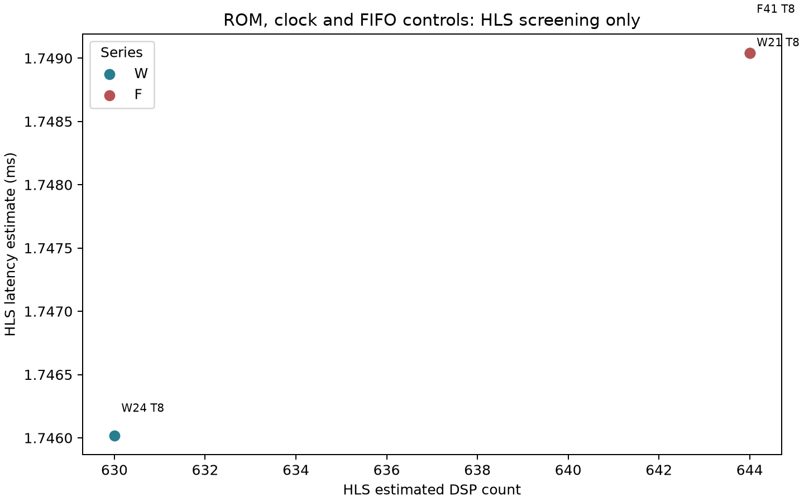
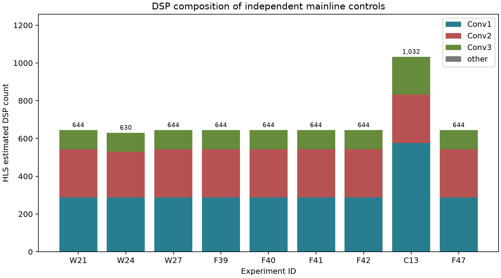
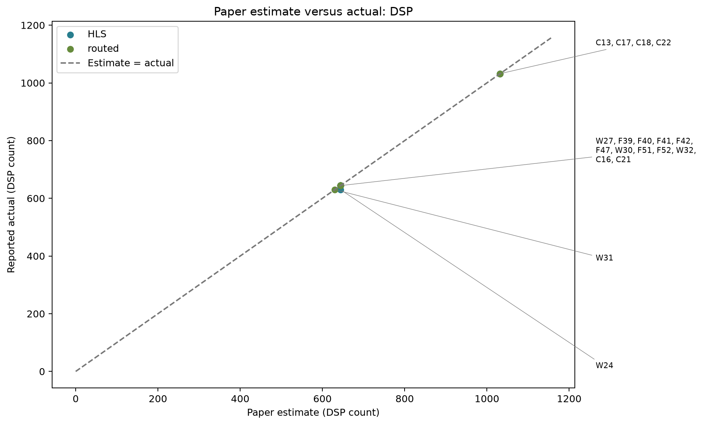
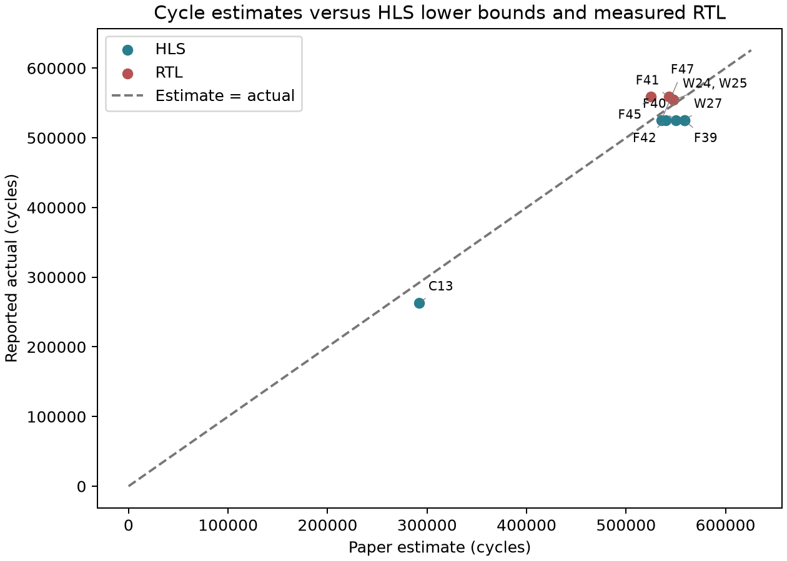
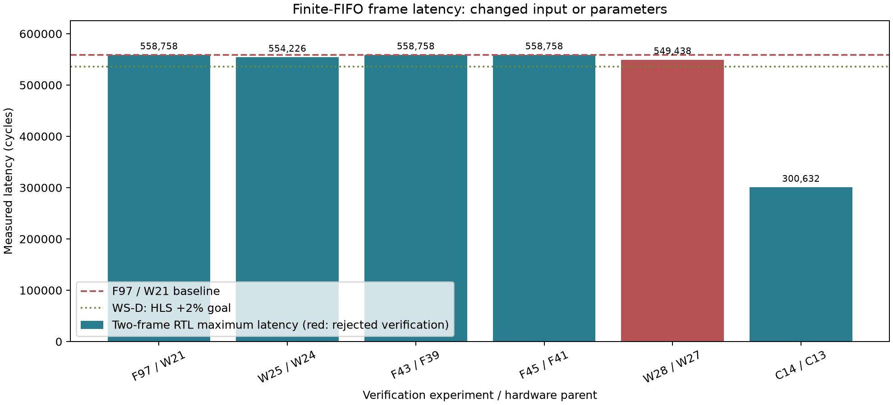
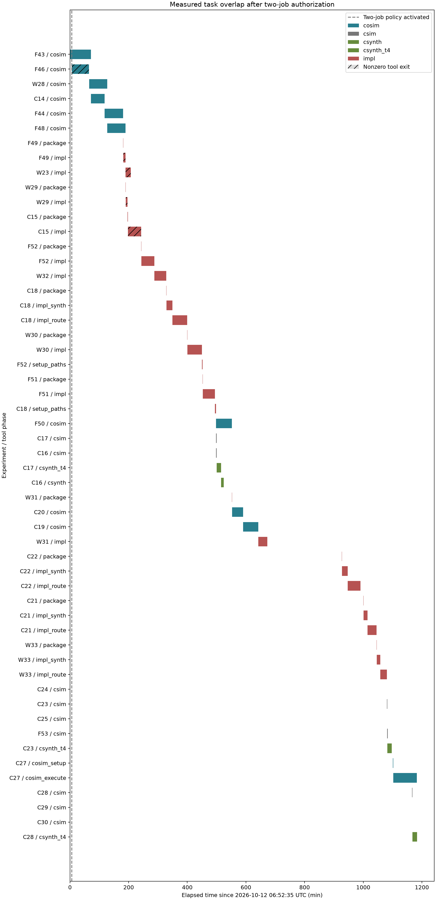

# ROM, clock, FIFO and T4 workstream

Plan: [docs/0005](../docs/0005-rom-clock-t4-plan.md). Updated 2026-10-12T10:55:15+00:00.

Runtime-loaded W21 remains the mainline. ROM is an independent experiment. Set14 means the complete 13-image course-provided set. Final resource acceptance uses independent OOC routed timing/utilization; archived HLS statuses are unchanged. No board performance is inferred.

## Current state

C15 T4 placement active; user accepts F48 mainline basis and faster W28; one-heavy policy. C15 T4 independent5ns placement remains active. User now accepts F48 as the T8 mainline basis and W28 faster RTL under the original upper bound only; retain all historical verdicts and append explicit authorization. Launch W30 FRP4.5ns route. F50 rasterFIFO RTL, F51 windowFIFO16 route, F52 registeredConv34.5ns, W31 ROM5ns and W32 strategy4.5ns retries remain queued. Enforce one heavy impl/cosim plus budgeted light jobs, preserving currentC15 actual0.5GiB guard. After C15 completes, implement independent T8 windows16+FRP and T4 windows32 combinations; consider T4 ROM only from physical pressure evidence. Original memory failures and OOM1->2 remain. No board results exist.

| id | parent | operation | status | bit_exact | delta_psnr | HLS_cycles | HLS_DSP | HLS_LUT | rtl_cycles | rtl_acceptance_basis | route_clock_ns | route_feasible | rtl_cycles_x_route_clock_ms | rtl_hls_excess_pct | wsD_goal_met |
| --- | --- | --- | --- | --- | --- | --- | --- | --- | --- | --- | --- | --- | --- | --- | --- |
| [F32](F32_ws0_memory_control_F28/F32.md) | F28 | csim/csynth | provisional | True | -0.0695141811880653 | 1046029.0 | 502.0 | 61553.0 | unknown | unknown | unknown | unknown | unknown | unknown | unknown |
| [F33](F33_ws0_memory_control_W21/F33.md) | W21 | csim/csynth | provisional | True | -0.0695141811880653 | 525237.0 | 644.0 | 81086.0 | unknown | unknown | unknown | unknown | unknown | unknown | unknown |
| [F34](F34_ws0_memory_control_F96/F34.md) | F96 | csim | csim_pass | True | -0.0695141811880653 | unknown | unknown | unknown | unknown | unknown | unknown | unknown | unknown | unknown | unknown |
| [F36](F36_ws0_memory_control_F28/F36.md) | F28 | csim/csynth | provisional | True | -0.0695141811880653 | 1046029.0 | 502.0 | 61553.0 | unknown | unknown | unknown | unknown | unknown | unknown | unknown |
| [F37](F37_ws0_memory_control_W21/F37.md) | W21 | csim/csynth | provisional | True | -0.0695141811880653 | 525237.0 | 644.0 | 81086.0 | unknown | unknown | unknown | unknown | unknown | unknown | unknown |
| [F38](F38_ws0_memory_control_F96/F38.md) | F96 | csim | csim_pass | True | -0.0695141811880653 | unknown | unknown | unknown | unknown | unknown | unknown | unknown | unknown | unknown | unknown |
| [F35](F35_runtime_rom_bank_equivalence/F35.md) | W19 | csim | csim_pass | True | -0.0695141811880653 | unknown | unknown | unknown | unknown | unknown | unknown | unknown | unknown | unknown | unknown |
| [W23](W23_ws_clock_strategy_4p5_W21/W23.md) | W21 | impl | fail | True | -0.0695141811880653 | 525237.0 | 644.0 | 81086.0 | unknown | unknown | unknown | unknown | unknown | 6.382071331608397 | unknown |
| [W24](W24_constant_rom_T8/W24.md) | W19 | csim/csynth | pass | True | -0.0695141811880653 | 524330.0 | 630.0 | 53316.0 | unknown | unknown | unknown | unknown | unknown | 5.701752712986097 | unknown |
| [W25](W25_rom_changed_input_cosim_W24/W25.md) | W24 | cosim | cosim_complete | True | -0.0695141811880653 | 524330.0 | 630.0 | 53316.0 | 554226.0 | original_verification_pass | unknown | unknown | unknown | 5.701752712986097 | unknown |
| [W26](W26_frp_W21_T8/W26.md) | W21 | csim/csynth | fail | unknown | unknown | unknown | unknown | unknown | unknown | unknown | unknown | unknown | unknown | unknown | unknown |
| [W27](W27_frp_W21_T8/W27.md) | W21 | csim/csynth | pass | True | -0.0695141811880653 | 525237.0 | 644.0 | 81484.0 | unknown | unknown | unknown | unknown | unknown | unknown | unknown |
| [F39](F39_c3_select_W21_T8/F39.md) | W21 | csim/csynth | pass | True | -0.0695141811880653 | 525237.0 | 644.0 | 81518.0 | unknown | unknown | unknown | unknown | unknown | 6.382071331608397 | unknown |
| [F40](F40_fifo16_W21_T8/F40.md) | W21 | csim/csynth | pass | True | -0.0695141811880653 | 525237.0 | 644.0 | 81086.0 | unknown | unknown | unknown | unknown | unknown | 6.382071331608397 | False |
| [F41](F41_fifo32_W21_T8/F41.md) | W21 | csim/csynth | pass | True | -0.0695141811880653 | 525237.0 | 644.0 | 81105.0 | unknown | unknown | unknown | unknown | unknown | 6.382071331608397 | False |
| [F42](F42_reorder_W21_T8/F42.md) | W21 | csim/csynth | pass | True | -0.0695141811880653 | 525237.0 | 644.0 | 81550.0 | unknown | unknown | unknown | unknown | unknown | unknown | unknown |
| [C13](C13_runtime_prepacked_conv2_T4/C13.md) | W21 | csim/csynth | infeasible | True | -0.07589037644656216 | 263090.0 | 1032.0 | 127966.0 | unknown | unknown | unknown | unknown | unknown | 14.269641567524417 | unknown |
| [F43](F43_ws_cosim_F39/F43.md) | F39 | cosim | cosim_complete | True | -0.0695141811880653 | 525237.0 | 644.0 | 81518.0 | 558758.0 | original_verification_pass | unknown | unknown | unknown | 6.382071331608397 | unknown |
| [F44](F44_ws_cosim_F40/F44.md) | F40 | cosim | cosim_complete | True | -0.0695141811880653 | 525237.0 | 644.0 | 81086.0 | 558758.0 | original_verification_pass | unknown | unknown | unknown | 6.382071331608397 | False |
| [F45](F45_ws_cosim_F41/F45.md) | F41 | cosim | cosim_complete | True | -0.0695141811880653 | 525237.0 | 644.0 | 81105.0 | 558758.0 | original_verification_pass | unknown | unknown | unknown | 6.382071331608397 | False |
| [F47](F47_windows16_W21_T8/F47.md) | W21 | csim/csynth | pass | True | -0.0695141811880653 | 525237.0 | 644.0 | 81086.0 | unknown | unknown | unknown | unknown | unknown | 2.0055708185066967 | False |
| [W28](W28_ws_cosim_W27/W28.md) | W27 | cosim | fail | True | -0.0695141811880653 | 525237.0 | 644.0 | 81484.0 | 549438.0 | user_authorized_upper_only | unknown | unknown | unknown | unknown | unknown |
| [W29](W29_ws_impl_W24/W29.md) | W24 | impl | fail | True | -0.0695141811880653 | 524330.0 | 630.0 | 53316.0 | unknown | unknown | unknown | unknown | unknown | 5.701752712986097 | unknown |
| [F48](F48_ws_cosim_F47/F48.md) | F47 | cosim | cosim_complete | True | -0.0695141811880653 | 525237.0 | 644.0 | 81086.0 | 535771.0 | original_verification_pass | unknown | unknown | unknown | 2.0055708185066967 | False |
| [F46](F46_ws_cosim_F42/F46.md) | F42 | cosim | fail | True | -0.0695141811880653 | 525237.0 | 644.0 | 81550.0 | unknown | rejected_or_unmeasured | unknown | unknown | unknown | unknown | unknown |
| [C14](C14_ws_cosim_C13/C14.md) | C13 | cosim | cosim_complete | True | -0.07589037644656216 | 263090.0 | 1032.0 | 127966.0 | 300632.0 | original_verification_pass | unknown | unknown | unknown | 14.269641567524417 | unknown |
| [C15](C15_ws_impl_C13/C15.md) | C13 | impl | fail | True | -0.07589037644656216 | 263090.0 | 1032.0 | 127966.0 | unknown | unknown | unknown | unknown | unknown | unknown | unknown |
| [F49](F49_ws_impl_F39/F49.md) | F39 | impl | fail | True | -0.0695141811880653 | 525237.0 | 644.0 | 81518.0 | unknown | unknown | unknown | unknown | unknown | 6.382071331608397 | unknown |

Missing measurements are unknown. A frame time is shown only for independently closed/resource-feasible routing plus matching-parent measured RTL cycles.

WS-D performance is separate from a successful functional cosimulation. With the525237-cycle HLS bound, the2% goal allows at most535741 integer RTL cycles (535741.74 before flooring); never round the threshold upward.
User revision in docs/0005 section6.2 accepts F48 as the new mainline basis despite its30-cycle diagnostic miss, and accepts faster W28 under the original upper bound only. Original result statuses and paper plans remain unchanged; the explicit acceptance basis records this authorization.

## Unmeasured plans

| id | parent | operation | status | condition |
| --- | --- | --- | --- | --- |
| [W30](W30_ws_impl_W27/W30.md) | W27 | impl | queued_or_running | User authorizes upper-only cycle acceptance of W28 exact549438cycles, <= original564345 limit; see docs/0005 section6.2 and W28 acceptance_override |
| [F50](F50_ws_cosim_F42/F50.md) | F42 | cosim | queued_or_running | unknown |
| [F51](F51_ws_impl_F47/F51.md) | F47 | impl | queued_or_running | unknown |
| [F52](F52_ws_impl_F39/F52.md) | F39 | impl | queued_or_running | unknown |
| [W31](W31_ws_impl_W24/W31.md) | W24 | impl | queued_or_running | unknown |
| [W32](W32_ws_clock_strategy_4p5_retry_W21/W32.md) | W21 | impl | queued_or_running | unknown |

These plans have no result row. In particular, unlaunched implementation is neither a timeout nor a timing failure.

## Verified IP timing

| id | parent | rtl_source | rtl_cycles | route_clock_ns | route_WNS_ns | route_DSP | route_BRAM18K | route_LUT | route_FF | rtl_frame_ms |
| --- | --- | --- | --- | --- | --- | --- | --- | --- | --- | --- |
| [W22](W22_ws_clock_4p95_W21/W22.md) | W21 | F97 | 558758.0 | 4.95 | 0.047 | 644.0 | 109.0 | 42592.0 | 88806.0 | 2.7658521 |
| [F98](F98_ws_impl_W21/F98.md) | W21 | F97 | 558758.0 | 5.0 | 0.14 | 644.0 | 109.0 | 42594.0 | 88806.0 | 2.79379 |

IP times exclude DDR, driver and board overhead. W21 remains the runtime-loaded integration fallback.

## Figures

## Measured Parallel Execution

The explicit two-task policy supersedes reservation-based admission. Completed tool intervals and per-task telemetry are in [parallel_jobs.csv](parallel_jobs.csv) and [parallel_overlap.csv](parallel_overlap.csv). Active tasks enter these tables only after a release record is archived.

| first_id | second_id | overlap_seconds | aligned_samples | peak_combined_process_tree_rss_GiB | minimum_available_GiB | cpu_busy_pct |
| --- | --- | --- | --- | --- | --- | --- |
| F43 | F46 | 3551.590785264969 | 1729 | 14.116714477539062 | 0.5022239685058594 | 18.49030818100524 |
| F43 | W28 | 401.79360151290894 | 191 | 11.563800811767578 | 2.8226356506347656 | 23.84113872200983 |
| W28 | C14 | 2752.318102836609 | 1337 | 12.649986267089844 | 2.3129348754882812 | 19.501111310893567 |
| W28 | F44 | 565.5901737213135 | 270 | 8.877937316894531 | 5.957366943359375 | 25.37125178827922 |
| F44 | F48 | 3247.45014834404 | 1581 | 13.121932983398438 | 1.8951187133789062 | 18.443802018977454 |
| F48 | F49 | 43.14403319358826 | 21 | 8.312904357910156 | 6.773231506347656 | 20.898714694065205 |
| F48 | F49 | 438.4953441619873 | 212 | 14.549797058105469 | 0.3904838562011719 | 22.087114337568057 |
| F48 | W23 | 12.646668434143066 | 6 | 6.898990631103516 | 6.786403656005859 | 27.73913043478261 |
| W23 | W29 | 48.38542175292969 | 23 | 6.715301513671875 | 9.157615661621094 | 31.001502937559774 |
| W23 | W29 | 342.5068440437317 | 161 | 16.554981231689453 | 0.5088157653808594 | 31.89580124556352 |

Process-tree RSS sums include shared mappings; minimum MemAvailable is measured for the entire host. Sampling alignment tolerance is4seconds. A hatch marks nonzero tool exit, not failed timing closure.

## Pending human decisions / 待人工决策

- Board validation remains unavailable to the agent; F98 handoff is archived.
- T4 ROM is conditional on C15/new combination routed pressure; preserve runtime interfaces until that separate experiment is planned.
