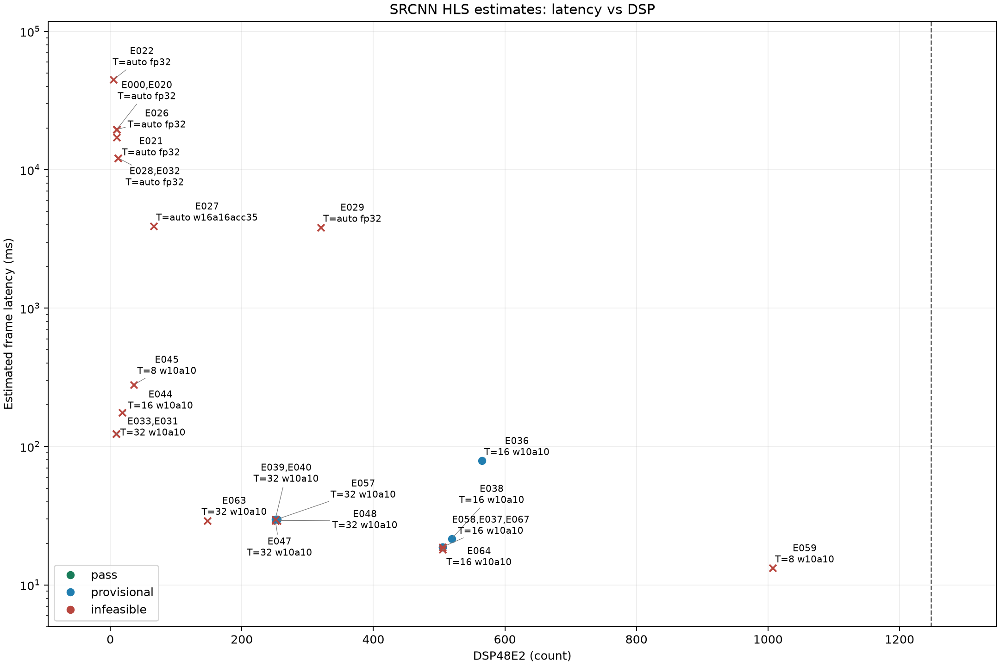
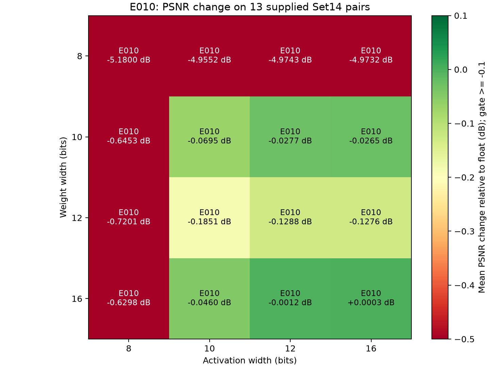
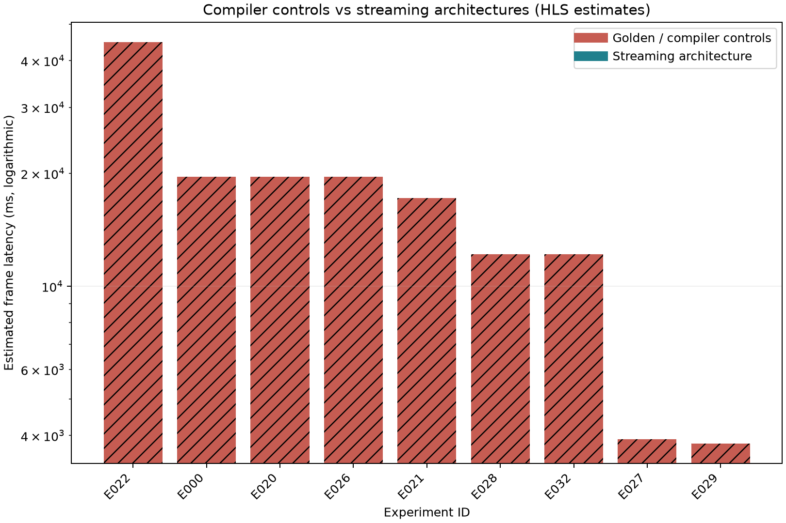

# SRCNN on K26: overnight experiments

The unchanged float baseline is functionally correct but infeasible (11064.0 BRAM18K; 19601.139 ms). Uniform w10a10 loses 0.069514 dB on all 13 supplied Set14 pairs; w8a8 loses 5.179955 dB. The fastest resource-feasible supplied-image candidate is [E039](E039_scan_storage_T32_E039/E039.md) at 29.830240 ms; missing comic prevents complete Set14 acceptance.

## Current best

| design | precision_w_a_acc | T_target | clock_target_ns | clock_est_ns | latency_cycles | interval_cycles | latency_ms_est | DSP | BRAM18K | LUT | FF | delta_psnr | ii_ok | status | id |
| --- | --- | --- | --- | --- | --- | --- | --- | --- | --- | --- | --- | --- | --- | --- | --- |
| designs/dataflow_dsp | w10a10acc23 | 32 | 10 | 7.3 | 2983024.0 | 2983025.0 | 29.83024 | 251.0 | 168.0 | 44530.0 | 46123.0 | -0.0695141811880653 | True | provisional | [E039](E039_scan_storage_T32_E039/E039.md) |

No completed Vivado implementation result has been recorded. All performance is tool-estimated or explicitly labeled RTL/implementation evidence. No board validation was run.

## Precision

[E010](E010_precision_scan/E010.md) profiles every supplied image and establishes nearest-even AP_RND_CONV, AP_SAT, full product fractions and bounded accumulators. [E015](E015_apfixed_w16a16_single_retry/E015.md), [E019](E019_apfixed_w10a10_retry/E019.md) and [E013](E013_apfixed_w8a8/E013.md) use real AMD ap_fixed and match numpy butterfly outputs bit for bit. [E017](E017_apfixed_boundary_w10a10/E017.md) confirms real-ap_fixed boundaries and exact integer convolution on every supplied image. [E049](E049_integer_boundary_exhaustive/E049.md) exhausts 25,165,824 signed accumulator/cast cases. [E062](E062_layer_int8_scan/E062.md) finds Conv2-only 8-bit weights pass (-0.075890 dB with other layers at w10a10); genuine INT8 activation inputs and Conv1/Conv3 INT8 weights fail. [E065](E065_apfixed_mixed_conv2w8/E065.md) confirms real-ap_fixed boundaries on all 13 images; [E066](E066_full_apfixed_mixed_butterfly/E066.md) confirms the complete all-ap_fixed mixed network bit for bit on butterfly.

Metric: normalized float MSE PSNR, no clipping/cropping, against the same unchanged float golden; the original uint8 conversion metric is retained in test logs. Supplied-image acceptance is provisional because comic is absent.

## Compiler Controls

See [STAGE2.md](STAGE2.md). Whole feature maps require 11,064 BRAM18K at baseline, so all valid structure-preserving controls are infeasible. The valid innermost pipeline reaches II=1 but 26.707 ns estimated clock; outer pixel pipeline reaches 3,811.217 ms with 11,114 BRAM18K. Floating-point loop-carried addition, memory ports and automatically unrolled inner loops remain limiting. E023/E024/E025 used unsupported directives and were invalidated; E028/E029/E032 are the valid replacements.

## Streaming And Scans

See [STAGE3.md](STAGE3.md) and streaming_analysis.csv for per-layer numbers. E030 float and E033 fixed T32 pass all butterfly pixels and six-pixel borders. E033 uses 168 BRAM18K but 136,868 LUT, and its 31.822 ns critical path gives 123.540 ms. E044 T16 worsens to 63.218 ns and E045 T8 reaches 126.008 ns / 266,266 LUT; removing redundant accumulator saturation and explicitly binding multipliers separates arithmetic semantics from fabric mapping. E047 maps exactly 251 scheduled products to DSPs and reaches 29.13855 ms, but 89,341 LUT exceeds the 81,984 cap. Banked memories and integer boundary primitives are measured follow-ups, not presumed improvements.

AXI float-array signature remains unchanged; weights/biases load once before DATAFLOW, intermediate maps stay on chip, and requested sequential bursts are up to 256 words. Inner II=1 does not imply T frame throughput: pixel-loop fill/drain and pad-row transactions add measured overhead.

| design | precision_w_a_acc | T_target | clock_target_ns | clock_est_ns | latency_cycles | interval_cycles | latency_ms_est | DSP | BRAM18K | LUT | FF | delta_psnr | ii_ok | status | id |
| --- | --- | --- | --- | --- | --- | --- | --- | --- | --- | --- | --- | --- | --- | --- | --- |
| designs/dataflow_dsp | w10a10acc23 | 32 | 10 | 7.3 | 2913855.0 | 2913856.0 | 29.13855 | 251.0 | 168.0 | 89341.0 | 132430.0 | -0.0695141811880653 | True | infeasible | [E047](E047_dataflow_dsp_T32/E047.md) |
| designs/dataflow_wrap | w10a10acc23 | 32 | 10 | 7.3 | 2913855.0 | 2913856.0 | 29.13855 | 148.0 | 168.0 | 95727.0 | 132430.0 | -0.0695141811880653 | True | infeasible | [E063](E063_dataflow_wrap_T32_retry/E063.md) |
| designs/dataflow_int | w10a10acc23 | 32 | 10 | 7.3 | 2913855.0 | 2913856.0 | 29.13855 | 254.0 | 168.0 | 89304.0 | 132635.0 | -0.0695141811880653 | True | infeasible | [E048](E048_dataflow_integer_T32/E048.md) |
| designs/dataflow_dsp | w10a10acc23 | 32 | 10 | 7.3 | 2983024.0 | 2983025.0 | 29.83024 | 251.0 | 168.0 | 44530.0 | 46123.0 | -0.0695141811880653 | True | provisional | [E039](E039_scan_storage_T32_E039/E039.md) |
| designs/dataflow_v1 | w10a10acc23 | 32 | 10 | 31.822 | 3882221.0 | 3882222.0 | 123.540036662 | 9.0 | 168.0 | 136868.0 | 149111.0 | -0.0695141811880653 | True | infeasible | [E033](E033_dataflow_fixed_T32_single/E033.md) |
| designs/dataflow_v1 | w10a10acc23 | 32 | 10 | 31.822 | 3882221.0 | 3882222.0 | 123.540036662 | 9.0 | 168.0 | 136868.0 | 149111.0 | -0.0695141811880653 | True | infeasible | [E031](E031_dataflow_fixed_T32/E031.md) |
| designs/dataflow_v1 | w10a10acc23 | 16 | 10 | 63.218 | 2775517.0 | 2775518.0 | 175.462633706 | 18.0 | 168.0 | 167715.0 | 135714.0 | -0.0695141811880653 | True | infeasible | [E044](E044_scan_T_T16_E034_retry/E044.md) |
| designs/dataflow_v1 | w10a10acc23 | 8 | 10 | 126.008 | 2222165.0 | 2222166.0 | 280.01056732 | 36.0 | 168.0 | 266266.0 | 142153.0 | -0.0695141811880653 | True | infeasible | [E045](E045_scan_T_T8_E035_retry/E045.md) |

## Optional Experiments

Multiplier kernels report their own cycle counts, never a network-frame latency. T4 mixed fabric/DSP feasibility and scatter preserve strict arithmetic checks; infeasible reports remain visible. Packing prerequisites: uniform INT8 quality fails; exact integer decomposition or confirmed Conv2 weight-only quantization is required. Direct T8 paper DSP split is 648/256/100=1004; Winograd Conv1 T4 plus direct Conv2 and packed Conv3 is 576/512/100=1188 before other overhead. These budgets are unmeasured phase-two hypotheses.

## Verification

No implementation or C/RTL cosimulation result yet. Finite-FIFO deadlock freedom cannot be inferred from unbounded software streams.

## All Experiments

| design | precision_w_a_acc | T_target | clock_target_ns | clock_est_ns | latency_cycles | interval_cycles | latency_ms_est | DSP | BRAM18K | LUT | FF | delta_psnr | ii_ok | status | id |
| --- | --- | --- | --- | --- | --- | --- | --- | --- | --- | --- | --- | --- | --- | --- | --- |
| designs/dataflow_dsp | w10a10acc23 | 32 | 10 | 7.3 | 2913855.0 | 2913856.0 | 29.13855 | 251.0 | 168.0 | 89341.0 | 132430.0 | -0.0695141811880653 | True | infeasible | [E047](E047_dataflow_dsp_T32/E047.md) |
| designs/dataflow_wrap | w10a10acc23 | 32 | 10 | 7.3 | 2913855.0 | 2913856.0 | 29.13855 | 148.0 | 168.0 | 95727.0 | 132430.0 | -0.0695141811880653 | True | infeasible | [E063](E063_dataflow_wrap_T32_retry/E063.md) |
| designs/dataflow_int | w10a10acc23 | 32 | 10 | 7.3 | 2913855.0 | 2913856.0 | 29.13855 | 254.0 | 168.0 | 89304.0 | 132635.0 | -0.0695141811880653 | True | infeasible | [E048](E048_dataflow_integer_T32/E048.md) |
| designs/dataflow_dsp | w10a10acc23 | 32 | 10 | 7.3 | 2983024.0 | 2983025.0 | 29.83024 | 251.0 | 168.0 | 44530.0 | 46123.0 | -0.0695141811880653 | True | provisional | [E039](E039_scan_storage_T32_E039/E039.md) |
| designs/dataflow_v1 | w10a10acc23 | 32 | 10 | 31.822 | 3882221.0 | 3882222.0 | 123.540036662 | 9.0 | 168.0 | 136868.0 | 149111.0 | -0.0695141811880653 | True | infeasible | [E033](E033_dataflow_fixed_T32_single/E033.md) |
| designs/dataflow_v1 | w10a10acc23 | 32 | 10 | 31.822 | 3882221.0 | 3882222.0 | 123.540036662 | 9.0 | 168.0 | 136868.0 | 149111.0 | -0.0695141811880653 | True | infeasible | [E031](E031_dataflow_fixed_T32/E031.md) |
| designs/dataflow_v1 | w10a10acc23 | 16 | 10 | 63.218 | 2775517.0 | 2775518.0 | 175.462633706 | 18.0 | 168.0 | 167715.0 | 135714.0 | -0.0695141811880653 | True | infeasible | [E044](E044_scan_T_T16_E034_retry/E044.md) |
| designs/dataflow_v1 | w10a10acc23 | 8 | 10 | 126.008 | 2222165.0 | 2222166.0 | 280.01056732 | 36.0 | 168.0 | 266266.0 | 142153.0 | -0.0695141811880653 | True | infeasible | [E045](E045_scan_T_T8_E035_retry/E045.md) |
| designs/golden_auto | float32 | unknown | 10 | 7.624 | 381121723.0 | 381121724.0 | 3811.21723 | 320.0 | 11114.0 | 80812.0 | 123203.0 | unknown | False | infeasible | [E029](E029_auto_pixel_pipeline_validcfg/E029.md) |
| designs/fixed_ref | w16a16acc35 | unknown | 10 | 7.177 | 391256088.0 | 391256089.0 | 3912.56088 | 66.0 | 5822.0 | 137322.0 | 8096.0 | unknown | unknown | infeasible | [E027](E027_auto_fixed16/E027.md) |
| designs/golden_auto | float32 | unknown | 10 | 26.707 | 455695454.0 | 455695455.0 | 12170.258489978001 | 12.0 | 11064.0 | 9914.0 | 8948.0 | unknown | True | infeasible | [E028](E028_auto_inner_pipeline_validcfg/E028.md) |
| designs/golden_auto | float32 | unknown | 10 | 26.707 | 455695454.0 | 455695455.0 | 12170.258489978001 | 12.0 | 11096.0 | 8585.0 | 10378.0 | unknown | True | infeasible | [E032](E032_auto_partition_validcfg/E032.md) |
| designs/golden_auto | float32 | unknown | 4 | 2.913 | 4294771851.0 | 4294771852.0 | 17179.087404 | 10.0 | 11064.0 | 9997.0 | 9596.0 | unknown | unknown | infeasible | [E021](E021_auto_default_4ns/E021.md) |
| designs/golden_auto | float32 | unknown | 10 | 7.331 | 1960113671.0 | 1960113672.0 | 19601.13671 | 10.0 | 11064.0 | 7624.0 | 3154.0 | unknown | unknown | infeasible | [E026](E026_auto_unsafe_math/E026.md) |
| src | float32 | unknown | 10 | 7.331 | 1960113853.0 | 1960113854.0 | 19601.13853 | 10.0 | 11064.0 | 9377.0 | 8027.0 | 0 | unknown | infeasible | [E000](E000_golden_baseline/E000.md) |
| designs/golden_auto | float32 | unknown | 10 | 7.331 | 1960113853.0 | 1960113854.0 | 19601.13853 | 10.0 | 11064.0 | 9377.0 | 8027.0 | unknown | unknown | infeasible | [E020](E020_auto_default_10ns/E020.md) |
| designs/golden_auto | float32 | unknown | 10 | 7.331 | 1960113853.0 | 1960113854.0 | 19601.13853 | 10.0 | 11064.0 | 9377.0 | 8027.0 | unknown | False | invalid_config | [E023](E023_auto_inner_pipeline/E023.md) |
| designs/golden_auto | float32 | unknown | 10 | 7.331 | 1960113853.0 | 1960113854.0 | 19601.13853 | 10.0 | 11064.0 | 9377.0 | 8027.0 | unknown | False | invalid_config | [E024](E024_auto_pixel_pipeline/E024.md) |
| designs/golden_auto | float32 | unknown | 10 | 7.331 | 1960113853.0 | 1960113854.0 | 19601.13853 | 10.0 | 11064.0 | 9377.0 | 8027.0 | unknown | False | invalid_config | [E025](E025_auto_partition/E025.md) |
| designs/golden_auto | float32 | unknown | 10 | 7.016 | 4482223011.0 | 4482223012.0 | 44822.23011 | 5.0 | 11064.0 | 2217.0 | 1267.0 | unknown | unknown | infeasible | [E022](E022_auto_pipeline_off/E022.md) |
| numpy_precision_scan | 16/12/10/8 scan | unknown | unknown | unknown | unknown | unknown | unknown | unknown | unknown | unknown | unknown | unknown | unknown | analysis_complete | [E010](E010_precision_scan/E010.md) |
| designs/fixed_ref | w16a16acc35 | unknown | 10 | unknown | unknown | unknown | unknown | unknown | unknown | unknown | unknown | unknown | unknown | fail | [E011](E011_apfixed_w16a16/E011.md) |
| designs/dataflow_v1 | float32 | 32 | 10 | unknown | unknown | unknown | unknown | unknown | unknown | unknown | unknown | unknown | unknown | csim_pass | [E030](E030_dataflow_float/E030.md) |
| designs/fixed_ref_raw | w10a10acc23 | unknown | 10 | unknown | unknown | unknown | unknown | unknown | unknown | unknown | unknown | -0.0695141811880653 | unknown | csim_pass | [E017](E017_apfixed_boundary_w10a10/E017.md) |
| designs/dataflow_v1 | w10a10acc23 | 16 | 10 | unknown | unknown | unknown | unknown | unknown | unknown | unknown | unknown | unknown | unknown | fail | [E034](E034_scan_T_T16_E034/E034.md) |
| designs/dataflow_v1 | w10a10acc23 | 8 | 10 | unknown | unknown | unknown | unknown | unknown | unknown | unknown | unknown | unknown | unknown | fail | [E035](E035_scan_T_T8_E035/E035.md) |
| designs/fixed_ref | w16a16acc35 | unknown | 10 | unknown | unknown | unknown | unknown | unknown | unknown | unknown | unknown | unknown | unknown | fail | [E018](E018_apfixed_w16a16_single/E018.md) |
| designs/fixed_ref | w16a16acc35 | unknown | 10 | unknown | unknown | unknown | unknown | unknown | unknown | unknown | unknown | unknown | unknown | timeout | [E014](E014_apfixed_w16a16/E014.md) |
| designs/fixed_ref | w10a10acc23 | unknown | 10 | unknown | unknown | unknown | unknown | unknown | unknown | unknown | unknown | unknown | unknown | fail | [E012](E012_apfixed_w10a10/E012.md) |
| designs/fixed_ref | w16a16acc35 | unknown | 10 | unknown | unknown | unknown | unknown | unknown | unknown | unknown | unknown | unknown | unknown | csim_pass | [E015](E015_apfixed_w16a16_single_retry/E015.md) |
| designs/fixed_ref | w8a8acc19 | unknown | 10 | unknown | unknown | unknown | unknown | unknown | unknown | unknown | unknown | unknown | unknown | csim_pass | [E013](E013_apfixed_w8a8/E013.md) |
| designs/fixed_ref | w10a10acc23 | unknown | 10 | unknown | unknown | unknown | unknown | unknown | unknown | unknown | unknown | unknown | unknown | csim_pass | [E019](E019_apfixed_w10a10_retry/E019.md) |
| designs/fixed_ref | w8a8acc19 | unknown | 10 | unknown | unknown | unknown | unknown | unknown | unknown | unknown | unknown | unknown | unknown | csim_pass | [E016](E016_apfixed_w8a8_retry/E016.md) |
| designs/dataflow_int | boundary_w10a10 | unknown | 10 | unknown | unknown | unknown | unknown | unknown | unknown | unknown | unknown | unknown | unknown | csim_pass | [E049](E049_integer_boundary_exhaustive/E049.md) |
| designs/dataflow_wrap | w10a10acc23 | 32 | 10 | unknown | unknown | unknown | unknown | unknown | unknown | unknown | unknown | -0.0695141811880653 | unknown | fail | [E046](E046_dataflow_wrap_T32/E046.md) |
| numpy_layer_precision_scan | mixed layer scan | unknown | unknown | unknown | unknown | unknown | unknown | unknown | unknown | unknown | unknown | unknown | unknown | analysis_complete | [E062](E062_layer_int8_scan/E062.md) |
| designs/fixed_ref_mixed_raw | w10_8_10a10acc23_21_23 | unknown | 10 | unknown | unknown | unknown | unknown | unknown | unknown | unknown | unknown | -0.07589037644656216 | unknown | csim_pass | [E065](E065_apfixed_mixed_conv2w8/E065.md) |
| designs/fixed_ref_mixed | w10_8_10a10acc23_21_23 | unknown | 10 | unknown | unknown | unknown | unknown | unknown | unknown | unknown | unknown | -0.07589037644656216 | unknown | csim_pass | [E066](E066_full_apfixed_mixed_butterfly/E066.md) |

## Failed And Timed-Out Runs

| id | status | reason |
| --- | --- | --- |
| [E011](E011_apfixed_w16a16/E011.md) | fail | ; C simulation not accepted (exit=1); synthesis not eligible |
| [E023](E023_auto_inner_pipeline/E023.md) | invalid_config | ; requested II missed; Vitis skipped unknown syn.directive; numbers describe default scheduling, not intended directive experiment |
| [E024](E024_auto_pixel_pipeline/E024.md) | invalid_config | ; requested II missed; Vitis skipped unknown syn.directive; numbers describe default scheduling, not intended directive experiment |
| [E025](E025_auto_partition/E025.md) | invalid_config | ; requested II missed; Vitis skipped unknown syn.directive; numbers describe default scheduling, not intended directive experiment |
| [E034](E034_scan_T_T16_E034/E034.md) | fail | ; C simulation not accepted (exit=1); synthesis not eligible |
| [E035](E035_scan_T_T8_E035/E035.md) | fail | ; C simulation not accepted (exit=1); synthesis not eligible |
| [E018](E018_apfixed_w16a16_single/E018.md) | fail | ; C simulation not accepted (exit=1); synthesis not eligible |
| [E014](E014_apfixed_w16a16/E014.md) | timeout | ; C simulation not accepted (exit=124); synthesis not eligible |
| [E012](E012_apfixed_w10a10/E012.md) | fail | ; C simulation not accepted (exit=1); synthesis not eligible |
| [E046](E046_dataflow_wrap_T32/E046.md) | fail | ; Run lock exists: /home/lipuze/amdprojects/90096_CNN_FPGA/workspace/exp_runs/.synthesis.lock; inspect its PID before recovery |

E014 reached its 45-minute full-ap_fixed simulation limit after nine images; E010/E017 still cover all supplied pairs. Quoted absolute include paths broke Vitis C simulation; retries use verified unquoted whitespace-free paths. Lock-queue failures are distinct from subprocess synthesis timeouts.

## Figures

## Pending Human Decisions

Missing comic input/GT pair blocks full 14-image acceptance. Windows Vitis environment was unavailable; verified Linux Vitis 2026.1 was used through existing SSH, with Windows environment-script support retained but untested. Review normalized-float PSNR versus the original wrapping uint8 metric before external benchmark claims. Detailed decisions and all tool failures remain in [LOG.md](LOG.md).

## Next Steps

Execute the authorized second phase on exp/explore-arch after phase-one completion. Prioritize packing/Winograd PE mapping, gather/scatter borders, memory banking and a loop schedule with continuous pixel throughput; compare all variants to the measured exact streaming baseline. Implement and RTL-cosim the best feasible provisional candidates while reporting the missing full-Set14 evidence.

Generated from results.csv and archived reference evidence at 2026-10-10T19:38:30+00:00.
