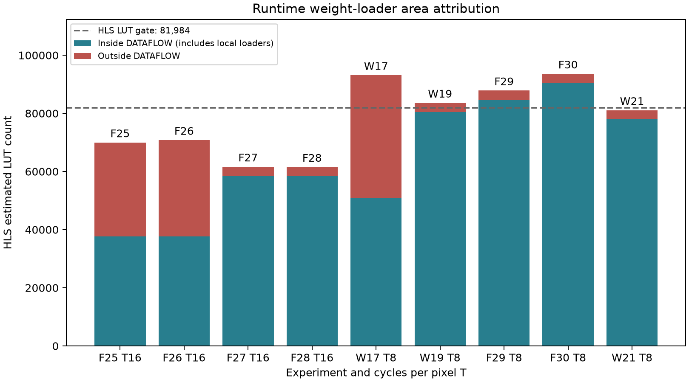
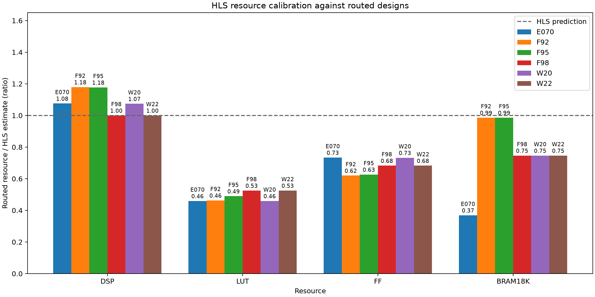
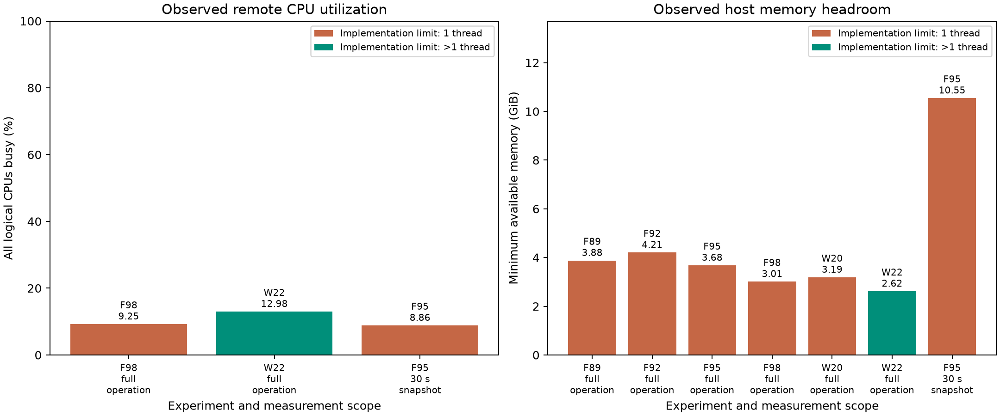

# Weight loading and T8 measurements

Generated by `python3 exp/analyze_weight_loading.py`. All numbers come from archived reports.

| id | T_target | clock_target_ns | clock_est_ns | latency_cycles | latency_ms_est | DSP | BRAM18K | LUT | dataflow_LUT | outside_LUT | FF | fold_II1 | ws2_all_gates | status |
| --- | --- | --- | --- | --- | --- | --- | --- | --- | --- | --- | --- | --- | --- | --- |
| F25 | 16 | 2.5 | 2.377 | 1056904.0 | 2.64226 | 502.0 | 73.0 | 69976.0 | 37682.0 | 32294.0 | 125404.0 | True | False | provisional |
| F26 | 16 | 2.5 | 2.377 | 1056908.0 | 2.64227 | 502.0 | 73.0 | 70808.0 | 37682.0 | 33126.0 | 126285.0 | True | False | provisional |
| F27 | 16 | 2.5 | 2.419 | 1045713.0 | 2.6142825 | 502.0 | 73.0 | 61656.0 | 58486.0 | 3170.0 | 122055.0 | True | False | provisional |
| F28 | 16 | 2.5 | 2.377 | 1046029.0 | 2.6150725 | 502.0 | 73.0 | 61553.0 | 58383.0 | 3170.0 | 122061.0 | True | True | provisional |
| W17 | 8 | 4 | 3.239 | 532562.0 | 2.130248 | 648.0 | 146.0 | 93166.0 | 50877.0 | 42289.0 | 122399.0 | True | False | infeasible |
| W19 | 8 | 3.33 | 2.431 | 525237.0 | 1.74903921 | 645.0 | 146.0 | 83623.0 | 80453.0 | 3170.0 | 130843.0 | True | False | infeasible |
| F29 | 8 | 3.33 | 2.431 | 525761.0 | 1.7507841300000002 | 1004.0 | 73.0 | 87869.0 | 84699.0 | 3170.0 | 194668.0 | True | False | infeasible |
| F30 | 8 | 3.33 | 2.431 | 525757.0 | 1.7507708100000001 | 1004.0 | 73.0 | 93631.0 | 90461.0 | 3170.0 | 104834.0 | True | False | infeasible |
| W21 | 8 | 3.33 | 2.431 | 525237.0 | 1.74903921 | 644.0 | 146.0 | 81086.0 | 77916.0 | 3170.0 | 130057.0 | True | False | provisional |

The WS2 gates compare T16 loaders with F25; T8 rows use the same diagnostics but are not WS2 acceptance points. Missing comic leaves image-quality conclusions provisional.

<!-- AUTO: WORKSTREAM START -->

## Measured WS0-WS4 results

Generated by `python3 exp/summarize_weight_loading.py`; numeric values are parsed from archived reports.

HLS estimates (verification rows inherit their parent and are not new synthesis measurements):

| id | parent | T_target | clock_target_ns | clock_est_ns | latency_cycles | interval_cycles | latency_ms_est | DSP | BRAM18K | LUT | outside_LUT | FF | bit_exact | border_mse | delta_psnr | ws2_all_gates | status |
| --- | --- | --- | --- | --- | --- | --- | --- | --- | --- | --- | --- | --- | --- | --- | --- | --- | --- |
| [F25](F25_nested_weight_loader_T16_2p5ns/F25.md) | unknown | 16 | 2.5 | 2.377 | 1056904.0 | 1056905.0 | 2.64226 | 502.0 | 73.0 | 69976.0 | 32294.0 | 125404.0 | True | 1.661846957728205e-05 | -0.0695141811880653 | False | provisional |
| [F26](F26_s2p_bias_shift_T16/F26.md) | unknown | 16 | 2.5 | 2.377 | 1056908.0 | 1056909.0 | 2.64227 | 502.0 | 73.0 | 70808.0 | 33126.0 | 126285.0 | True | 1.661846957728205e-05 | -0.0695141811880653 | False | provisional |
| [F27](F27_local_streamed_params_T16/F27.md) | unknown | 16 | 2.5 | 2.419 | 1045713.0 | 1045714.0 | 2.6142825 | 502.0 | 73.0 | 61656.0 | 3170.0 | 122055.0 | True | 1.661846957728205e-05 | -0.0695141811880653 | False | provisional |
| [F28](F28_local_load_no_flatten_T16/F28.md) | unknown | 16 | 2.5 | 2.377 | 1046029.0 | 1046030.0 | 2.6150725 | 502.0 | 73.0 | 61553.0 | 3170.0 | 122061.0 | True | 1.661846957728205e-05 | -0.0695141811880653 | True | provisional |
| [F29](F29_streamed_direct_T8_tree1/F29.md) | unknown | 8 | 3.33 | 2.431 | 525761.0 | 525762.0 | 1.7507841300000002 | 1004.0 | 73.0 | 87869.0 | 3170.0 | 194668.0 | True | 1.661846957728205e-05 | -0.0695141811880653 | False | infeasible |
| [F30](F30_streamed_direct_T8_tree0/F30.md) | unknown | 8 | 3.33 | 2.431 | 525757.0 | 525758.0 | 1.7507708100000001 | 1004.0 | 73.0 | 93631.0 | 3170.0 | 104834.0 | True | 1.661846957728205e-05 | -0.0695141811880653 | False | infeasible |
| [F31](F31_reload_testbench_csim_F28/F31.md) | unknown | 16 | 2.5 | unknown | unknown | unknown | unknown | unknown | unknown | unknown | unknown | unknown | True | 1.661846957728205e-05 | unknown | unknown | csim_pass |
| [F89](F89_serial_vivado_impl_F25/F89.md) | F25 | 16 | 2.5 | 2.377 | 1056904.0 | 1056905.0 | 2.64226 | 502.0 | 73.0 | 69976.0 | unknown | 125404.0 | True | 1.661846957728205e-05 | -0.0695141811880653 | unknown | timeout |
| [F92](F92_ws_impl_F25/F92.md) | F25 | 16 | 2.5 | 2.377 | 1056904.0 | 1056905.0 | 2.64226 | 502.0 | 73.0 | 69976.0 | unknown | 125404.0 | True | 1.661846957728205e-05 | -0.0695141811880653 | unknown | impl_complete |
| [F93](F93_ws_reload_cosim_F28/F93.md) | F28 | 16 | 2.5 | 2.377 | 1046029.0 | 1046030.0 | 2.6150725 | 502.0 | 73.0 | 61553.0 | unknown | 122061.0 | True | 1.661846957728205e-05 | -0.0695141811880653 | unknown | cosim_complete |
| [F94](F94_ws_all_F28/F94.md) | unknown | 16 | 2.5 | unknown | unknown | unknown | unknown | unknown | unknown | unknown | unknown | unknown | True | 1.661846957728205e-05 | -0.0695141811880653 | unknown | csim_pass |
| [F95](F95_ws_impl_F28/F95.md) | F28 | 16 | 2.5 | 2.377 | 1046029.0 | 1046030.0 | 2.6150725 | 502.0 | 73.0 | 61553.0 | unknown | 122061.0 | True | 1.661846957728205e-05 | -0.0695141811880653 | unknown | impl_complete |
| [F96](F96_ws_all_W21/F96.md) | unknown | 8 | 3.33 | unknown | unknown | unknown | unknown | unknown | unknown | unknown | unknown | unknown | True | 1.661846957728205e-05 | -0.0695141811880653 | unknown | csim_pass |
| [F97](F97_ws_cosim_W21/F97.md) | W21 | 8 | 3.33 | 2.431 | 525237.0 | 525238.0 | 1.74903921 | 644.0 | 146.0 | 81086.0 | unknown | 130057.0 | True | 1.661846957728205e-05 | -0.0695141811880653 | unknown | cosim_complete |
| [F98](F98_ws_impl_W21/F98.md) | W21 | 8 | 3.33 | 2.431 | 525237.0 | 525238.0 | 1.74903921 | 644.0 | 146.0 | 81086.0 | unknown | 130057.0 | True | 1.661846957728205e-05 | -0.0695141811880653 | unknown | impl_complete |
| [W17](W17_narrow_raw_banks_T8/W17.md) | unknown | 8 | 4 | 3.239 | 532562.0 | 532563.0 | 2.130248 | 648.0 | 146.0 | 93166.0 | 42289.0 | 122399.0 | True | 1.661846957728205e-05 | -0.0695141811880653 | False | infeasible |
| [W19](W19_streamed_winograd_T8/W19.md) | unknown | 8 | 3.33 | 2.431 | 525237.0 | 525238.0 | 1.74903921 | 645.0 | 146.0 | 83623.0 | 3170.0 | 130843.0 | True | 1.661846957728205e-05 | -0.0695141811880653 | False | infeasible |
| [W20](W20_ws_impl_W17/W20.md) | W17 | 8 | 4 | 3.239 | 532562.0 | 532563.0 | 2.130248 | 648.0 | 146.0 | 93166.0 | unknown | 122399.0 | True | 1.661846957728205e-05 | -0.0695141811880653 | unknown | impl_complete |
| [W21](W21_subkernel_raw_cache_T8/W21.md) | unknown | 8 | 3.33 | 2.431 | 525237.0 | 525238.0 | 1.74903921 | 644.0 | 146.0 | 81086.0 | 3170.0 | 130057.0 | True | 1.661846957728205e-05 | -0.0695141811880653 | False | provisional |
| [W22](W22_ws_clock_4p95_W21/W22.md) | W21 | 8 | 3.33 | 2.431 | 525237.0 | 525238.0 | 1.74903921 | 644.0 | 146.0 | 81086.0 | unknown | 130057.0 | True | 1.661846957728205e-05 | -0.0695141811880653 | unknown | impl_complete |

RTL and routed results, kept separate:

| id | parent | rtl_source | rtl_latency_cycles | rtl_interval_cycles | route_target_ns | route_WNS_ns | route_TNS_ns | route_period_from_slack_ns | route_DSP | route_BRAM18K | route_LUT | route_FF | timing_met | rtl_frame_ms_at_route_target | status |
| --- | --- | --- | --- | --- | --- | --- | --- | --- | --- | --- | --- | --- | --- | --- | --- |
| [F89](F89_serial_vivado_impl_F25/F89.md) | F25 | unknown | unknown | unknown | unknown | unknown | unknown | unknown | unknown | unknown | unknown | unknown | unknown | unknown | timeout |
| [F92](F92_ws_impl_F25/F92.md) | F25 | F82 | 1068183.0 | 1068212.0 | 5.0 | 0.568 | 0.0 | 4.432 | 592.0 | 72.0 | 32400.0 | 77757.0 | True | 5.340915 | impl_complete |
| [F93](F93_ws_reload_cosim_F28/F93.md) | F28 | unknown | 1059506.0 | 1059535.0 | unknown | unknown | unknown | unknown | unknown | unknown | unknown | unknown | unknown | unknown | cosim_complete |
| [F95](F95_ws_impl_F28/F95.md) | F28 | F93 | 1059506.0 | 1059535.0 | 5.0 | 0.282 | 0.0 | 4.718 | 591.0 | 72.0 | 30140.0 | 76498.0 | True | 5.29753 | impl_complete |
| [F97](F97_ws_cosim_W21/F97.md) | W21 | unknown | 558758.0 | 558787.0 | unknown | unknown | unknown | unknown | unknown | unknown | unknown | unknown | unknown | unknown | cosim_complete |
| [F98](F98_ws_impl_W21/F98.md) | W21 | F97 | 558758.0 | 558787.0 | 5.0 | 0.14 | 0.0 | 4.86 | 644.0 | 109.0 | 42594.0 | 88806.0 | True | 2.79379 | impl_complete |
| [W20](W20_ws_impl_W17/W20.md) | W17 | unknown | unknown | unknown | 5.0 | 0.188 | 0.0 | 4.812 | 696.0 | 109.0 | 42812.0 | 89690.0 | True | unknown | impl_complete |
| [W22](W22_ws_clock_4p95_W21/W22.md) | W21 | F97 | 558758.0 | 558787.0 | 4.95 | 0.047 | 0.0 | 4.9030000000000005 | 644.0 | 109.0 | 42592.0 | 88806.0 | True | 2.7658521 | impl_complete |

Times derived from RTL cycles at a routed target are conditional on `timing_met=true`. Target minus negative WNS is a slack-derived period estimate, not a proven closed clock. Missing values remain unknown. No board validation has run.

Routed/HLS resource calibration from [route_calibration.csv](route_calibration.csv); HLS resource gates remain unchanged:

Host utilization from archived CPU/memory CSV files (short snapshots are labeled; old runs without CPU telemetry stay unknown):

Current recovery state: Review section6 decisions, missing comic and any failed route/RTL gates; use measured physical bottlenecks for the next independent design. No board acceptance or push.

<!-- AUTO: WORKSTREAM END -->
